# WoW: Forever — A Sustainable Level-60 Endgame

**A community game-design proposal for a fixed long-term power ceiling, lasting raid rewards, city allegiance and a growing world of group adventures.**

> **Status: design proposal · v0.11 · 11 November 2026.** This is an independent community project, unaffiliated with Blizzard Entertainment. Everything described as a proposed system is a suggestion for discussion, rather than an announced feature or an implementation of the game.

**[Read the complete GitHub Wiki](https://github.com/Finland6738/wow-forever-game-design-proposal/wiki)** · [Documentation index](docs/README.md) · [Questions and discussion](https://github.com/Finland6738/wow-forever-game-design-proposal/discussions)

## The proposal in one minute

Keep characters at level 60 and establish an accessible, lasting equipment-power budget. New content should add encounters, builds, stories, collections, and opportunities for mastery without continually raising the minimum permanent power needed to participate.

Raid equipment remains usable throughout the game. Its additional progression bonuses activate only in the **raid group belonging to its content update and in its own difficulty**. Normal and Veteran retain separate contextual equipment tracks. Final-boss clears teach permanently owned **raid-only talents**: one slot, Normal options only in Normal raids and Veteran options only in Veteran raids. They are inactive in the world, every dungeon and all PvP.

Around that foundation, expand the level-60 endgame with tactical Heroic dungeons, keyless timed Challenge Modes, elite open-world regions, territorial PvP, settlement defense and reconstruction, procedural expeditions, professions, and exploration. Adventurer, Explorer and Honor recognize participation; Gladiator and Challenger identify separate competitive domains. Runes record completion milestones and targeted unlocks, with no usage-based or cumulative statistical power. Future regions and new playable options expand the world within the same power policy.

**The revised promise:** a returning player can enter a new raid without a sequential item-level climb through earlier tiers. Historical raids remain worthwhile sources of useful abilities for a chosen build; direct equipment access does not imply an already complete ability collection.

## A world built around playing together

The heart of this proposal is cooperation: finding companions, learning to trust a group, helping a settlement and earning a reputation through shared adventures. Leveling and everyday exploration still have a place, while the most meaningful endgame achievements should reward people who organize, communicate and overcome challenges together.

Keep the rules understandable and let depth come from decisions and teamwork. Approachable entry does not mean automatic completion or identical rewards for every activity. Difficult encounters and prestigious cosmetics should remain earned, recognizable accomplishments. Normal and Veteran offer independent contextual equipment progression. Collecting both of their permanent repertoire options intentionally requires both completions.

[Read the social principles and earned-reward policy →](docs/10-social-design-and-earned-prestige.md)

## Find a topic

The [Wiki Home](https://github.com/Finland6738/wow-forever-game-design-proposal/wiki) and sidebar are organized by activity. Use the dedicated page for the topic you want:

| Area | Topics |
| --- | --- |
| PvE — Raids and Dungeons | [Raids](docs/01-progression-and-raids.md) · [World Bosses](docs/activities/world-bosses.md) · [Dungeon Overview](docs/02-dungeons-and-challenges.md) · [Heroic Dungeons (HC)](docs/activities/heroic-dungeons.md) · [Challenge Dungeons](docs/activities/challenge-dungeons.md) · [Procedural Dungeons](docs/07-procedural-expeditions.md) |
| Open World | [Open World](docs/03-world-and-professions.md) · [NPC Invasions and Reconstruction](docs/06-invasions-and-reconstruction.md) · [Exploration and Small-Group Adventures](docs/activities/exploration-and-adventures.md) · [Professions and Crafting](docs/activities/professions.md) · [New Regions](docs/09-regions-races-and-classes.md) |
| PvP and Faction Warfare | [PvP Overview](docs/activities/pvp.md) · [Arenas and Gladiator](docs/activities/arenas.md) · [Open-World PvP](docs/activities/open-world-pvp.md) · [Faction Warfare](docs/activities/faction-warfare.md) · [Warfare Models and Rules](docs/activities/warfare-models.md) · [Warfare Reputation and Cosmetics](docs/activities/warfare-rewards.md) |
| Character and Progression | [Equipment and Progression](docs/systems/equipment-and-progression.md) · [Raid Entry Preset](docs/systems/raid-entry-preset.md) · [Runes](docs/systems/runes.md) · [Adventurer Abilities](docs/systems/adventurer-abilities.md) · [Recognition and Competitive Standing](docs/08-prestige-ranks.md) · [Races](docs/identity/races.md) · [Classes](docs/identity/classes.md) · [Roles and Specializations](docs/identity/class-roles-and-specializations.md) · [Group Tools](docs/identity/group-tools-and-class-identity.md) · [Artificer](docs/identity/classes/artificer.md) · [Summoner](docs/identity/classes/summoner.md) · [Rewards and Acquisition](docs/11-rewards-and-acquisition.md) |

For technical rules, design philosophy, FAQ, glossary, roadmap and report reviews, see the [complete topic directory](docs/README.md). To propose an improvement, read [CONTRIBUTING.md](CONTRIBUTING.md).

## Concept coverage at a glance

Every listed system has a README section and a visual summary, with detailed rules linked in the wiki. These are design proposals; open values and prototypes remain labeled.

Raid difficulties are **Normal / Veteran** in this proposal. **Heroic / HC** names the dungeon mode; it does not mean the character-death Hardcore ruleset.

| Concept | README | Detail and status |
| --- | --- | --- |
| Horizontal raid equipment | [§3](#3-raids-a-new-challenge-without-a-new-permanent-gear-ladder) | [Details](docs/01-progression-and-raids.md) — Defined concept; acquisition tuning open |
| Normal and Veteran raids | [§3 · difficulties](#normal-and-veteran-equipment-tracks-are-independent) | [Details](docs/01-progression-and-raids.md) — Separate equipment; each difficulty teaches its own ability |
| Heroic / HC dungeons | [§4](#4-heroic-dungeons-make-the-leveling-catalog-matter-at-60) | [Details](docs/activities/heroic-dungeons.md) — Defined concept; dungeon pilots and tuning open |
| Challenge dungeons | [§5](#5-challenge-modes-practice-freely-compete-on-execution) | [Details](docs/activities/challenge-dungeons.md) — Normalized, keyless and timed; detailed ranked policies open |
| Procedural dungeons | [§9](#9-procedural-expeditions-unpredictable-routes-finite-depth) | [Details](docs/07-procedural-expeditions.md) — 5–20 players and 1–5 floors; generation/scaling pilot |
| Open-world elite regions and World Bosses | [§6](#6-elite-regions-and-territorial-world-bosses) | [Details](docs/activities/world-bosses.md) — Defined concept; access and population pilot |
| Open-world PvP and Faction Warfare | [§7](#7-open-world-faction-warfare-factions-and-city-standards) | [Details](docs/activities/faction-warfare.md) — Bivalent prototype; capture/support details open |
| NPC-faction assaults and reconstruction | [§8](#8-npc-invasions-defend-a-village-or-help-rebuild-it) | [Details](docs/06-invasions-and-reconstruction.md) — Defined lifecycle; event timing and reward tuning open |
| PvE, world, PvP, Arena and Challenge recognition | [§10](#10-rankings-and-recognition-pve-world-pvp-arenas-and-challenge) | [Details](docs/08-prestige-ranks.md) — Five Arena queue profiles selected; rating formulas remain open |
| Milestone Rune unlocks | [§11](#11-runes-milestones-and-choices-without-stat-accumulation) | [Details](docs/systems/runes.md) — Completion-based unlocks; usage-based statistics rejected |
| Permanent raid ability collection | [§12](#12-adventurer-repertoire-one-matching-difficulty-raid-talent) | [Details](docs/systems/adventurer-abilities.md) — One raid-only matching-difficulty slot; catalog and swap tuning open |
| Regions, races and classes | [§13](#13-new-regions-playable-races-and-class-specializations) | [Details](docs/09-regions-races-and-classes.md) — Ten established race candidates, original alternatives and role/spec studies; no release roster |
| Professions, exploration and small-group play | [§14](#14-professions-exploration-and-small-group-adventures) | [Details](docs/03-world-and-professions.md) — Defined direction; individual activities require pilots |

## 1. Why a permanent level cap needs a permanent power policy

A fixed character level does not, by itself, prevent an endless gearing ladder. If every release introduces permanently stronger equipment, effective character power can continue increasing while the level display stays unchanged.

Smaller increases delay this problem. Catch-up systems can also make old tiers unnecessary, so a sequential raid grind is **not an inevitable outcome** of vertical progression. However, that approach still needs recurring replacement gear, resets, or upward retuning. This proposal explores a different contract: keep the long-term power range stable and put most new growth into content, choices, collections, and local progression.

The aim is to preserve the pleasure of earning a useful drop while making a long absence less costly. It is a design preference with real trade-offs, rather than a claim that every player wants horizontal progression.

Blizzard describes Forever as a permanent home with a level 1–60 journey and an account-wide Legacy System. Those are the verified starting points for this discussion. A permanent equipment ceiling and the systems below are **our proposals**, not conclusions about Blizzard's future roadmap. See the [official sources and claim register](docs/references.md).

## 2. Progression channels with different purposes

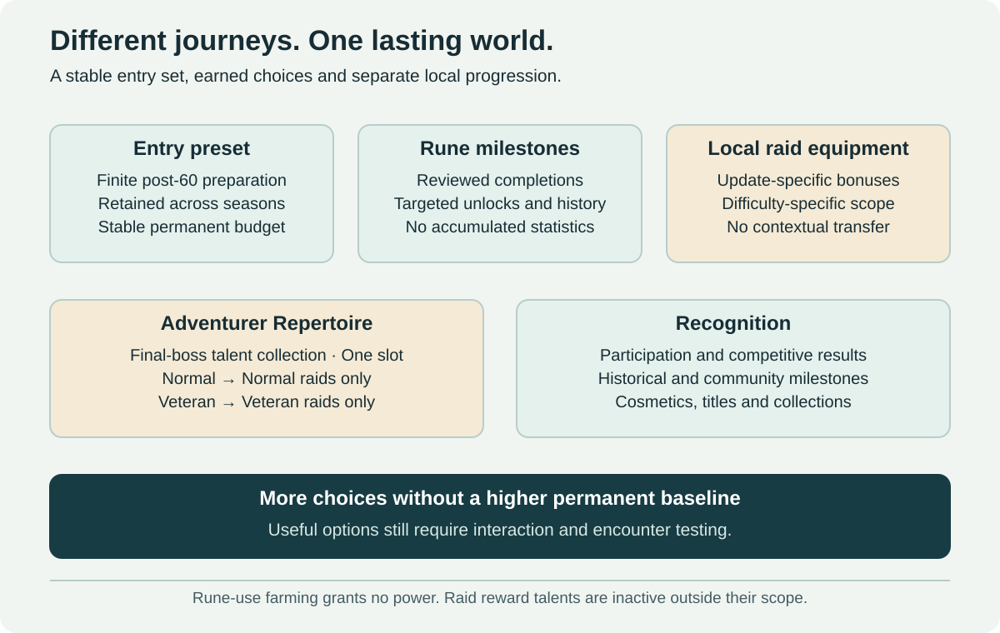

| Channel | What develops | Boundary |
| --- | --- | --- |
| Permanent equipment | Finite preparation, stat profiles and reviewed sidegrades | No automatic stronger baseline every update |
| Runes | Completion milestones, targeted choices and history | No cast-count power, cumulative statistics or extra rank |
| Contextual raid equipment | Local bonuses in an approved update and difficulty | No transfer of those equipment bonuses to another scope |
| Adventurer Repertoire | Permanently owned final-boss raid talents | One option; Normal only in Normal raids, Veteran only in Veteran raids; inactive elsewhere |
| Recognition and collections | Participation, competitive results, city service and earned identity | No hidden combat/yield bonus from a rank |

After level 60, an accessible transition earns the role-appropriate [raid-entry preset](docs/systems/raid-entry-preset.md). Its permanent budget is the default starting set for every new raid season. Runes add completion/unlock history, not another stat allowance.

A larger repertoire offers useful answers to more encounters. One slot limits simultaneous options but does not prove equal power or remove the incentive to revisit an old raid. This is an intended long-term collection goal, with interaction balance and group access to evaluate.

[Runes →](docs/systems/runes.md) · [Adventurer Abilities →](docs/systems/adventurer-abilities.md)

## 3. Raids: a new challenge without a new permanent gear ladder

This diagram shows the equipment channel. Rune milestones record unlocks; the separate raid-talent slot follows its raid/difficulty boundary.

### Permanent items, contextual bonuses

A raid item keeps its appearance and an approved permanent stat profile. Its additional progression effect has a visible activation scope.

**Illustrative item — Ancient Guardian's Breastplate**

| Property | Proposed behavior |
| --- | --- |
| Required level | 60 |
| Permanent stats | Within the lasting equipment budget; usable outside its raid group |
| Progression scope | All approved raids in **Update A** |
| Difficulty scope | **Normal only** |
| Contextual effect | An encounter-oriented bonus, funded from Update A Normal's capped bonus budget |
| Outside that scope | The contextual effect is inactive; the item remains equipped |

The example uses fictional identifiers. It does not describe an actual item or an announced raid update.

Disabling a set bonus alone would be insufficient if the item's base stats, proc or enchant still exceeded the permanent budget. Every source of effective power needs the same policy, including effects carried across instance boundaries.

### Shared across the raids of one update

The chosen scope is a **content update's raid group**, rather than a separate set for every raid. This reduces fragmented progression, especially when an update contains raids of different lengths.

Shared bonuses create a risk: players may farm the shortest raid before attempting another. Each raid must therefore be independently startable and completable from the permanent baseline, with its own route to the shared progression budget. Avoid exclusive power unlocks in sibling raids, additive per-raid power caps, or an uncapped shared currency. Test whether the easiest raid becomes the practical gearing prerequisite anyway.

### Normal and Veteran equipment tracks are independent

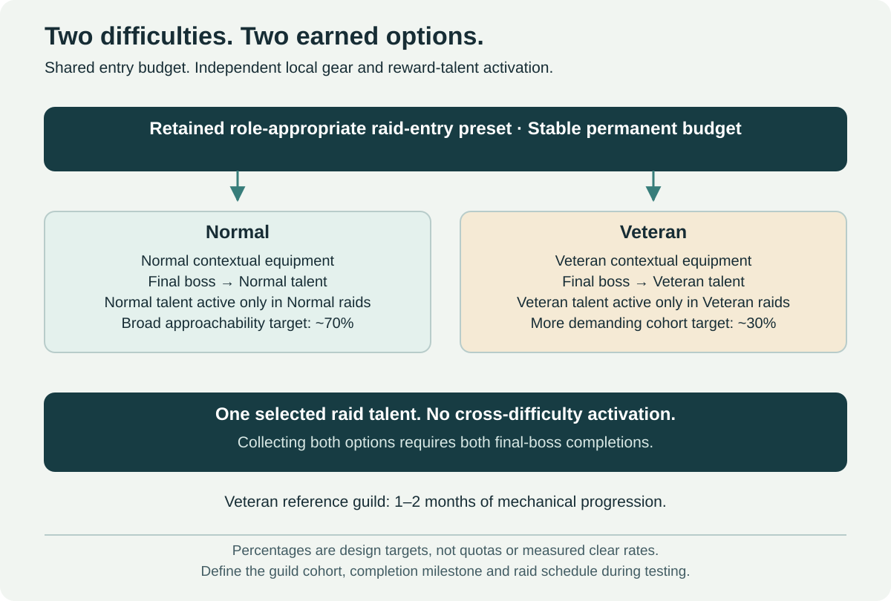

| Rule | Normal | Veteran |
| --- | --- | --- |
| Entry preparation | Accessible permanent baseline | The same accessible permanent baseline |
| Encounter goal | Full raid experience for reasonably prepared casual groups | More demanding execution and coordination for organized guilds |
| Local progression | Update-specific Normal bonuses | Update-specific Veteran bonuses |
| Cross-difficulty effects | Veteran bonuses inactive | Normal bonuses inactive |
| Prestige | Core collections and completion rewards | Additional appearances, titles, mounts and achievements |

Veteran is a proposed difficulty, separate from a Hardcore ruleset. Target **1–2 months of mechanical progression** for its prepared reference guild, with Ulduar hard modes as the author's qualitative upper difficulty compass. Normal aims to be approachable for roughly **70%** and Veteran for roughly **30%** of a defined raiding-guild cohort. These are tuning targets, not entry quotas or measured clear rates. Define the cohort, completion milestone and raid schedule in testing; skilled groups may finish sooner, without calendar gates or Rune-use grinding.

Neither difficulty feeds the other's contextual equipment currency or upgrades. Permanent abilities are a separate reward: Normal teaches its own option and Veteran teaches its own option, without automatically granting Normal. Collecting both can motivate both clears; a shared equipment ladder is still avoided.

### What happens when Update B arrives?

The player keeps their items, collections and Update A progress. Update A bonuses continue working in Update A. They do not work in Update B, which starts its own progression from the same lasting baseline. Old content remains available; the proposal does not require expiring its rewards.

Older raids retain their local progression, stories, collections, profession projects and permanently owned raid-talent unlocks. A player can deliberately seek an old ability for a preferred build. Group organization and reward balance still matter; one useful unlock does not guarantee a healthy population at every hour.

[Read the raid design, trade-offs and safeguards →](docs/01-progression-and-raids.md)

## 4. Heroic dungeons: make the leveling catalog matter at 60

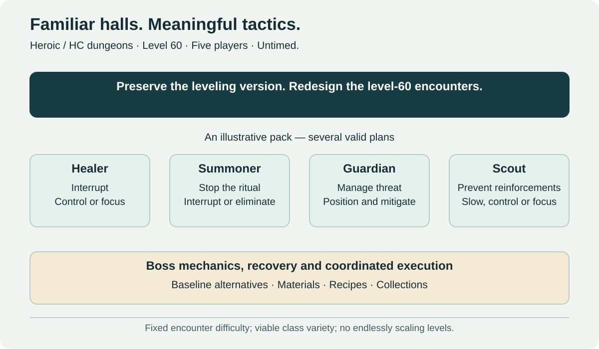

Add level-60 Heroic versions of existing dungeons, gradually. Preserve the leveling versions and their original purpose.

Heroics use five-player groups, familiar layouts and recognizable encounters, with reworked abilities, carefully placed elite packs and additional boss mechanics. Their challenge comes from target priority, crowd control, interrupts, dispels, positioning, threat and resource management.

For example, a pack might contain a healer, a summoner, a guardian and a scout. Groups can control one threat and interrupt another, or focus down a dangerous enemy while stopping reinforcements. Different compositions should have viable solutions. Every pull need not demand the same level of coordination.

Rewards include accessible permanent baseline gear, alternative builds, profession materials, recipes and collections. There is no endlessly increasing difficulty ladder. The long-term ambition is the wider dungeon catalog; the first release should cover a small, representative selection.

## 5. Challenge Modes: practice freely, compete on execution

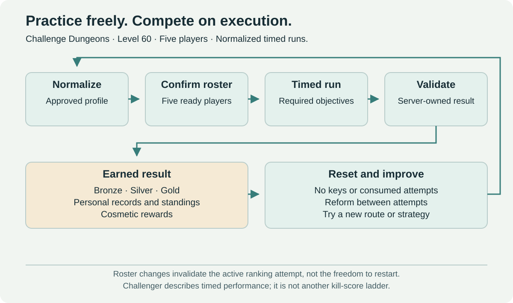

Challenge Modes are normalized timed dungeon expeditions built around execution, route planning and repeated practice. They use the proposed access and reward rules below.

| Element | Proposed rule |
| --- | --- |
| Access | Level 60, five players, no keystone or consumable entry item |
| Attempts | Unlimited retries and immediate restarts, with narrowly targeted technical safeguards |
| Difficulty | Stable encounter difficulty; no infinitely scaling levels or rotating affixes |
| Equipment | A versioned normalization profile covering stats, effects, enchants and consumables |
| Goals | Bronze, Silver and Gold times, personal records and per-dungeon leaderboards |
| Rewards | Cosmetics, mounts, pets, toys, titles and achievements; no raid-power reward track |
| Group changes | Reform freely between attempts; an active ranked run keeps its starting roster |

Resetting an attempt must not consume an opportunity to play. If someone leaves, the remaining players can replace them and start again. A roster change invalidates the current leaderboard attempt, with an option to continue unranked where technically supported.

Required bosses and explicit encounter objectives prevent trivial bypasses. Major balance changes create a new leaderboard ruleset while preserving previous records in an archive. Permanent medal rewards should remain earnable through a maintained version of the activity.

[Heroic Dungeon design →](docs/activities/heroic-dungeons.md) · [Challenge rules →](docs/activities/challenge-dungeons.md)

## 6. Elite regions and territorial World Bosses

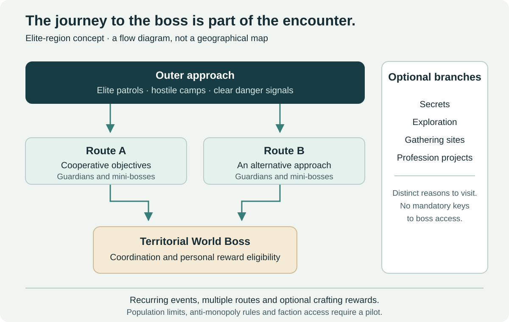

Create level-60 areas where reaching a World Boss is part of the adventure. Outer patrols and elite camps lead to intermediate objectives, guardians and multiple routes toward a central encounter. Secrets and profession opportunities give the region additional reasons to exist.

Recurring event windows, contribution-based personal eligibility and objectives that require coordination can reduce camping and uncontrolled zerging. These are mitigation ideas, not a complete solution to monopolization, faction imbalance or server-load limits. One region should be tested before expansion.

Bosses may reward artifacts, materials and recipes for specialized crafting. A combat modification must consume an existing effect budget and have a reasonable alternative acquisition path. No World Boss-exclusive advantage should be necessary for a raid or Challenge Mode.

## 7. Open-world Faction Warfare: factions and city standards

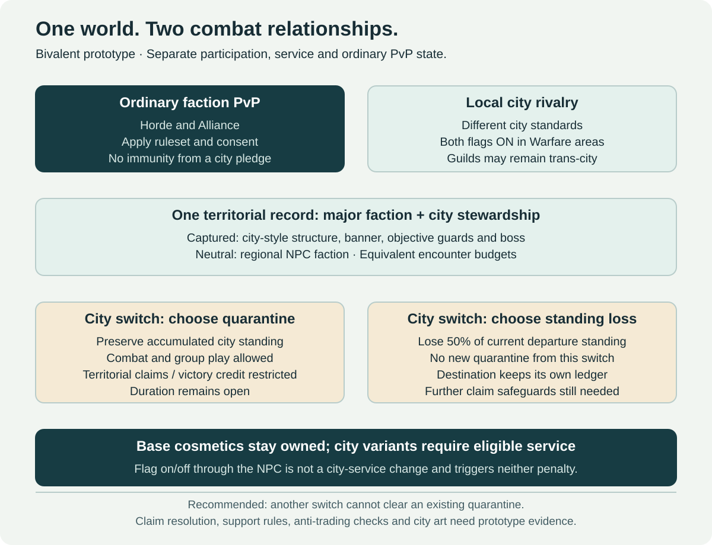

The core Warfare activity is a group assault on designated camps or small forts: defeat objective guards and a boss, validate participation, and capture the location. Ordinary questgivers and essential city services are not conquest targets.

City service would let a player choose an eligible standard within their existing major faction, without race restrictions, and earn a separate Warfare reputation. The selected reward direction keeps base banners, cloaks and mounts permanently owned, while city crests/variants require eligible service. At service change, choose preserved standing with territorial quarantine or loss of 50% of the departed city standing without a new quarantine; duration and further claim safeguards remain open. Merely turning the combat flag off is a distinct action.

The preferred bivalent prototype keeps ordinary Horde/Alliance combat and adds voluntary city rivalry inside Warfare areas. Different cities can fight even within the same major faction, but only when both city flags are active. A city-neutral ally remains outside that rivalry. Ordinary legal PvP is evaluated separately, so a city flag never grants immunity from it.

[Faction Warfare →](docs/activities/faction-warfare.md) · [Model comparison →](docs/activities/warfare-models.md) · [City reputation and cosmetics →](docs/activities/warfare-rewards.md)

[Professions, exploration and small-group adventures](#14-professions-exploration-and-small-group-adventures) have their own overview below. Their rewards do not require territorial victory for PvE power.

[Read the world activities →](docs/03-world-and-professions.md)

## 8. NPC invasions: defend a village or help rebuild it

Hostile **NPC factions**, separate from Horde and Alliance players, periodically attack settlements. Players defend objectives, protect residents and repel a commander. A successful defense preserves the village. Defeat leaves a damaged site whose local NPCs withdraw, followed by cooperative resource gathering, construction and recruitment to restore them.

Reconstruction uses regional supplies and visible communal projects. NPC recruitment restores approved service roles; players cannot duplicate or control public questgivers. Essential displaced services remain accessible from a fallback camp, and NPC-assisted recovery prevents an unattended village from staying broken indefinitely.

Defense and recovery grant civic recognition within **Explorer prestige**, with no combat bonuses. One event's bounded reward allowance covers both phases, and successful defense should be at least as attractive as deliberately losing and repairing. This must be tested against real reward rates.

[Read the invasion lifecycle and recovery safeguards →](docs/06-invasions-and-reconstruction.md)

## 9. Procedural expeditions: unpredictable routes, finite depth

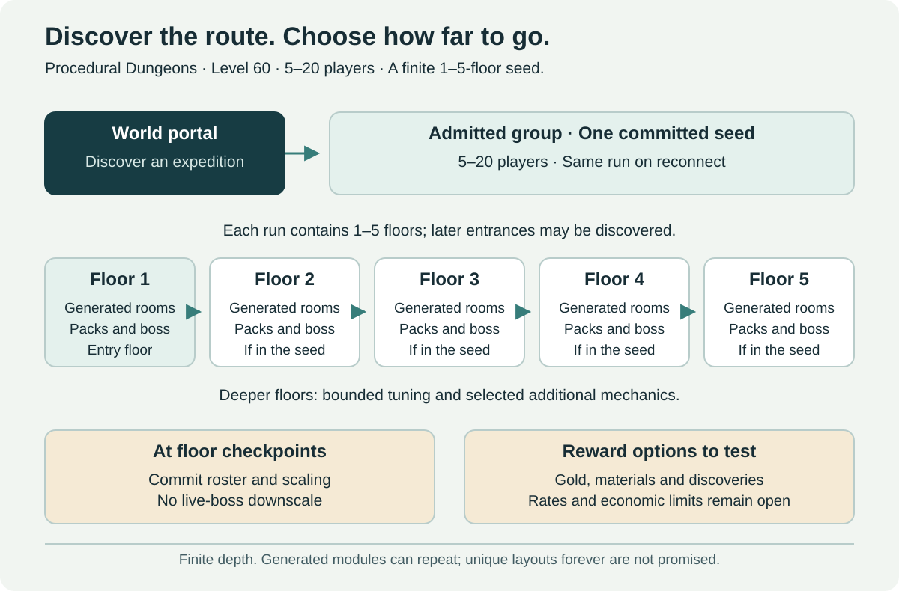

Portals appearing in the world admit level-60 groups of **5–20 players** into cooperative, untimed expeditions. Authored rooms and corridors assemble into generated layouts; compatible enemy packs, positions and bosses vary as well. Each run commits a depth of **1–5 floors**, with further entrances discovered during play.

Later floors increase challenge within a finite envelope through encounter combinations, bounded health/damage/resistance changes and selected additional abilities. This creates deeper adventures without infinitely scaling levels or a permanent equipment ladder. A finite module library provides variety, rather than a guarantee that every layout is historically unique.

Group size is committed at floor checkpoints so leaving or dying cannot downscale an active boss. Reconnects retain the same expedition and seed; rewards cannot be rerolled or claimed twice. Proposed pilot rewards are modest gold, common crafting materials, cosmetic discoveries and Adventurer prestige. Their exact balance remains open, including safeguards against inflation and easy-seed farming.

[Read generation, scaling and reward options →](docs/07-procedural-expeditions.md)

## 10. Rankings and recognition: PvE, world, PvP, arenas and Challenge

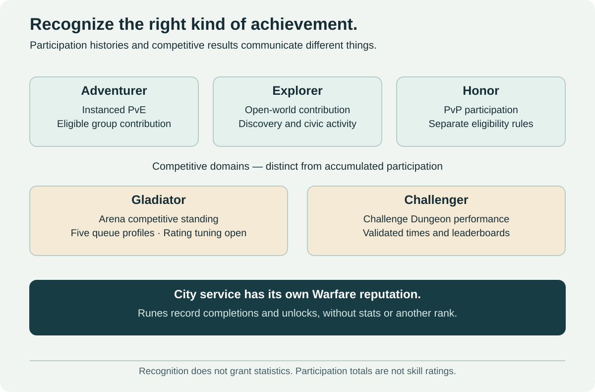

| Identity | What it communicates |
| --- | --- |
| Adventurer | Eligible instanced-PvE participation |
| Explorer | Discovery and meaningful open-world contribution |
| Honor | PvP participation under its separate rules |
| Gladiator | Arena standing across 1v1, premade/assembled 2v2 and full/split 5v5 profiles; formulas remain open |
| Challenger | Validated Challenge Dungeon performance and time-based standings |
| City service | Warfare reputation and cosmetic recognition for a chosen standard |

Runes are not another rank. They record completed objectives and targeted unlocks, without numerical stat growth or an extra prestige ladder. The combat-ability repertoire is likewise distinct from the Adventurer participation score.

The initial Adventurer base-point prototype remains native creature level ×1, ×2 for elites or ×5 for bosses, with role-aware eligibility and repeat rules. Tanking, healing, control and objective assignments count; the final blow does not determine the reward.

Adventurer/Explorer participation tiers use a provisional Wood-to-Legend ladder, reserving Challenger for timed competition. Exact thresholds remain open. Participation totals are not skill ratings, and recognition ranks do not grant statistics or activity-access advantages.

Support compositions exchange some speed for control and safety; numerical targets remain open. Historical titles, city decorations, winner monuments, accomplishment registers and exclusive visuals recognize mastery and community contribution without compulsory daily power chores.

[Recognition rules →](docs/08-prestige-ranks.md) · [Arenas →](docs/activities/arenas.md) · [Rune record →](docs/systems/runes.md)

## 11. Runes: milestones and choices without stat accumulation

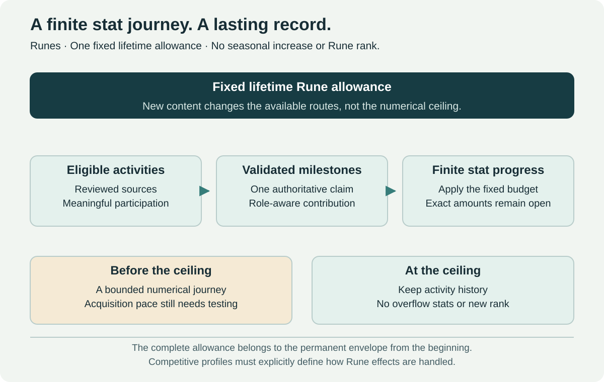

Runes follow the principle **permanent progression expands choices, not cumulative statistical advantages**. No 0.01%-per-use, exponential usage requirement or 1% spell-power mastery is adopted, even inside raids. Boss completions and authored objectives grant declared unlocks, cosmetics and history. Repeating casts, prolonging a boss phase or farming trash does not improve the reward.

[Current twelve-point decision review →](docs/proposals/current-contract-clarification.md)

[Read the Rune system →](docs/systems/runes.md)

## 12. Adventurer Repertoire: one matching-difficulty raid talent

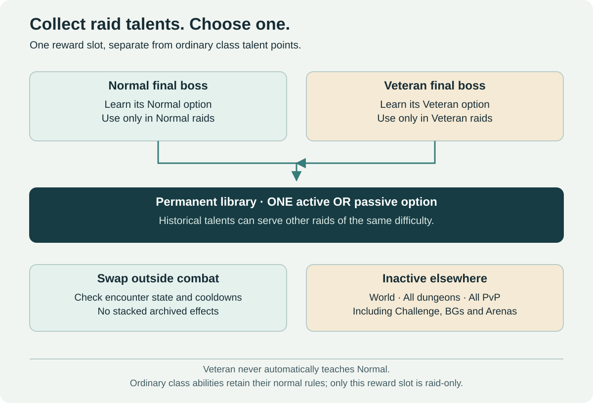

Defeating a final boss teaches its difficulty's reviewed raid talent. **Normal options work only in Normal raids; Veteran options only in Veteran raids.** One active or passive option may be selected outside combat, with encounter, cooldown and persistent-effect checks. This is an extra raid-choice slot, separate from the normal 51-point class trees.

These rewards are inactive in open world, every dungeon including Challenge, all PvP, battlegrounds and Arenas. Base class abilities are unaffected. More raid utility/choice may make a raid easier; it does not justify cumulative permanent spell statistics. Older raids remain useful sources of matching-difficulty choices.

[Read the raid-talent rules →](docs/systems/adventurer-abilities.md)

## 13. New regions, playable races and class specializations

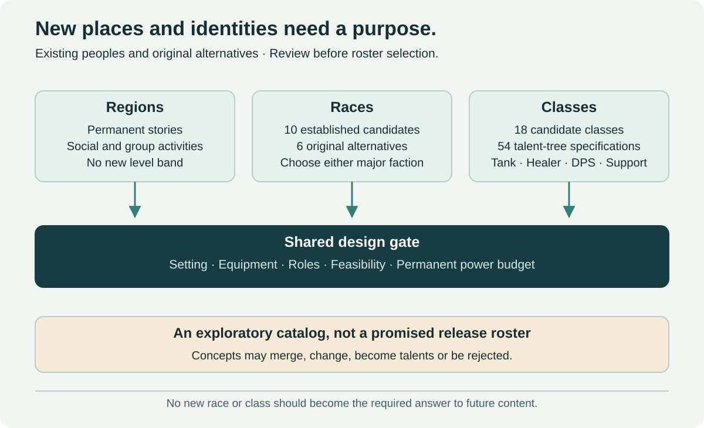

Future updates can add lasting regions, cultures, classes and playable peoples while keeping level 60 and the same permanent power range. They do not need to deliver a new race or class every season, and older regions should keep useful stories, activities and rewards.

The race shortlist starts with **ten established peoples from Vanilla, TBC or Wrath**: Ethereals, Ogres, Naga, classic Worgen, Quilboar/Razormane, Kobolds, Gnolls, Furbolgs, Arakkoa and Tuskarr. Preserve their early visual identity, especially the Silverpine/Arugal-associated Worgen appearance. Six invented alternatives remain secondary rather than replacing recognizable peoples with new names.

Every new playable race has a neutral introductory experience and then permits **Alliance or Horde** membership, so friends can keep their preferred race and choose the same faction. Armor remains recognizable through anatomy-specific adaptations. Wrists, cloaks and gloves may be adapted or hidden; footwear is reviewed individually, while head and weapon presentation must preserve combat readability. Test overall class recognition through silhouette, animations, effects and nameplates. Existing NPC assets are visual starting points, not proof that arbitrary player equipment or animations already work.

The class catalog uses **English archetypes** such as Bard, Alchemist, Summoner, Oracle, Spellblade and Artificer. **Every one of the eighteen candidates has an individual dossier and three talent-tree specifications: 54 trees in total.** Pages define roles, resources, states, baseline actions, talent anchors, recovery and acceptance scenes. The thirteen mechanical studies have explicit primary homes and documented adaptations.

The ten established race candidates also have individual dossiers covering body/armor treatment, animation, traversal, customization, proposed neutral-introduction beats and evaluation handoff. The six original alternatives remain secondary.

**Artificer/Puppet Warden is a tank:** stationary dummies generate threat and taunt, move through hammer strikes/kicks, and gain shield or weapon functions through talents. Each has separate HP and only the Artificer repairs it; ordinary healing targets the player. A powerful temporary autonomous puppet is an extra capstone summon with its own cooldown and reviewed power allowance.

**Summoner** accumulates small beings through ranged abilities and commands their attacks. Its three selected trees are **Swarmcaller** (insect DPS), **Soulbinder** (souls/wisps DPS) and **Sporekeeper** (pure-support colony). The beings are not selectable and have no HP; counterplay targets the caster and commanded effects. Ability details and tuning remain prototypes.

**Pure support is a separate role to investigate.** It contributes through active utility rather than full tanking, direct damage or healing. Five-player groups must remain viable both as 1 tank + 1 healer + 3 DPS and as 1 tank + 1 healer + 2 DPS + 1 support. No extra player or compulsory support slot is introduced; numerical viability still requires testing.

Each concept needs a distinct loop, readable role, equipment/animation plan and the same power constraints as existing choices. New classes must not become mandatory party members; new races must not supply a stronger permanent racial package. Prestige rank or old raid completion must not be required to unlock them.

These are implementation specifications for evaluation, not evidence of engine or production readiness. Complete talent allocation, numerical tuning, hybrid-build testing and race asset/wardrobe validation remain required. See the [implementation standard](docs/identity/implementation-standard.md) and [archetype/mechanic coverage audit](docs/identity/mechanic-coverage.md).

The selected working talent profile is **51 points at level 60 with a 31-point capstone**, subject to target-game validation. Ordinary support groups trade a little speed for control and safety. Losing the Artificer's last dummy permits brief owner emergency defense and reconstruction at a real cost. Exact allocations, timings and tolerances remain open in the [critical readiness review](docs/proposals/design-readiness-review.md).

[New Regions →](docs/09-regions-races-and-classes.md) · [Races →](docs/identity/races.md) · [Classes →](docs/identity/classes.md) · [Roles →](docs/identity/class-roles-and-specializations.md) · [Artificer tank →](docs/identity/classes/artificer.md) · [Summoner trees →](docs/identity/classes/summoner.md)

## 14. Professions, exploration and small-group adventures

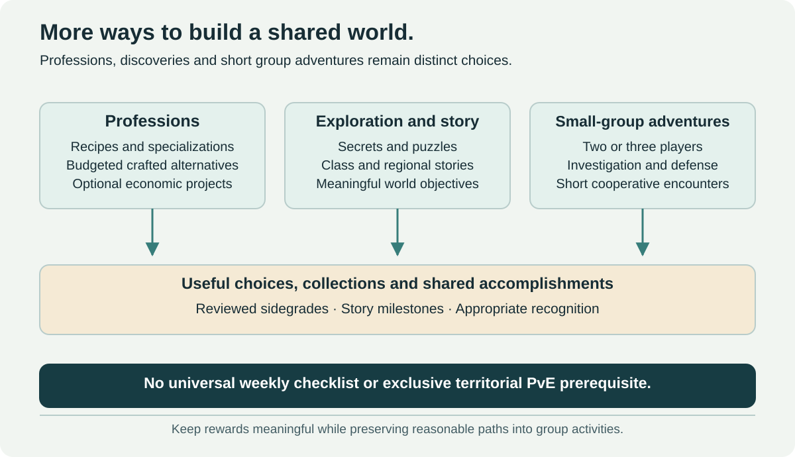

Professions add reviewed sidegrades, specialized recipes, cosmetic projects and useful variety within the permanent equipment budget. Materials from group activities and the world need reasonable alternatives and monitored supply; territorial victory must not become the only practical source of necessary PvE resources.

Exploration adds secrets, puzzles, class stories and permanent regional discoveries. Explorer recognition follows meaningful authored objectives, rather than repeated dialogue clicks or idle travel loops. Any proposed Legacy integration must respect the same power boundaries.

Two- or three-player adventures offer investigations, defense missions and smaller encounters for groups without a full dungeon party. Their pace and rewards should complement larger cooperative activities. The proposed short-session duration is a hypothesis to test, not a universal fixed requirement.

[Professions →](docs/activities/professions.md) · [Exploration and small-group adventures →](docs/activities/exploration-and-adventures.md)

## 15. A shared technical contract

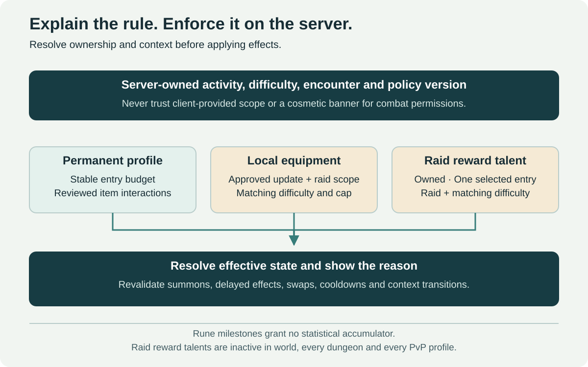

The technical proposal uses a lasting equipment budget, explicit content scopes, separate difficulty identifiers and versioned normalization profiles. All are conceptual fields; this repository makes no claim about Blizzard's internal architecture.

The server determines whether an effect is active. A tooltip explains that decision, but does not enforce it. Validation must include equipment changes, difficulty changes, login/reconnect, transfers, pets, proc snapshots, consumables and temporary effects.

For Challenge Modes, use approved normalized equipment profiles or accessible template equivalents so legacy item farming cannot become the hidden preparation game. Raw item-level scaling is insufficient. A maintained effect catalog and class/build testing remain necessary.

The same contract covers completion-only Rune records, matching-difficulty raid-slot state, durable settlements, seeded expeditions, separate recognition ledgers and explicitly resolved Warfare/ordinary-PvP permissions. No objective adds cumulative Rune statistics, and no raid slot activates outside its raid/difficulty scope.

[Read the conceptual model and acceptance cases →](docs/04-technical-framework.md)

## 16. Benefits, costs and alternatives

| Approach | Main benefit | Main cost or limitation |
| --- | --- | --- |
| Slow vertical progression | Familiar upgrades and simpler continuity with traditional gearing | Permanent power still rises; catch-up and occasional resets may remain necessary |
| Items usable only in their source raids | Strong isolation of power | Awkward item usability, collection management and weaker attachment outside raids |
| **Permanent gear with scoped progression** | Preserves item ownership and local upgrades while keeping new updates accessible | More rules, normalization work, reward-design pressure and ongoing balance costs |

The equipment model reduces regular obsolescence while local gearing can still feel repetitive. Permanent ability unlocks add a practical old-raid goal, and Rune milestones add completion-based choices and history. Those additions also create acquisition pressure and interaction costs; the design should measure them rather than promise every progression path is interchangeable.

Inventory pressure needs a dedicated bonus collection or archive, clear presets and automatic scope previews. Balance work must detect mandatory sidegrades, not merely keep item levels equal. Development costs require pilots and evidence; reusing dungeon geometry does not make encounter redesign cheap or automatic.

The additions introduce further costs: village consequences can disrupt other players, procedural generation needs authored modules and extensive validation, participation ranks can encourage farming or social exclusion, and new classes/races create long-term art and balance commitments. These risks belong in pilot decisions rather than being hidden behind the word “horizontal.”

## 17. Build evidence before expanding the system

Start by defining the permanent budget and measuring effective power. Then test a small Heroic selection, one update-wide raid group with independent difficulties, and selected normalized Challenge dungeons. Elite regions and territorial PvP follow as separate pilots.

Add one settlement-defense cycle, a limited procedural environment and non-statistical prestige as bounded experiments. New regions and playable identities use separate creative, technical and balance gates; a class wishlist is not a delivery schedule.

Measure preparation time for returning players, the practical need to farm sibling raids or another difficulty, class diversity, reward satisfaction, unwanted activity obligations and maintenance cost. Publish outcomes and revise the design before scaling it.

The critical test is concrete: **can a player with an adequate permanent set enter Update C without gearing through A and B, while still having worthwhile historical ability goals to pursue?**

[Read the pilot sequence and open questions →](docs/05-roadmap-and-evaluation.md)

## Discuss and contribute

The [GitHub Wiki](https://github.com/Finland6738/wow-forever-game-design-proposal/wiki) provides the complete reading view, a topic index and detailed navigation. The Markdown files in this repository are the source: changes merged into `main` automatically rebuild the wiki, including new or renamed documentation pages. See [wiki maintenance](docs/14-wiki-maintenance.md) for the publishing rules.

Concept-documentation updates on `main` are also announced automatically in [Announcements](https://github.com/Finland6738/wow-forever-game-design-proposal/discussions/categories/announcements) after the wiki publishes successfully. Posts link the changed sources and summarize new change-history entries, with duplicate prevention on reruns.

Use [GitHub Discussions](https://github.com/Finland6738/wow-forever-game-design-proposal/discussions) for open-ended design debate, [Issues](https://github.com/Finland6738/wow-forever-game-design-proposal/issues) for specific problems, and pull requests for proposed edits. Explain the affected player experience, the trade-off and how we could test an improvement.

Three useful starting questions:

1. Would local raid progression feel rewarding if the permanent equipment baseline stayed stable?
2. What would make historical ability collection rewarding and access to those raid groups sustainable?
3. Which optional activities would keep you playing at 60 without regular item-level increases?

The repository holds the detailed proposal. A short forum introduction can link here once the wording is ready; the [current forum draft](docs/forum-summary.md) has not been posted.

## About the author

I am a software developer and have loved video games since childhood, especially Warcraft, Diablo, StarCraft and World of Warcraft. I started playing WoW in 2004 and spent around fourteen years raiding. Over time, I lost interest as the game moved further from the experience that first drew me in.

My strongest memories are the friendships, unexpected situations and accomplishments shared with other people. The loot and boss strategies mattered, but the people made those experiences last. That is what I hope Forever can preserve from Vanilla: a world where grouping matters, communities recognize effort and success feels earned.

For years I have occasionally shared forum suggestions about what I would improve, add, preserve or remove. This project brings those thoughts together in a form others can examine and challenge. I want to see Forever grow while keeping clear rules, a strong social identity and room for players to pursue more demanding challenges. After so many years of raiding, I would love to see that kind of world thrive for just as long again.

World of Warcraft and related names belong to their respective owners. See [asset provenance](assets/README.md) and the [change history](CHANGELOG.md).
