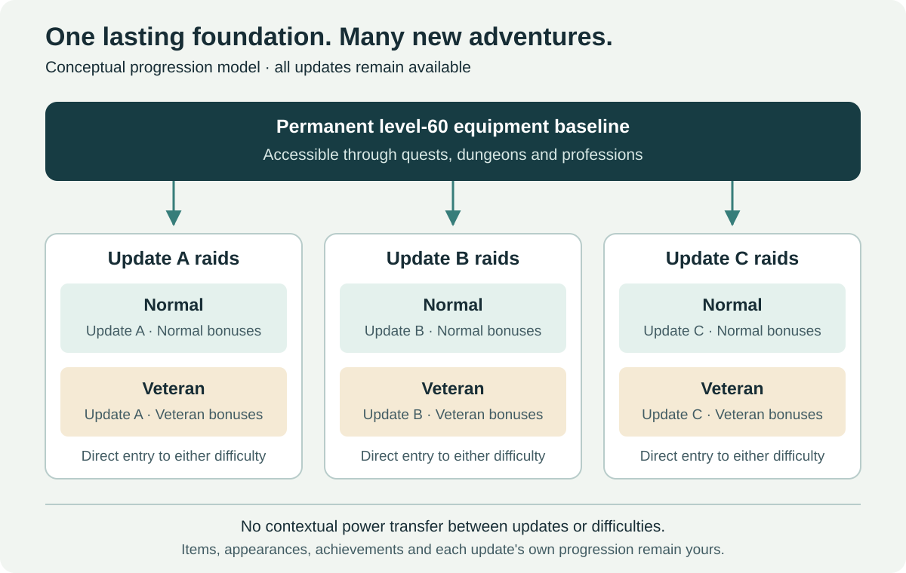
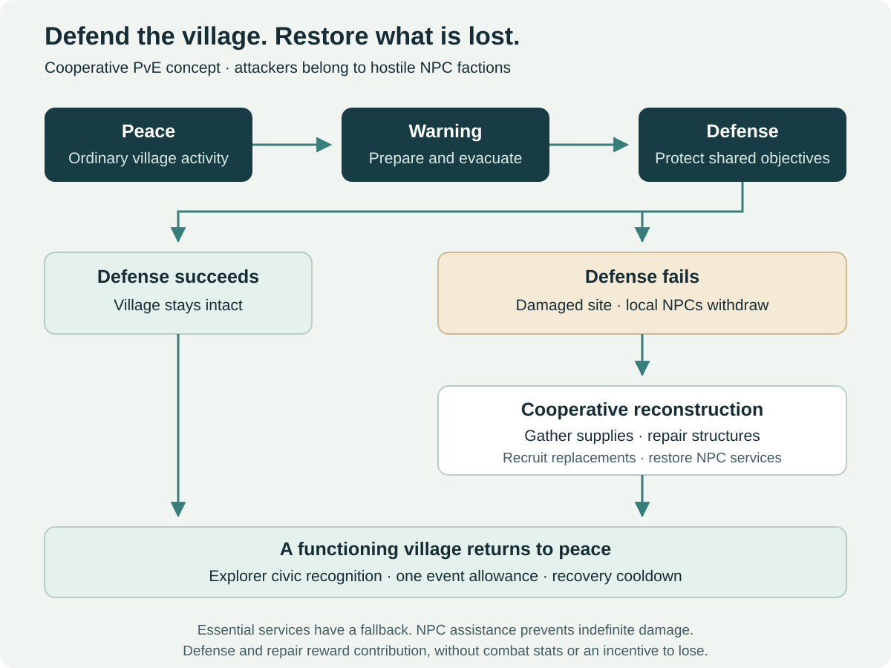

# WoW: Forever — A Sustainable Level-60 Endgame

**A community game-design proposal for permanent character power, independent raid progression, and a growing world of optional adventures.**

> **Status: design proposal · v0.3 · 10 November 2026.** This is an independent community project, unaffiliated with Blizzard Entertainment. Everything described as a proposed system is a suggestion for discussion, rather than an announced feature or an implementation of the game.

**[Read the complete GitHub Wiki](https://github.com/Finland6738/wow-forever-game-design/wiki)** · [Documentation index](docs/README.md) · [Questions and discussion](https://github.com/Finland6738/wow-forever-game-design/discussions)

## The proposal in one minute

Keep characters at level 60 and establish an accessible, lasting equipment-power budget. New content should add encounters, builds, stories, collections, and opportunities for mastery without continually raising the minimum permanent power needed to participate.

Raid equipment remains usable throughout the game. Its additional progression bonuses activate only in the **raid group belonging to its content update and in its own difficulty**. Normal and Veteran have independent progression. A player can start Veteran directly, without farming Normal or previous raid updates.

Around that foundation, expand the level-60 endgame with tactical Heroic dungeons, keyless timed Challenge Modes, elite open-world regions, territorial PvP, settlement defense and reconstruction, procedural expeditions, professions, and exploration. Separate Adventurer, Explorer and Honor prestige recognize participation without granting statistics. Future regions and original playable identities expand the world within the same power policy.

**The central promise:** a returning player can prepare through accessible non-raid activities and enter a newly released raid without completing years of previous raid tiers.

## A world built around playing together

The heart of this proposal is cooperation: finding companions, learning to trust a group, helping a settlement and earning a reputation through shared adventures. Leveling and everyday exploration still have a place, while the most meaningful endgame achievements should reward people who organize, communicate and overcome challenges together.

Keep the rules understandable and let depth come from decisions and teamwork. Approachable entry does not mean automatic completion or identical rewards for every activity. Difficult encounters and prestigious cosmetics should remain earned, recognizable accomplishments. Normal and Veteran offer different commitments without making one a compulsory preparation step for the other.

[Read the social principles and earned-reward policy →](docs/10-social-design-and-earned-prestige.md)

## Read the proposal

| Document | What it explains |
| --- | --- |
| [Progression and raids](docs/01-progression-and-raids.md) | Permanent power, update-wide raid scopes, independent Normal/Veteran paths, rewards and loot management |
| [Heroic dungeons and Challenge Modes](docs/02-dungeons-and-challenges.md) | Tactical encounters, unrestricted retries, normalization, medals and leaderboard integrity |
| [Open world, PvP and professions](docs/03-world-and-professions.md) | Elite regions, territorial bosses, crafting artifacts, regional objectives and optional activities |
| [Technical framework](docs/04-technical-framework.md) | Conceptual data model, server-side validation, normalization, transition rules and acceptance cases |
| [Roadmap and evaluation](docs/05-roadmap-and-evaluation.md) | Small pilots, dependencies, success criteria and unresolved decisions |
| [NPC invasions and reconstruction](docs/06-invasions-and-reconstruction.md) | Defend settlements, gather resources after defeat and restore buildings and NPCs |
| [Procedural expeditions](docs/07-procedural-expeditions.md) | World portals, groups of 5–20, generated routes and encounters, and 1–5 finite floors |
| [Prestige ranks](docs/08-prestige-ranks.md) | Adventurer, Explorer and Honor identities, role-aware credit and rewards without statistics |
| [Regions, races and classes](docs/09-regions-races-and-classes.md) | Creative direction, six exploratory peoples, 18 class families and 13 mechanical studies |
| [Social design and earned prestige](docs/10-social-design-and-earned-prestige.md) | Group play, readable rules, meaningful difficulty and rewards earned through participation |
| [Rewards and acquisition policies](docs/11-rewards-and-acquisition.md) | Power boundaries, acquisition alternatives, lockouts, economic faucets and ownership |
| [Player journeys and FAQ](docs/12-player-journeys-and-faq.md) | Concrete examples of joining, returning, grouping, progressing and recovering from interruptions |
| [Glossary and decision register](docs/13-glossary-and-decisions.md) | Terms, fixed design commitments, working parameters and open tuning decisions |
| [Wiki publishing](docs/14-wiki-maintenance.md) | How concept edits automatically generate and publish the wiki |
| [Sources and factual boundaries](docs/references.md) | Verified official context and the limits of the proposal |
| [Forum summary draft](docs/forum-summary.md) | A short introduction linking readers here; not published |

For the documentation index, see [docs/README.md](docs/README.md). To propose an improvement, read [CONTRIBUTING.md](CONTRIBUTING.md).

## 1. Why a permanent level cap needs a permanent power policy

A fixed character level does not, by itself, prevent an endless gearing ladder. If every release introduces permanently stronger equipment, effective character power can continue increasing while the level display stays unchanged.

Smaller increases delay this problem. Catch-up systems can also make old tiers unnecessary, so a sequential raid grind is **not an inevitable outcome** of vertical progression. However, that approach still needs recurring replacement gear, resets, or upward retuning. This proposal explores a different contract: keep the long-term power range stable and put most new growth into content, choices, collections, and local progression.

The aim is to preserve the pleasure of earning a useful drop while making a long absence less costly. It is a design preference with real trade-offs, rather than a claim that every player wants horizontal progression.

Blizzard describes Forever as a permanent home with a level 1–60 journey and an account-wide Legacy System. Those are the verified starting points for this discussion. A permanent equipment ceiling and the systems below are **our proposals**, not conclusions about Blizzard's future roadmap. See the [official sources and claim register](docs/references.md).

## 2. Three layers of progression

| Layer | What grows | Where it applies | What it must avoid |
| --- | --- | --- | --- |
| Permanent equipment | A finite preparation journey, alternative stat profiles and budgeted item effects | General gameplay, subject to each activity's rules | An upward baseline with every content update |
| Contextual raid progression | Equipment bonuses and set combinations earned in a particular update and difficulty | Approved raids in that update, in that difficulty only | Power transfer into another update, difficulty or competitive mode |
| Permanent collections, prestige and mastery | Appearances, mounts, pets, toys, titles, achievements, stories, recipes, participation ranks and personal skill | Character/account collections and the activities themselves | Hidden combat advantages, or presenting accumulated participation as a skill rating |

Players still improve their initial level-60 equipment. The goal is a **finite, accessible preparation path**, followed by sidegrades and independent content progression. Quest rewards, max-level dungeons and crafting should offer reasonable routes to a raid-ready baseline. A newly leveled character is not automatically fully prepared, and a returning player need not replace an already adequate baseline set.

Equal item level or an equal sum of stats does not guarantee equal performance. Weapon behavior, class interactions, proc effects and stat combinations must all be evaluated. Horizontal itemization needs continuing balance work.

## 3. Raids: a new challenge without a new permanent gear ladder

### Permanent items, contextual bonuses

A raid item keeps its appearance and an approved permanent stat profile. Its additional progression effect has a visible activation scope.

**Illustrative item — Ancient Guardian's Breastplate**

| Property | Proposed behavior |
| --- | --- |
| Required level | 60 |
| Permanent stats | Within the lasting equipment budget; usable outside its raid group |
| Progression scope | All approved raids in **Update A** |
| Difficulty scope | **Normal only** |
| Contextual effect | An encounter-oriented bonus, funded from Update A Normal's capped bonus budget |
| Outside that scope | The contextual effect is inactive; the item remains equipped |

The example uses fictional identifiers. It does not describe an actual item or an announced raid update.

Disabling a set bonus alone would be insufficient if the item's base stats, proc or enchant still exceeded the permanent budget. Every source of effective power needs the same policy, including effects carried across instance boundaries.

### Shared across the raids of one update

The chosen scope is a **content update's raid group**, rather than a separate set for every raid. This reduces fragmented progression, especially when an update contains raids of different lengths.

Shared bonuses create a risk: players may farm the shortest raid before attempting another. Each raid must therefore be independently startable and completable from the permanent baseline, with its own route to the shared progression budget. Avoid exclusive power unlocks in sibling raids, additive per-raid power caps, or an uncapped shared currency. Test whether the easiest raid becomes the practical gearing prerequisite anyway.

### Normal and Veteran are independent

| Rule | Normal | Veteran |
| --- | --- | --- |
| Entry preparation | Accessible permanent baseline | The same accessible permanent baseline |
| Encounter goal | Full raid experience for reasonably prepared casual groups | More demanding execution and coordination for organized guilds |
| Local progression | Update-specific Normal bonuses | Update-specific Veteran bonuses |
| Cross-difficulty effects | Veteran bonuses inactive | Normal bonuses inactive |
| Prestige | Core collections and completion rewards | Additional appearances, titles, mounts and achievements |

Veteran is a proposed difficulty name. It is separate from any Hardcore ruleset. Its intended feel is readable tactical progression: deliberate preparation, important individual responsibilities and coordination without excessive mechanical clutter. A roughly **four-to-eight-week progression journey** for an appropriately prepared target guild is a tuning hypothesis, not a forced waiting period or a guarantee. Skilled groups may finish sooner.

Neither difficulty supplies a currency, base-stat upgrade or unique combat effect required in the other. Playing both remains an optional preference. Normal must not become the weekly gearing errand for Veteran guilds.

### What happens when Update B arrives?

The player keeps their items, collections and Update A progress. Update A bonuses continue working in Update A. They do not work in Update B, which starts its own progression from the same lasting baseline. Old content remains available; the proposal does not require expiring its rewards.

Older raids retain their own progression, stories, collections and optional profession projects. This can support replay, but it cannot guarantee healthy populations in every old raid. New content, social organization and the quality of the rewards still matter.

[Read the raid design, trade-offs and safeguards →](docs/01-progression-and-raids.md)

## 4. Heroic dungeons: make the leveling catalog matter at 60

Add level-60 Heroic versions of existing dungeons, gradually. Preserve the leveling versions and their original purpose.

Heroics use five-player groups, familiar layouts and recognizable encounters, with reworked abilities, carefully placed elite packs and additional boss mechanics. Their challenge comes from target priority, crowd control, interrupts, dispels, positioning, threat and resource management.

For example, a pack might contain a healer, a summoner, a guardian and a scout. Groups can control one threat and interrupt another, or focus down a dangerous enemy while stopping reinforcements. Different compositions should have viable solutions. Every pull need not demand the same level of coordination.

Rewards include accessible permanent baseline gear, alternative builds, profession materials, recipes and collections. There is no endlessly increasing difficulty ladder. The long-term ambition is the wider dungeon catalog; the first release should cover a small, representative selection.

## 5. Challenge Modes: practice freely, compete on execution

Challenge Modes are normalized timed dungeon expeditions built around execution, route planning and repeated practice. They use the proposed access and reward rules below.

| Element | Proposed rule |
| --- | --- |
| Access | Level 60, five players, no keystone or consumable entry item |
| Attempts | Unlimited retries and immediate restarts, with narrowly targeted technical safeguards |
| Difficulty | Stable encounter difficulty; no infinitely scaling levels or rotating affixes |
| Equipment | A versioned normalization profile covering stats, effects, enchants and consumables |
| Goals | Bronze, Silver and Gold times, personal records and per-dungeon leaderboards |
| Rewards | Cosmetics, mounts, pets, toys, titles and achievements; no raid-power reward track |
| Group changes | Reform freely between attempts; an active ranked run keeps its starting roster |

Resetting an attempt must not consume an opportunity to play. If someone leaves, the remaining players can replace them and start again. A roster change invalidates the current leaderboard attempt, with an option to continue unranked where technically supported.

Required bosses and explicit encounter objectives prevent trivial bypasses. Major balance changes create a new leaderboard ruleset while preserving previous records in an archive. Permanent medal rewards should remain earnable through a maintained version of the activity.

[Read the dungeon and competitive design →](docs/02-dungeons-and-challenges.md)

## 6. Elite regions and territorial World Bosses

Create level-60 areas where reaching a World Boss is part of the adventure. Outer patrols and elite camps lead to intermediate objectives, guardians and multiple routes toward a central encounter. Secrets and profession opportunities give the region additional reasons to exist.

Recurring event windows, contribution-based personal eligibility and objectives that require coordination can reduce camping and uncontrolled zerging. These are mitigation ideas, not a complete solution to monopolization, faction imbalance or server-load limits. One region should be tested before expansion.

Bosses may reward artifacts, materials and recipes for specialized crafting. A combat modification must consume an existing effect budget and have a reasonable alternative acquisition path. No World Boss-exclusive advantage should be necessary for a raid or Challenge Mode.

## 7. Territorial PvP and other ways to live in Azeroth

Regional faction objectives can give older zones a continuing social purpose. Illustrative possibilities include outposts in the Barrens, military positions in Ashenvale, supply routes in Hillsbrad and contested resources in Stranglethorn Vale. These are examples, not a proposed confirmed map.

Territorial control could grant **30–60 minutes** of regional services, reputation opportunities, gathering benefits or PvP-specific tactical effects. That duration needs testing. Regional combat bonuses must be inactive in raids and Challenge Modes, and PvE crafting must not depend on winning territorial PvP.

Participation follows the relevant ruleset, with explicit consent wherever appropriate. Objectives should avoid main leveling routes and use temporary control, recurring contests and underrepresented-faction support to reduce permanent domination.

Other parallel activities include short two- or three-player adventures, class quests, exploration, puzzles, story chains, profession specializations and collections. Any proposed Legacy integration must preserve the same power boundaries; the existence of the Legacy System does not establish that these additions are planned.

**More activities should create more choices, rather than a longer compulsory daily or weekly checklist.**

[Read the world, PvP and crafting design →](docs/03-world-and-professions.md)

## 8. NPC invasions: defend a village or help rebuild it

Hostile **NPC factions**, separate from Horde and Alliance players, periodically attack settlements. Players defend objectives, protect residents and repel a commander. A successful defense preserves the village. Defeat leaves a damaged site whose local NPCs withdraw, followed by cooperative resource gathering, construction and recruitment to restore them.

Reconstruction uses regional supplies and visible communal projects. NPC recruitment restores approved service roles; players cannot duplicate or control public questgivers. Essential displaced services remain accessible from a fallback camp, and NPC-assisted recovery prevents an unattended village from staying broken indefinitely.

Defense and recovery grant civic recognition within **Explorer prestige**, with no combat bonuses. One event's bounded reward allowance covers both phases, and successful defense should be at least as attractive as deliberately losing and repairing. This must be tested against real reward rates.

[Read the invasion lifecycle and recovery safeguards →](docs/06-invasions-and-reconstruction.md)

## 9. Procedural expeditions: unpredictable routes, finite depth

Portals appearing in the world admit level-60 groups of **5–20 players** into cooperative, untimed expeditions. Authored rooms and corridors assemble into generated layouts; compatible enemy packs, positions and bosses vary as well. Each run commits a depth of **1–5 floors**, with further entrances discovered during play.

Later floors increase challenge within a finite envelope through encounter combinations, bounded health/damage/resistance changes and selected additional abilities. This creates deeper adventures without infinitely scaling levels or a permanent equipment ladder. A finite module library provides variety, rather than a guarantee that every layout is historically unique.

Group size is committed at floor checkpoints so leaving or dying cannot downscale an active boss. Reconnects retain the same expedition and seed; rewards cannot be rerolled or claimed twice. Proposed pilot rewards are modest gold, common crafting materials, cosmetic discoveries and Adventurer prestige. Their exact balance remains open, including safeguards against inflation and easy-seed farming.

[Read generation, scaling and reward options →](docs/07-procedural-expeditions.md)

## 10. Prestige without statistics: Adventurer, Explorer and Honor

| Track | Recognizes | Reward boundary |
| --- | --- | --- |
| Adventurer | Instanced PvE participation in dungeons, raids and procedural expeditions | Titles, badges and cosmetics; no damage, healing or equipment advantage |
| Explorer | Discoveries, quests, authored NPC interactions, world events, settlement defense and reconstruction | Recognition of world contribution; no raid access or profession-throughput advantage |
| Honor | PvP participation under its separate rules | PvE activities do not feed this track |

The initial Adventurer base-point prototype is **native creature level ×1**, **×2 for an elite**, or **×5 for a boss**. Categories are exclusive. A level-60 ordinary enemy, elite and boss would therefore provide 60, 120 and 300 base points respectively, before eligibility and repeat rules.

Every eligible participant receives credit, including tanking, healing, control and encounter assignments. Final blows and damage rankings do not determine the payout. Exclude trivial targets, infinite summoned adds and duplicate claims; review repeat farming without limiting the freedom to practice.

Explorer points come from meaningful completed objectives, rather than dialogue clicks or repeatedly crossing a zone boundary. An illustrative ladder runs **Wood → Bronze → Silver → Gold → Platinum → Diamond → Master → Challenger**, with four subdivisions per tier and no stat rewards or proposed decay. Thresholds remain open.

These cumulative ranks describe participation and history. They are not a skill rating and should not become entry requirements, matchmaking gates or minimum-rank group filters.

[Read scoring, ownership and anti-farming rules →](docs/08-prestige-ranks.md)

## 11. New regions and original playable identities

Future updates can add lasting regions, cultures, classes and playable peoples while keeping level 60 and the same permanent power range. They do not need to deliver a new race or class every season, and older regions should keep useful stories, activities and rewards.

The creative direction favors grounded, sometimes ominous fantasy and distinctive new playable identities. Six invented working concepts—Gravemarch, Brineveil, Stonewake, Thornmaw, Briarhide and Veilbound—explore different cultures and silhouettes. Each needs setting, anatomy and narrative review; these names do not identify announced peoples or additions to existing lore.

The class catalog uses invented working names for 18 exploratory identities, including Veilcantor, Cruciblewright, Pactbinder, Aetheredge, Cogwarden and Stillguard. Each entry explains its fantasy, decision loop and group-balance risks. Overlapping ideas are consolidated; a new name alone is insufficient to justify a new class.

Thirteen additional mechanical studies preserve the useful ideas in the brainstorming—forms, swarms, companion empowerment, state consumption, stances, devices, blood resources, parries, ammunition, rune selection and mounted coordination. They are alternatives that may become specializations or talents, rather than 13 more promised classes.

Each concept needs a unique decision loop, readable role, practical animation/pathing plan and the same power constraints as existing choices. New classes must not become mandatory party slots; new races must not supply a stronger permanent racial package. Prestige rank or old raid completion must not be required to unlock them.

[Read the creative policy and full concept catalog →](docs/09-regions-races-and-classes.md)

## 12. A shared technical contract

The technical proposal uses a lasting equipment budget, explicit content scopes, separate difficulty identifiers and versioned normalization profiles. All are conceptual fields; this repository makes no claim about Blizzard's internal architecture.

The server determines whether an effect is active. A tooltip explains that decision, but does not enforce it. Validation must include equipment changes, difficulty changes, login/reconnect, transfers, pets, proc snapshots, consumables and temporary effects.

For Challenge Modes, use approved normalized equipment profiles or accessible template equivalents so legacy item farming cannot become the hidden preparation game. Raw item-level scaling is insufficient. A maintained effect catalog and class/build testing remain necessary.

The same contract extends to durable settlement state, validated reconstruction deliveries, seeded expeditions with floor-level scaling snapshots, and separate prestige ledgers. Their progression grants no exception to the permanent power budget.

[Read the conceptual model and acceptance cases →](docs/04-technical-framework.md)

## 13. Benefits, costs and alternatives

| Approach | Main benefit | Main cost or limitation |
| --- | --- | --- |
| Slow vertical progression | Familiar upgrades and simpler continuity with traditional gearing | Permanent power still rises; catch-up and occasional resets may remain necessary |
| Items usable only in their source raids | Strong isolation of power | Awkward item usability, collection management and weaker attachment outside raids |
| **Permanent gear with scoped progression** | Preserves item ownership and local upgrades while keeping new updates accessible | More rules, normalization work, reward-design pressure and ongoing balance costs |

The proposed model can reduce obsolescence and unwanted prerequisite farming. It also makes some epic drops less universally powerful, can feel like repeating a local gearing journey, and may give old raids fewer power-based reasons to revisit. Collections alone will not satisfy everyone.

Inventory pressure needs a dedicated bonus collection or archive, clear presets and automatic scope previews. Balance work must detect mandatory sidegrades, not merely keep item levels equal. Development costs require pilots and evidence; reusing dungeon geometry does not make encounter redesign cheap or automatic.

The additions introduce further costs: village consequences can disrupt other players, procedural generation needs authored modules and extensive validation, participation ranks can encourage farming or social exclusion, and new classes/races create long-term art and balance commitments. These risks belong in pilot decisions rather than being hidden behind the word “horizontal.”

## 14. Build evidence before expanding the system

Start by defining the permanent budget and measuring effective power. Then test a small Heroic selection, one update-wide raid group with independent difficulties, and selected normalized Challenge dungeons. Elite regions and territorial PvP follow as separate pilots.

Add one settlement-defense cycle, a limited procedural environment and non-statistical prestige as bounded experiments. New regions and playable identities use separate creative, technical and balance gates; a class wishlist is not a delivery schedule.

Measure preparation time for returning players, the practical need to farm sibling raids or another difficulty, class diversity, reward satisfaction, unwanted activity obligations and maintenance cost. Publish outcomes and revise the design before scaling it.

The critical test is concrete: **can a player with an adequate permanent set skip Updates A and B, join during Update C, and progress without obtaining their equipment?**

[Read the pilot sequence and open questions →](docs/05-roadmap-and-evaluation.md)

## Discuss and contribute

The [GitHub Wiki](https://github.com/Finland6738/wow-forever-game-design/wiki) provides the complete reading view, a topic index and detailed navigation. The Markdown files in this repository are the source: changes merged into `main` automatically rebuild the wiki, including new or renamed documentation pages. See [wiki maintenance](docs/14-wiki-maintenance.md) for the publishing rules.

Use [GitHub Discussions](https://github.com/Finland6738/wow-forever-game-design/discussions) for open-ended design debate, [Issues](https://github.com/Finland6738/wow-forever-game-design/issues) for specific problems, and pull requests for proposed edits. Explain the affected player experience, the trade-off and how we could test an improvement.

Three useful starting questions:

1. Would local raid progression feel rewarding if the permanent equipment baseline stayed stable?
2. What would make older raids worth revisiting without making them prerequisites?
3. Which optional activities would keep you playing at 60 without regular item-level increases?

The repository holds the detailed proposal. A short forum introduction can link here once the wording is ready; the [current forum draft](docs/forum-summary.md) has not been posted.

## About the author

I am a software developer and have loved video games since childhood, especially Warcraft, Diablo, StarCraft and World of Warcraft. I started playing WoW in 2004 and spent around fourteen years raiding. Over time, I lost interest as the game moved further from the experience that first drew me in.

My strongest memories are the friendships, unexpected situations and accomplishments shared with other people. The loot and boss strategies mattered, but the people made those experiences last. That is what I hope Forever can preserve from Vanilla: a world where grouping matters, communities recognize effort and success feels earned.

For years I have occasionally shared forum suggestions about what I would improve, add, preserve or remove. This project brings those thoughts together in a form others can examine and challenge. I want to see Forever grow while keeping clear rules, a strong social identity and room for players to pursue more demanding challenges. After so many years of raiding, I would love to see that kind of world thrive for just as long again.

World of Warcraft and related names belong to their respective owners. See [asset provenance](assets/README.md) and the [change history](CHANGELOG.md).
