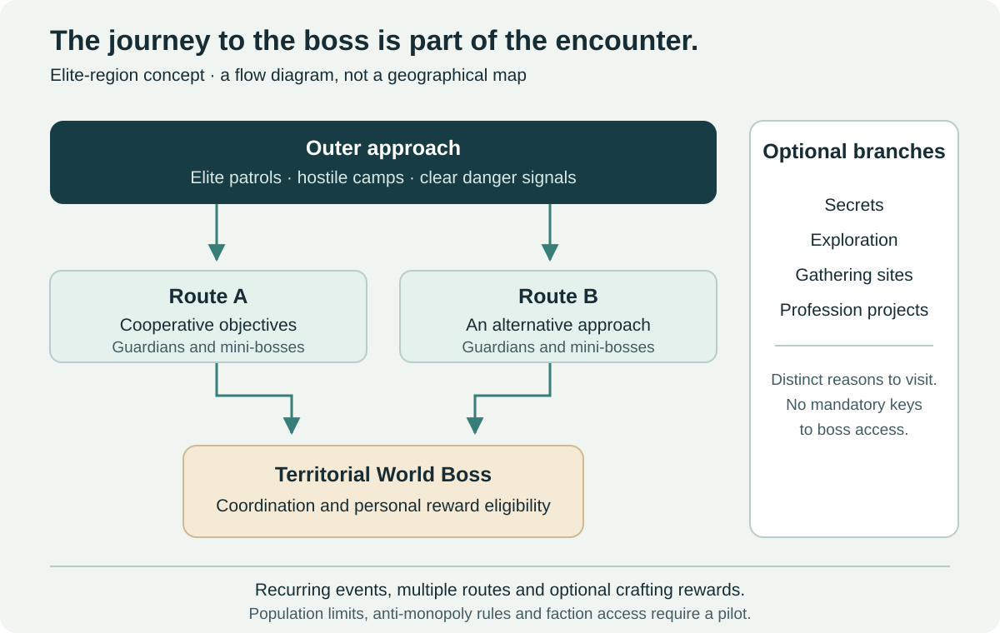

# Open world, territorial PvP and professions

[← Main proposal](../README.md) · [Documentation index](README.md) · [Progression contract](01-progression-and-raids.md)

## Make the world an endgame destination

A permanent level-60 world needs reasons to explore beyond traveling to instance portals. Elite regions, territorial encounters, faction objectives, professions and story activities can create those reasons without adding another mandatory power ladder.

The guiding constraint is reward independence. A player may specialize in world content, and a raider may visit it for enjoyment or collections. Neither should need the other's exclusive rewards to participate in their preferred activity.

## Elite regions as cooperative adventures

An elite region is a proposed level-60 area in which the approach to a territorial World Boss forms part of the encounter experience. It is an addition to the world, rather than a replacement for ordinary leveling zones.

| Region layer | Play experience | Design constraint |
| --- | --- | --- |
| Outer approach | Elite patrols, hostile camps and clear warnings | Players understand the danger before committing |
| Intermediate routes | Cooperative objectives, guardians and mini-bosses | Several viable approaches; no exclusive guild ownership |
| Central encounter | A territorial World Boss requiring coordinated mechanics | Numbers alone should not bypass all encounter requirements |
| Optional branches | Secrets, gathering sites, profession projects and exploration | Optional rewards do not become keys to the central route |

An event might open several paths after groups defeat guardians or complete simultaneous objectives. The boss encounter can require distributed tasks, protection of allies or environmental interactions so every participant is not simply attacking one target.

These are encounter patterns to test, not proof that open-world zerging can be solved. Health scaling by itself does not create coordination, and unrestricted player counts can exceed both encounter readability and server capacity.

## Access, monopolization and technical limits

Use recurring, visible activity windows and reasonable event durations rather than a single rare spawn owned by the first guild to camp it. Provide personal reward eligibility based on meaningful participation, including healing, mitigation, control and objective contribution.

Participation must be more than a last-second tag, but a damage-only threshold would unfairly exclude support roles. Evaluate contributions over the event and publish understandable eligibility rules. Handle reconnects and group reorganizations without allowing duplicate claims.

Multiple staging routes and repeated events may reduce choke-point control. If population distribution or event copies are needed, preserve party cohesion and prevent repeated reward collection by hopping between copies. Reward eligibility must follow the encounter identity and the player, rather than the current group leader.

Design around a tested participant envelope. If the population is too high, add more event opportunities or reduce the event's scope. Instancing could improve reliability but would change the social premise; that trade-off belongs in pilot evaluation.

On PvP rulesets, territorial conflict may be part of reaching the boss. That must still not turn a faction-dominated spawn into the only source of raid-critical equipment. Separate the cooperative event's reward contract from territorial PvP bonuses and test faction-access disparities.

## World Boss artifacts and crafting

Artifacts can support distinctive crafted sidegrades: an alternative proc, specialized defensive effect, visual treatment or utility option. Combat effects must consume an established item/effect budget, with explicit incompatibilities and content rules.

For example, a crafted modification could exchange a general offensive effect for an approved bonus against one enemy family. This is a hypothetical trade-off, not a tuned item. If it becomes decisively optimal for a raid, it needs adjustment or a comparable non-boss acquisition path.

| Reward | Suitable design | Failure to avoid |
| --- | --- | --- |
| Artifact material | Optional route to a budgeted sidegrade, also attainable through a reasonable PvE alternative | World Boss ownership determines raid access |
| Recipe | Distinctive appearance or equivalent functional option | An exclusive recipe grants unmatched permanent damage |
| Modification | Replaces another effect in the same budget family | Extra sockets or effects stack outside all existing caps |
| Cosmetic | Prestige, visual identity and long-term collection | Cosmetic ownership secretly enables combat benefits |

An alternative path must be reasonable in time, cost and availability. Merely placing an expensive equivalent on an auction house does not establish accessibility. Record acquisition time and compare real player behavior.

## Regional faction objectives

Bring faction conflict back into the geography through recurring regional objectives. The following examples are illustrative design prompts:

| Region | Possible objective | Possible regional reward |
| --- | --- | --- |
| The Barrens | Capture and defend three outposts | Temporary faction services and local reputation opportunities |
| Ashenvale | Contest military positions | Tactical support within the active PvP event |
| Hillsbrad | Escort or intercept supply convoys | Local logistics and cosmetic progress |
| Stranglethorn Vale | Contest resource sites | Additional regional gathering opportunities with PvE alternatives |

Control might last around 30–60 minutes. That is an initial hypothesis, not a fixed specification. Time-limited control prevents one victory from establishing permanent ownership, but recurring schedule coverage and faction participation still matter.

Rewards must not grant raid or Challenge Mode combat advantages. Gathering benefits must not make rare PvE materials effectively faction-exclusive. Regional reputation and currency should serve this activity's rewards rather than purchasing a universal power upgrade.

## Consent, leveling and faction imbalance

Follow the selected ruleset's PvP expectations. Where PvP is discretionary, entering a high-level event must clearly explain and obtain the required participation state. Do not silently flag an unsuspecting player through an unrelated quest or reward click. Precise entry and exit rules need implementation review.

Place objectives away from essential leveling routes and low-level quest NPCs. Avoid incentives for farming low-level kills, and provide viable traversal around event hotspots. This cannot remove all incidental conflict on PvP rulesets, but it can avoid making new-player disruption the objective.

Potential imbalance controls include recurring control resets, independent sub-objectives, rewards for meaningful participation, temporary NPC assistance and incentives for the underrepresented faction. Avoid paying rewards for simply being outnumbered or letting players manipulate population counts through alts.

Measure actual faction participation and control duration, including low-population hours. No single comeback mechanic can guarantee balanced conflict in every region.

## Other permanent level-60 activities

**Small-group adventures:** short two- or three-player scenarios, such as investigations, defense missions, exploration and smaller boss encounters. A 15–25-minute duration is a possible target to test, rather than a commitment for every scenario. Rewards emphasize stories, collections and accessible alternatives.

**Professions:** recipe specializations, cosmetic projects, utility items and budgeted equipment choices can keep crafting relevant without issuing a stronger permanent tier every update. Economic demand should come from useful variety and optional projects. Evaluate material supply, speculation and profession dependency before introducing rare bottlenecks.

**Exploration and class identity:** hidden locations, puzzles, reputations, class-specific quests and permanent story chains can expand the world. Avoid turning all of them into combat-stat unlocks that players must complete before raiding.

**Legacy integration:** official sources describe an account-wide Legacy System. New challenges, collections or milestones could be integrated, but this repository does not assume access to its internal rules or propose stacking unbounded perks. Any combat effect must fit the baseline and competitive normalization policies. See [factual boundaries](references.md).

## Reward cadence without a checklist

Permanent availability, visible long-term goals and optional repeatable projects support player choice. Daily or weekly limits may sometimes help event reward integrity, but must not funnel every player through every activity for combat power.

Evaluate obligations as players experience them. An activity can be technically optional and still feel compulsory if it is the only efficient source of a powerful sidegrade. Surveys, acquisition data and preparation-path analysis should accompany participation counts.
