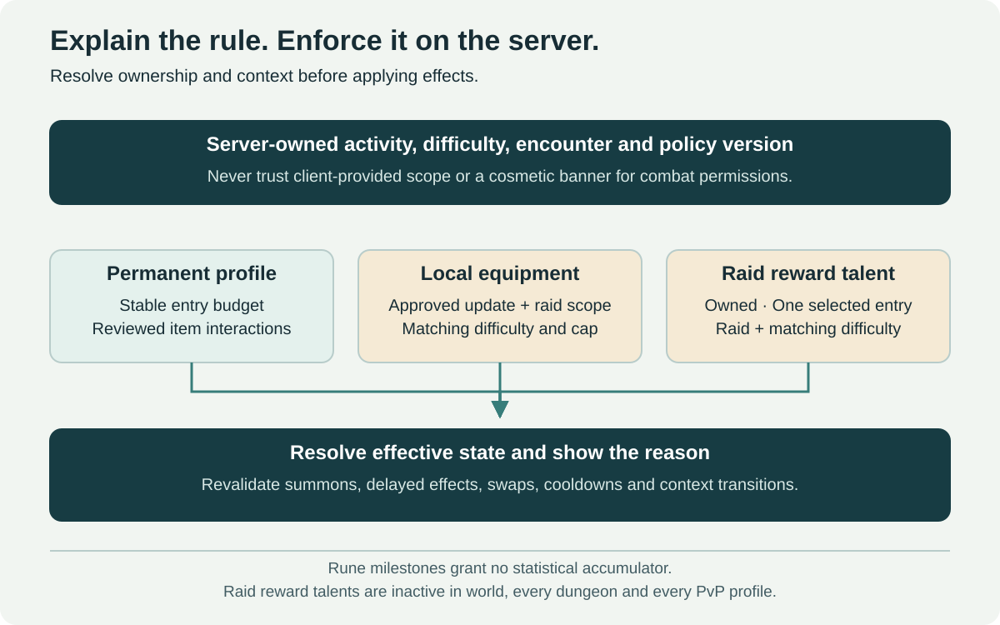

# A conceptual framework for scoped power

[← Main proposal](../README.md) · [Documentation index](README.md) · [Evaluation plan](05-roadmap-and-evaluation.md)

> This is a behavior specification and an illustrative data model. It is not production code, an API contract, a database migration, or a description of Blizzard's internal systems. Exact budgets, performance costs and engine integration need investigation.



## Invariants

1. Releasing new content does not automatically raise the approved permanent equipment-power range.
2. An additional contextual equipment effect is eligible only for its approved content group, instance and difficulty.
3. Normal and Veteran do not exchange contextual equipment power or its currency; permanent repertoire abilities are a separate channel with one unlock source per difficulty.
4. An update's equipment preparation cannot require a sequential previous-tier climb and must offer self-contained contextual routes within each sibling raid.
5. Challenge Modes use an explicit versioned profile, including Rune/repertoire eligibility, with contextual raid-equipment and territorial effects inactive.
6. Participation and effect eligibility are authoritative server decisions.
7. Transitioning contexts cannot preserve otherwise ineligible effects or produce duplicate progression/reward claims.
8. Adventurer, Explorer and civic recognition grant no combat stats, economic throughput, equipment budget or activity-access advantage.
9. A procedural expedition commits its seed, finite depth and generator version; floor scaling cannot shrink during an active encounter.
10. Settlement transitions, reconstruction deliveries and prestige claims are durable, authoritative and deduplicated.
11. Rune statistics stay inside a fixed lifetime allowance; new updates do not increase or bypass it, and the Rune record is not a rank.
12. Exactly one eligible repertoire option is equipped; archived effects, cooldowns or summons cannot preserve several options through a swap.

Invariants 1 and 4 include balance and acquisition claims. A validator can enforce identifiers and caps, but cannot prove that an item interaction or a social gearing expectation is acceptable. Those require analysis and playtesting.

## Suggested separation of concerns

| Component | Responsibility |
| --- | --- |
| Permanent item profile | Defines approved base stats, weapon/armor properties and permanent effects |
| Contextual effect definition | Declares scope, difficulty, effect family, budget cost and interaction rules |
| Progression ownership | Records which character earned a local unlock and under what transfer policy |
| Activity policy | Resolves current content group, allowed instances, difficulty and normalization |
| Effect resolver | Produces the server-authoritative effective loadout and derived combat state |
| Reward service | Grants local progression and collections once per valid claim |
| Run validator | Establishes roster, timer, objectives, ruleset and leaderboard eligibility |
| Settlement event coordinator | Owns invasion state, reconstruction stages, NPC-role restoration and canonical event identity |
| Expedition generator | Creates and validates seeded layouts, encounter selections, finite depth and floor scaling profiles |
| Prestige ledger | Separates activity tracks, validates role-aware credit and applies duplicate/repeat policies without power rewards |
| Rune ledger | Grants validated finite stat progress inside fixed per-profile/aggregate limits and preserves activity history |
| Repertoire ownership/resolver | Records permanent raid ability unlocks, validates one selected entry and enforces swap/competitive policies |
| Warfare relation and service ledger | Separates city enrollment, service reputation, objective ownership, Warfare eligibility and ordinary PvP state |

These are logical responsibilities. They need not become separate services, tables or new network boundaries.

## Illustrative fields

```yaml
# Fictional identifiers and descriptive budget references; not a proposed engine schema.
item_id: ancient_guardians_breastplate
required_level: 60
permanent_profile_id: plate_tank_sidegrade_01
base_power_budget: level_60_permanent_v1
contextual_effects:
  - context_bonus_id: guardian_resonance
    content_group_id: update_a_raids
    allowed_instance_ids:
      - fallen_observatory
      - vault_of_cinders
    difficulty_id: normal
    effect_family: raid_defensive_choice
    context_budget_id: update_a_normal_v1
    stacking_rule: exclusive_with_same_family
ownership_policy: character_local_progression
```

The `base_power_budget` reference is not a single scalar guaranteed to predict combat performance. Its definition needs role-specific constraints, effect catalogs and empirical validation. The same applies to contextual budgets.

Activity state separately declares the current instance, difficulty, content group, policy version and optional `normalization_profile`. Do not trust a scope identifier supplied by a client or inferred from an item tooltip.

## Effect eligibility and effective power

For a contextual effect, the conceptual predicate is:

```text
eligible = owned_by_character
       AND current_content_group == effect.content_group
       AND current_instance IN effect.allowed_instances
       AND current_difficulty == effect.difficulty
       AND activity_policy.permits_contextual_effects
       AND effect_is_approved_for_current_policy_version
```

Eligibility does not mean every matching effect stacks. The resolver must then enforce family exclusions, ownership, per-slot rules and the context budget. Conflicts need deterministic resolution and a clear player-facing explanation.

The resulting combat state is a policy composition:

```text
effective loadout = resolve(
    approved permanent profile OR activity-normalized replacement,
    permitted contextual choices,
    approved temporary effects,
    role/class and interaction constraints
)
```

This is not a damage formula. Multiplicative synergies, uptime, encounter mechanics and stat breakpoints can defeat a naïve sum-of-stats approach. Test build outcomes, not merely data validity.

## A complete power catalog

| Source | Required review |
| --- | --- |
| Weapons and armor | Damage ranges, speed, armor, primary/secondary stats and unusual scaling |
| Trinkets and item effects | On-use effects, procs, cooldown interactions, proc chains and internal cooldowns |
| Set bonuses and enhancements | Conditional activation, sockets, enchants, crafted modifications and stacking families |
| Consumables and temporary buffs | Potions, food, profession effects, regional buffs and expiration behavior |
| Character/account unlocks | Talents and relevant permanent benefits, including any applicable Legacy effects |
| Pets and summons | Inherited stats, snapshot timing, persistent auras and transferred ownership/context |
| Encounter-created effects | Vehicles, special resources, triggered abilities and encounter-specific objects |

New items or effects must have a reviewed policy. For ranked activities, an unknown effect must not silently remain enabled. Provide an approved substitute or prevent a ranked start until the loadout is valid; explain the remedy.

## Context transitions and snapshots

Recompute effective state when a player enters or exits an activity, changes difficulty, equips an item, changes a relevant build, logs in or reconnects, transfers to another event context, or gains/loses an eligible effect. Cache resolved policy where safe, with invalidation tied to authoritative state changes.

Transition handling needs one consistent lifecycle:

1. Resolve the destination activity and policy version from server-owned state.
2. Rebuild the effective loadout, removing incompatible auras and recalculating dependent stats.
3. Revalidate pets, summons, resource maxima and derived effects.
4. Apply the activity's explicit starting-resource or transition policy without granting a heal, cooldown reset or resource duplication exploit.
5. Update the client explanation and persist only the intended progression/ownership state.

Do not mutate the permanent item to represent temporary scaling. Preserve its identity and restore effective behavior outside normalization. Handle rollback and reconnect so a partially completed transition cannot leave mixed policies active.

Snapshotting is especially dangerous. A pet summoned in Update A Normal cannot carry its empowered stats into Veteran, and an aura triggered before leaving a raid cannot keep its effect in the world. Review persistent ground effects, delayed damage, summons, absorbs and cooldown interactions, rather than only clearing the player's visible buff list.

## Challenge run lifecycle

```text
PREPARING -> READY -> RUNNING -> COMPLETED -> VALIDATED
                            -> INVALIDATED
                            -> ABANDONED
```

At ranked start, atomically bind the run ID, dungeon, server roster, normalization profile, encounter/objective version, relevant balance version and starting-state policy. Record authoritative timestamps and progression through required objectives.

A participant replacement marks the active ranked run ineligible; the party can reform and create a new run without a consumed resource. A reconnect by the same character preserves the run and its timer. Reset requests must be idempotent and rebuild encounters, cooldowns, buffs and eligible resources according to the published policy.

At completion, validate objectives, roster history, encounter integrity and ruleset before granting medals or ranking. A duplicate completion request cannot grant another reward. Keep enough evidence to inspect suspicious records, with a retention policy and no unnecessary public account data.

If balance changes materially alter achievable times, archive the old ranking version. A version label alone does not establish fairness: content designers still need to decide whether a fix creates a new competition context.

## Ownership, collections and reward integrity

Collection unlocks and local combat progression have different transfer policies. Account-wide appearances need not imply account-wide power. Trading, mail, auctions, shared storage, duplicate items and item recovery must not bypass contextual ownership.

For an update shared by multiple raids, record progression against the intended update/difficulty budget. Reward duplication across sibling instances, alts or event copies must not increase that cap. Acquisition cadence and loot locking remain design decisions; any chosen implementation must preserve independent Normal/Veteran progression.

An archive or preset system stores references to owned effects. It should not create extra tradable items, duplicate unique effects or activate archived bonuses outside their scope.

## Settlement state and reconstruction

Bind a settlement cycle to a canonical event ID within an explicit world/ruleset scope. State transitions follow the [invasion lifecycle](06-invasions-and-reconstruction.md); related world copies consume a versioned authoritative snapshot rather than independently creating reward-bearing destructions.

Validate a resource delivery as one transaction: check project state and accepted quantity, consume only that quantity, advance project progress and record the contribution ID. Retried requests cannot consume resources twice or grant duplicate progress. Completed projects reject or return overflow under a published policy.

NPC restoration activates a configured service role once for the appropriate project version. Persist this alongside settlement state so reconnects and server restarts do not duplicate questgivers or remove already restored services. A scheduled fallback recovers essential services when player contributions stall. Quest continuity and refugee-camp service routing need acceptance coverage, not only visual state checks.

The personal civic-reward ledger covers both defense and recovery within one event. Reward-rate tuning must test deliberate-failure incentives; a shared event cap alone does not prove successful defense is more attractive.

## Procedural generation and floor snapshots

Persist an expedition's ID, admitted roster, seed, generator/module/encounter versions, planned floor count, current floor, objectives, checkpoint and claim state. A seed alone is not reproducible if the generator or module library changes; pin versions or persist the generated graph and placements as needed.

Generation validates connectivity, navigation, exits, objective placement, boss arena constraints, pacing and encounter compatibility before admission. Use a bounded retry process and a prevalidated fallback. Geometry, spawn selection and reward configuration are server-owned and cannot be rerolled by reconnecting.

At each new floor checkpoint, validate a 5–20-player roster and commit a scaling profile. Do not reduce active encounter difficulty when players die or leave. Replacements are admitted only at permitted safe checkpoints, without replaying already claimed floors or generating a new seed. Preserve return access for admitted players after the world discovery portal expires, within the published instance lifetime.

Record rewards by expedition, character and floor/objective. Entitlements follow actual participation, and duplicate completion messages cannot recreate gold or materials. Log expected and actual gold/material generation separately from prestige. Higher floor depth is a finite encounter setting, not a new item-power budget.

## Prestige provenance and eligibility

Classify a source event into the intended track: instanced PvE to Adventurer, authored world objectives to Explorer, and PvP under the separate Honor policy. NPC invasion defense is Explorer civic recognition. The same raw kill must not automatically feed every ledger.

For Adventurer credit, record native creature level and one exclusive category multiplier, then apply eligibility and repeat policies. Deduplicate against an encounter/spawn occurrence, not merely a creature template shared by legitimate encounters. Respawn/reset provenance still needs separate anti-farming rules: a new spawn ID must not automatically earn unrestricted points.

Role-aware eligibility uses a participation window and approved evidence, including healing, mitigation, control and objective assignments. Do not turn raw damage, overhealing or a final blow into the ranking formula. Death and reconnect cases need grace rules that recognize legitimate effort without paying AFK passengers.

Explorer claims use discovery, quest, event or project objective IDs. Repeated dialogue requests, location-boundary crossings and already completed construction do not create fresh milestones. Store character-level cumulative progress separately from deduplicated account cosmetic entitlements. Any account summary is presentation, not automatic point pooling.

## Fixed Rune allowances and permanent ability state

Rune objectives grant against a fixed lifetime budget with explicit rounding and derived-stat behavior. Per-objective progress cannot create a new uncapped stat pool. Changing content versions, completing a new update or repeating an entitlement does not increase the allowance.

Repertoire entries store source raid, difficulty, class/build compatibility, ownership, selected state and persistent cooldown/effect identity. A Normal completion grants only the Normal entry; Veteran grants only its own. Validate eligibility once and make retries idempotent. The global use policy does not re-enable scoped equipment bonuses.

Out-of-combat selection still checks encounter state, outstanding effects, summons, delayed damage and resource changes. Keep or resolve relevant cooldowns across deselection. Ranked Challenge/Arena profiles explicitly approve their Rune/repertoire treatment; ordinary ownership alone is insufficient to bypass that profile.

## City Warfare and ordinary combat permissions

Model city standard, major faction, Warfare flag, ordinary PvP state, area policy and capture occurrence separately. City service is race-independent within the eligible major faction. Only one active standard can participate in a claim.

An ordinary legal opposing-faction attack is not suppressed because someone has a Warfare pledge. Conversely, a Normal-ruleset Warfare flag must not silently become universal ordinary-PvP consent. Any city-versus-city relation among allied factions is restricted to the Warfare area with both flags active, if the city-rivalry variant is selected.

The preferred prototype combines ordinary faction combat and the local opt-in city relation. Final support inheritance, capture ownership resolution and the city-switch penalty amount remain open. Base cosmetic ownership persists; city variants require eligible current service. Objective guards and boss state are dedicated event data; ordinary quest/service NPCs cannot be used as conquest triggers.

## Playable identities, construct tanks and support

Record race origin and chosen major faction separately. Every proposed new race permits either major faction after its introduction; city-standard eligibility then follows the chosen faction. Race appearance must not decide targeting permissions. Armor adaptations change presentation, not item identity, slot count or effective power.

An Artificer deployment needs an owner, construct identifier, anchor, function/loadout, independent health and threat relation. Only the owner's repair actions restore construct HP; ordinary direct/group healing targets the player instead. Ordinary dummies stay stationary until a valid command moves them. The extra autonomous capstone has a separate duration/cooldown state and reviewed power allowance. Threat-transfer and external-prevention policies still need engine validation; no production architecture is claimed. See the [tank dossier](identity/classes/artificer.md).

The Summoner reserve has gathered, committed and consumed states, owned by one player. Its small beings have no targetable health state. Counterplay follows caster/effect rules; decorative followers cannot multiply procs, reward shares or raid bonuses. Scope and normalization apply through the owner. See [Summoner](identity/classes/summoner.md).

Support contributions require validated control, prevention, dispel or objective events rather than damage-only eligibility. A support occupies one of a five-player group's flexible slots; both selected group patterns face the same ordinary encounter. Competitive composition/profile rules remain open. These are behavior contracts for prototypes, not new live systems.

## Acceptance matrix

These are proposed implementation acceptance cases, not tests executed against an existing game.

| Case | Expected behavior |
| --- | --- |
| Update A Normal item used in a sibling Update A Normal raid | Approved permanent profile plus eligible capped contextual effect |
| The same item enters Update A Veteran | Permanent profile remains; Normal contextual effect is absent |
| The same item enters Update B | Permanent profile remains; Update A contextual effect is absent |
| The item is worn in the world or a Heroic dungeon | Permanent profile remains; raid progression effect is absent |
| A ranked Challenge Mode starts | Approved Challenge profile; raid and territorial effects absent |
| An old low-item-level trinket has an unapproved proc | It cannot bypass normalization; substitute or ranked-start rejection |
| An empowered pet or delayed effect crosses contexts | Incompatible inherited/snapshotted power cannot persist |
| A character changes gear or difficulty near an encounter transition | One authoritative policy applies; no mixed-state stacking |
| A player reconnects during a ranked run | Same run and character identity; timer continues; no reset advantage |
| A replacement player joins a ranked run | Current ranking attempt invalidated; immediate fresh attempt available |
| Reset/completion requests are repeated | Idempotent state change and a single legitimate reward claim |
| An alt or duplicate item attempts to funnel local power | Ownership and cap rules prevent unauthorized transfer |
| A World Boss reward is acquired in multiple event copies | Event/reward identity prevents duplicate claims |
| A player skips Updates A and B and prepares for C | Accessible baseline route exists with no required earlier raid item |
| A Veteran-only guild prepares for progression | No Normal contextual equipment/currency is required; a desired Normal repertoire ability still needs its own completion |
| One sibling raid is skipped | The other retains a self-contained progression path |
| A contextual effect is inactive in the UI | The destination and reason are understandable without internal IDs |
| A settlement defense succeeds | Village stays intact; valid contributions receive the intended event recognition |
| A settlement is lost while a leveling quest is active | Local NPCs withdraw; quest continuity and essential services remain available through the fallback |
| Few players rebuild the settlement | Durable recovery stages persist; NPC assistance restores essential functions by the configured deadline |
| A reconstruction hand-in is retried or exceeds remaining need | One accepted quantity is consumed and credited; duplicate or overflow behavior is predictable |
| A settlement is destroyed/restored across related world copies | One authoritative state scope and event identity prevent reward and NPC duplication |
| Someone defends and later rebuilds the same event | Legitimate work is recognized within one bounded event allowance; no two full event payouts |
| An expedition seed produces an inaccessible objective | Validation rejects/repairs it before admission or uses a prevalidated fallback |
| A procedural run is rejoined after a generator update | Its committed seed/graph, depth and versioned encounter state remain reproducible |
| Players leave, die or reconnect during an expedition boss | The committed floor/encounter profile does not downscale or reset |
| A floor's reward is claimed again or by a late replacement | Only actual participation entitlements are granted, once |
| An admitted group's discovery portal expires | Existing members retain the configured return path and expiry notice |
| A tank or healer contributes to an eligible level-60 elite kill | Receives the same 120 prototype base points as another eligible participant before repeat policy |
| A boss is also flagged elite | Uses the boss multiplier only, without stacking categories |
| Infinite adds, trivial targets or reset-farmed spawns are killed | Eligibility/repeat rules prevent an unrestricted prestige faucet |
| An NPC is greeted repeatedly or a zone boundary is crossed in a loop | No fresh Explorer objective claim is created |
| A high prestige tier is reached | Grants approved recognition only; no stats, increased loot/material yield or activity-access gate |
| A new race or class prototype is added | Fits permanent budgets and activity policies; no mandatory racial utility or new required party slot |
| A candidate class has three talent trees | Evaluate actual point allocation, prerequisites and hybrid builds; do not assume three mutually exclusive full kits |
| Moon Predator fights at different world times | Uses the same internal combat-cycle rules; personal combat toggles cannot reset an active encounter's phase |
| A primed companion action has several hit components | Consumes one enhancement entitlement and applies the reviewed total effect once |
| A cold damage state is applied to a slow-immune boss | Damage eligibility and control immunity resolve separately under the tree policy |
| An anchored remote caster must move | Owner stays vulnerable; movement cancels/reconfigures the channel with the published cost and recovery |
| A rare intervention is spent during an encounter | Personal combat loss does not restore its finite allowance |
| A new race finishes its introduction | Can choose Alliance or Horde; its ancestry does not force membership |
| A neutral-origin race chooses a Warfare city | Only standards eligible for its chosen major faction are offered |
| An unusual anatomy equips leg/foot armor | Keeps ordinary slot effects and a recognizable approved visual adaptation |
| A support replaces one DPS in a five-player group | Both the traditional and support compositions can complete the intended ordinary encounter |
| A tank dummy's enemy moves out of reach | Ordinary dummy does not chase; a valid player action repositions or redirects it |
| A healer attempts to heal a tank dummy | No construct HP is restored; feedback explains the owner's repair-only rule |
| One dummy is damaged or repaired | Other dummies and the owner retain their separate health; only valid Artificer repairs restore that dummy |
| An Artificer capstone expires | Extra autonomous unit ends predictably, preserving cooldown state and an explicit threat transition |
| A Summoner follower is inside enemy AoE | No hidden HP/death is simulated; its selected no-HP policy remains true |
| A Summoner consumes a committed group | The same unit cannot retain its full future payload and also grant a free full burst/refund |
| A new update adds Rune objectives | Existing lifetime limits remain unchanged; objectives can offer equivalent acquisition paths |
| A character reaches the Rune ceiling | Further activity cannot grant hidden stat overflow or a new Rune rank |
| A character clears Veteran | Receives the eligible Veteran repertoire option, without automatically learning Normal |
| An old raid ability is learned | Can be selected for ordinary external play, while only one repertoire entry is equipped |
| A repertoire option is replaced outside personal combat during an active boss | Encounter-state restrictions still prevent a mid-encounter swap exploit |
| A discarded ability leaves a summon, buff or cooldown | The approved swap policy prevents stacked active benefits and cooldown resets |
| A repertoire option enters ranked competition | The published mode profile decides eligibility; global ownership cannot silently bypass normalization |
| A Warfare player meets a legal ordinary PvP opponent | The Warfare state grants no ordinary-PvP immunity |
| An allied character has no active city flag | City rivalry alone does not make them a target |
| Two allied-major-faction rivals leave the Warfare area | Their city flags create no allied-faction hostility outside it |
| A character toggles city combat off through the NPC | This is distinct from changing service; active combat/claim commitments cannot vanish instantly |
| A character changes city service | Apply the selected departure loss, preserve base objects and reevaluate live city treatments |
| A neutral supporter attempts to affect a city fight while immune | Require the appropriate participation or disallow the protected interaction under the published policy |

## Operational questions

Before implementation, investigate validation cost under large events, cache correctness, save compatibility, error recovery and policy rollout. Add structured diagnostics for rejected effects, unexpected power deltas and invalid runs. Do not assume the current engine already supports this architecture or that an effect catalog is cheap to maintain.

Major balance corrections should preserve earned collections and use a communicated migration policy for changed contextual effects. A stable long-term budget can still need correction when a combination exceeds its intent; publish why it changes and how affected players can choose an equivalent option.

The largest unresolved risk is effective-power balancing across classes and encounter types. Numeric ceilings and identifiers provide boundaries, while gameplay evidence determines whether those boundaries deliver the promised experience.
