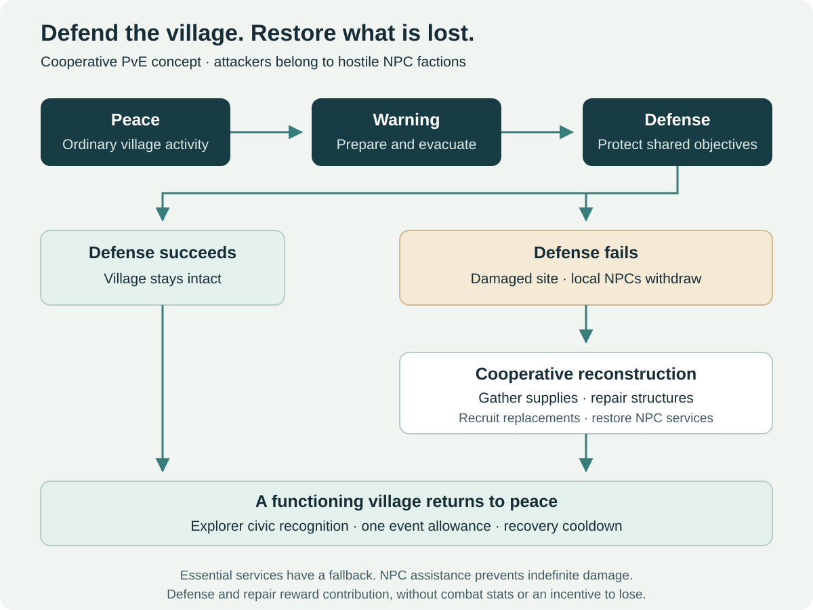

# NPC Invasions and Reconstruction

[← Main proposal](../README.md) · [Documentation index](README.md) · [Explorer prestige](08-prestige-ranks.md) · [Technical rules](04-technical-framework.md)

## A world that players help maintain

Hostile **NPC factions**, rather than the Horde or Alliance, periodically attack settlements. Players can defend a village, prevent destruction and earn civic recognition. If the defenders lose, local NPCs withdraw or disappear from the damaged site, and players cooperate to rebuild structures and restore its population and services.

Crossroads is an illustrative location, not a requirement that a critical leveling hub become unavailable in the first pilot. Begin with one purpose-built or peripheral settlement where consequences can be tested safely, then evaluate familiar towns.

The appeal is a visible shared consequence: players preserve a place they know, or help recover it. The main risk is making everyone else pay for an event they did not choose to play. Recovery therefore has meaningful stages alongside service continuity and an eventual fallback.

## Event lifecycle

| State | Player activity | Settlement behavior |
| --- | --- | --- |
| Peace | Ordinary quests, services and travel | Normal village activity; event on cooldown |
| Warning | Respond to scouts, prepare defenses and escort civilians | Clear regional notice and visible preparation; no surprise service removal |
| Defense | Hold objectives, stop attackers, protect structures and support allies | NPC attackers use defined routes and encounter objectives |
| Defense succeeds | Defeat or repel the invasion commander | Village remains intact; defenders earn recognition; cooldown begins |
| Defense fails | Evacuate survivors and secure the outskirts | The site becomes damaged; affected local NPCs withdraw or are absent |
| Reconstruction | Collect event resources, deliver supplies, repair buildings and complete recruitment tasks | Visible communal projects restore the village in stages |
| Restored | Welcome replacement NPCs and reopen local services | Recovery contributors earn recognition; cooldown begins |

NPC “summoning” or creation represents recruiting, rescuing, escorting or calling approved replacement NPCs into restored buildings. Players do not own the questgivers or gain a tool to delete, duplicate or relocate public NPCs at will.

## Defense as a cooperative activity

An invasion should have readable objectives: hold a gate, protect a healer, interrupt a siege ritual, move supplies or defeat a commander. Credit damage, tanking, healing, control and objective work. A character should not need the final blow or a specific group leader to receive participation credit.

Scale within a tested population range. Add simultaneous objectives and bounded reinforcement waves where useful; simply adding enemy health does not make an encounter interesting. Repeated failures should not spawn progressively stronger enemies indefinitely.

Provide a preparation window and clearly communicate expected level and danger. High-level encounters should not target low-level travelers or obstruct essential routes. Lower-level participation could use safe supply tasks in a later design, but the first combat pilot targets prepared level-60 characters.

This is PvE. Joining a defense does not silently opt a player into territorial PvP. On PvP rulesets, existing conflict expectations still apply; opposing players must not be able to force a server-owned destruction outcome through an unrelated interaction or unauthorized NPC kill.

## Reconstruction and service continuity

After defeat, the damaged village should look and behave differently: broken structures, evacuated residents and communal work orders. Players gather timber, stone, provisions or other event-defined resources in the region, deliver them, repair facilities and restore approved NPC services.

Use several contribution types so gathering professions, combat groups and casual helpers can participate. Prefer event resources or readily available supplies over rare raid materials. Bound each project's requirements and show public progress. A contribution is a validated delivery or task, not repeated clicking on an NPC.

Essential services and quest continuity require explicit fallbacks. Displaced questgivers, transport access and necessary vendors can operate from a nearby refugee camp while the original site is damaged. Preserve quest acceptance and turn-in state; “NPCs disappear from the village” must not strand a leveling character or erase a story chain.

Restoration can proceed in functional stages, such as securing the site, rebuilding shelters, repairing the workshop and reopening the inn. Exact order and resource quantities remain tuning decisions. Recruitment tasks restore named service roles under server control; they do not repeatedly generate rewards for the same restored NPC.

If few players participate, NPC assistance and a finite recovery deadline restore essential functions automatically. Player effort accelerates recovery and provides recognition. The fallback prevents a low-population region from staying broken indefinitely; the deadline should be visible once tuned.

## Recognition without an incentive to lose

“Roleplay honor” is represented here as **civic commendations within the Explorer prestige track**. It is separate from PvP Honor and from Adventurer prestige for instanced PvE. Rewards can include titles, settlement-themed appearances, banners, camp decorations and visible restoration achievements, with no combat-stat increases.

Defense and rebuilding are both worthy contributions, but failure must not become the efficient farming strategy. In comparable participation windows, successful defense should be at least as attractive as deliberately allowing defeat and collecting the recovery rewards. This is a reward-rate target to test, not a guarantee provided by wording alone.

Use a single event identity, separate contribution categories and a bounded personal commendation allowance across that event's defense and recovery. A participant may help in both phases, but cannot collect two full event payouts by engineering failure. Avoid an exclusive progression reward that requires the village to be destroyed; recovery stories and visuals can differ without creating a mandatory sabotage achievement.

Reconstruction is a response to the shared outcome, not a daily tax needed to unlock raids or professions. Contributions grant no raid buff, permanent stat, extra dungeon floor or increased equipment budget.

## Persistence and exploit controls

| Risk | Proposed rule |
| --- | --- |
| Players repeatedly switch event copies for rewards | Bind rewards to the canonical settlement/event identity and the character's claim ledger |
| Copies disagree about whether the village is damaged | Define one authoritative state scope for the settlement; distribute snapshots to related copies |
| Resource deposits are replayed after a disconnect | Validate inventory consumption and project progress atomically; deduplicate the delivery ID |
| Someone deposits after a project is already complete | Consume only accepted resources; reject or return overflow predictably |
| A group intentionally loses for extra points | Shared event commendation budget and reward-rate review; no failure-exclusive power |
| NPCs are spawned twice after a server restart | Persist restoration stages and use idempotent NPC-role activation |
| A player joins near the end and tags one enemy | Reward meaningful role-aware contribution, not a single tag or raw damage quota |
| No group repairs the village | Visible NPC-assisted recovery and a bounded deadline |

World-state scope across layers needs engine investigation. The proposal does not assume one global village state shared across all regions or rulesets; it requires a defined, durable scope and consistent reward identity within it.

## Pilot evaluation

Start with one hostile NPC faction, one settlement, one invasion pattern and a few reconstruction projects. Measure participation by role, unwanted leveling disruption, service availability, time to recovery, defense-versus-failure reward efficiency and state consistency after restarts.

Expand only if players value the visible consequences without feeling forced to perform maintenance. The defense, supply, reconstruction and recruitment stages form one self-contained cooperative design.
