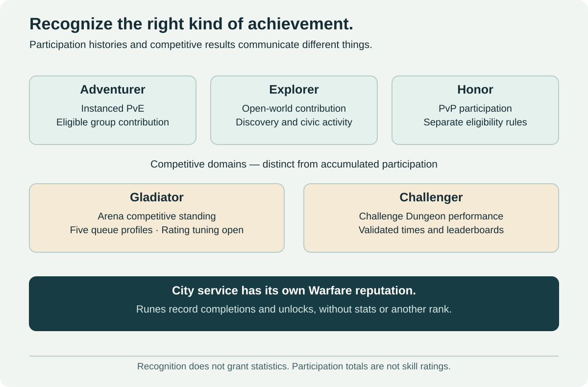

# Prestige and Competitive Recognition

[← Main proposal](../README.md) · [Documentation index](README.md) · [Settlement recognition](06-invasions-and-reconstruction.md)



## Recognition without another power system

Keep activity identities distinct: **Adventurer** for instanced PvE participation, **Explorer** for open-world contribution, **Honor** for PvP participation, **Gladiator** for arena competition and **Challenger** for Challenge Dungeon performance. Recognition grants titles, badges and cosmetics, with **no statistics, combat talent points, increased equipment budget or access advantage**.

The requested system resembles a persistent participation record. It must not be presented as a skill rating, a guarantee of player quality or a direct measure of performance. A high total can reflect time played or farming efficiency. Encounter-specific achievements and Challenge records can show different kinds of accomplishment separately.

| Track | Recognizes | Does not recognize |
| --- | --- | --- |
| Adventurer | Eligible dungeon, raid and procedural-expedition combat and completion | Open-world kill farming or PvP kills |
| Explorer | Discoveries, quests, regional stories, defense, reconstruction and meaningful world interactions | Repeated dialogue clicks or instanced kill totals |
| Honor | PvP participation under its own rules | PvE defense against hostile NPCs |
| Gladiator | Arena competitive standing under a defined rating policy | Raw accumulated PvE or Honor totals |
| Challenger | Validated Challenge Dungeon completion times and standings | An unlimited participation-point ladder |
| City service | Warfare reputation for a city's standard and its cosmetic rewards | A universal competitive skill rating |

Honor is kept conceptually distinct here; its current mechanics are not redefined or assumed to match a competitive rating. “Roleplay honor” from settlement defense becomes Explorer civic commendations, avoiding two unrelated currencies called Honor.

[Runes](systems/runes.md) are a separate fixed-ceiling numerical system with a history record, not another rank. [Adventurer Abilities](systems/adventurer-abilities.md) form a combat-choice collection; the similar name does not make them rewards from the Adventurer participation score. [City service](activities/faction-warfare.md) records a specific allegiance rather than adding another general-purpose participation ladder.

## Adventurer: a simple starting score

Retain the proposed kill-value idea as a **prototype**, with exclusive enemy categories:

```text
base kill points = native creature level × category multiplier
ordinary enemy: ×1
elite enemy:    ×2
boss:           ×5
```

A level-60 ordinary enemy is worth 60 base points, an elite 120 and a boss 300. A boss uses the boss category only; elite and boss multipliers do not stack. These are initial point weights for playtesting, not tuned reward rates or combat-power values.

Use native encounter level for the score, rather than a level modified for display or scaling. This prevents a scaling change from silently inflating prestige. Meaningful level-60 instance content is eligible; trivial enemies, endlessly resummoned adds, training targets, friendly units and scripted non-combat spawns are excluded.

## Credit the group, including support roles

An eligible participant receives the configured points for a credited kill. Points are not awarded only to the killer, divided by damage dealt or reserved for top damage rankings. Healing, mitigation, tanking, control, encounter objectives and legitimate participation through a death or disconnect must be recognized.

Eligibility is server-validated encounter participation and presence, with role-aware evidence over the encounter window. One incidental tag or remaining AFK nearby does not qualify. Do not demand a flat damage threshold from healers or turn overhealing and unnecessary damage taken into profitable contribution spam.

Full configured credit per eligible player is the starting rule, rather than splitting a fixed kill value across five or twenty people. This does not make the tracks equally fast across activities: larger raids, easier packs and shorter encounters may still generate points faster. Tune eligibility and repeat controls with that limitation visible.

Recognize meaningful support even when it is not easily captured by a single counter. Examples include a tank who controls a boss then dies near completion, a healer keeping an objective NPC alive, and a player performing an encounter assignment away from the main target.

## Anti-farming and repeat behavior

| Situation | Proposed handling |
| --- | --- |
| Final blow versus healing or tanking | Same base kill value for every eligible participant |
| Respawned pack reset repeatedly before the boss | Encounter provenance and repeat rules prevent an endless best-rate trash loop |
| A boss summons unlimited adds | Adds use explicit eligibility; no uncapped kill-score faucet |
| A previously cleared encounter is replayed legitimately | Repeat participation can earn reduced, bounded credit under a published policy |
| Same kill is reported again after reconnect | One character/encounter/creature claim, processed idempotently |
| Several characters on one account repeat a first-clear bonus | The bonus follows its published ownership scope; no account collection duplication |
| Two group members stand AFK while others clear | Neither proximity nor group membership alone proves participation |

The level-and-multiplier formula defines **base points**. Actual awarded points apply the eligibility, duplicate and repeat policies. Begin with transparent reductions for repeatedly resetting the same eligible content, plus capped completion recognition if the pilot needs it. Exact windows, floors and completion weights remain open; do not silently replace the simple prototype with an opaque “performance score.”

Unlimited attempts remain available. Reduced prestige or duplicate-reward eligibility must not consume a Challenge key or block players from practicing. Monitor whether repeat controls penalize people who enjoy one dungeon, and revise them where necessary.

## Explorer: discovery and meaningful world contribution

Use objective identities, not interaction counts. First discoveries and story milestones can provide substantial one-time recognition, while continuing world activity supplies bounded repeatable progress.

| Activity | Creditable event | Abuse to avoid |
| --- | --- | --- |
| Exploration | Discover an approved location, landmark or secret | Running back and forth across the same boundary |
| Quests and stories | Complete a quest or a defined chapter milestone | Accept/abandon loops or counting each dialogue page |
| NPC interaction | Complete an authored investigation, escort, negotiation or assistance objective | Repeatedly greeting, trading with or clicking the same NPC |
| Regional familiarity | Complete a varied regional objective set or a periodic return expedition | Passive time spent in a zone or idle travel loops |
| Settlement defense | Validated contribution to repelling an NPC invasion | Last-second tags or mixing it into PvP Honor |
| Reconstruction | Accepted resource delivery, repair or recruitment milestone | Repeated hand-ins after restoration or farming deliberate failure |
| Other world events | Complete reviewed event objectives with meaningful contribution | Credit for every enemy spawn regardless of event state |

Continuing to visit older regions can matter through fresh objectives, rotating assistance requests and exploration projects, rather than awarding points for merely entering the same zone again. This supports the requested long-term world identity without incentivizing idle movement bots.

## Rank ladder and presentation

Use the same readable tier vocabulary across Adventurer and Explorer, while storing separate totals and showing separate badges. One illustrative ladder is:

**Wood → Bronze → Silver → Gold → Platinum → Diamond → Master → Legend**

Each tier contains **IV, III, II and I** subdivisions, with I highest. Legend is a provisional participation-tier name; Challenger is reserved for the separate timed-dungeon domain. Names, tier count and thresholds can change after testing. No rank decay or compulsory seasonal reset is proposed for cumulative participation.

For the first design, progress is **per character and cumulative**, with account-wide cosmetic unlocks deduplicated separately. An optional account summary can show earned milestones without pooling points into an alt-based acceleration loop. This is a starting ownership policy, not a claim about existing Honor or Legacy implementation.

After the final tier, a lifetime total can continue to be displayed without opening further power-bearing levels. Keep cumulative participation, optional current-update milestones and actual competitive records visually distinct. New content may add objectives without erasing earned recognition.

Public badges should be optional and accompanied by an accessible explanation of what they measure. Do not build minimum-rank requirements into activity entry, automated matchmaking or advertised group filters. Social gatekeeping can still occur; monitor it instead of assuming an explanatory label prevents it.

## Rewards and progression boundaries

Suitable rewards include title variations, profile borders, cosmetic badges, banners, appearances, pets and commemorative collection milestones. None increases damage, healing, health, resistance, loot quality, gold yield, material yield, floor depth or access to a new class/race.

Arena rating rules belong to [Arenas](activities/arenas.md), timed standings to [Challenge Dungeons](activities/challenge-dungeons.md), and city-service ranks to [Faction Warfare](activities/faction-warfare.md). Their formats and reset rules must not be inferred from the Adventurer/Explorer participation ladder.

Avoid an XP buff or profession throughput perk that quietly converts rank into progression efficiency. The reward is recognition itself and optional identity, not another mandatory account grind. Any cosmetic vendor uses the earned cosmetic entitlement rather than selling combat items.

## Evaluation and unresolved choices

Test whether all roles receive comparable eligibility, whether old content becomes an optimized points farm, and whether ranks create unwanted group exclusion. Inspect time-to-tier across activities, recognition of world support tasks, repeat-rule false positives and the clarity of the display.

Thresholds, repeat windows, completion recognition, discoverable objectives and account presentation remain open. A combat contribution model cannot be declared fair from its formula alone; inspect ordinary logs, edge cases and player feedback before awarding permanent progression at scale.
