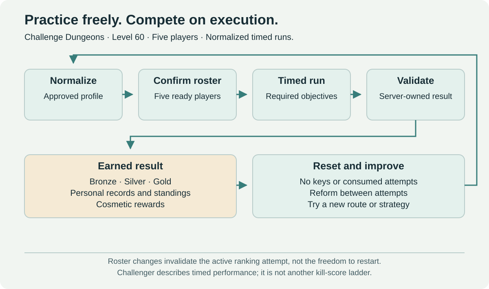

# Challenge Dungeons

[← Main proposal](../../README.md) · [Topic directory](../README.md)

Normalized timed five-player dungeons with keyless entry, free retries, medals and records. This page covers the complete Challenge rule set; untimed tactical play belongs to [Heroic Dungeons](heroic-dungeons.md).

## Challenge Mode rules

The design is a normalized dungeon run measured against clear time targets. Class, itemization and encounter changes can affect fair comparison, so the ruleset and rankings are versioned. The following rules define this proposal directly.

1. Any level-60 five-player group can enter without a key or consumed entry resource.
2. The group chooses a dungeon, reviews its objectives and normalized loadout, and confirms readiness.
3. The server validates the roster, establishes the ruleset version, initializes resources and starts the timer atomically.
4. Completion requires all specified bosses and encounter objectives, including an enemy-completion threshold only where that is suitable for the dungeon.
5. Bronze, Silver and Gold targets reward completion milestones. Personal records and per-dungeon leaderboards support further mastery.
6. Retries are unlimited. The group can reset, change its route or composition, and immediately begin another attempt.
7. Rewards provide no permanent or contextual raid-power progression.

There are no infinitely scaling levels, rotating affixes, key depletion or weekly raid-equivalent equipment rewards. Adding another difficulty treadmill would contradict the purpose of this activity.

**Challenger** identifies this activity's performance domain: validated completion times and rankings, not an extra kill-score progression. Medal thresholds and any title/standing criteria need their own published rules. It is distinct from Adventurer participation and arena Gladiator standing.

## Normalize effective power, not just item level

For the competitive pilot, provide accessible approved equipment templates with role-appropriate stat distributions and bounded effect choices. Owned items can map to those same profiles, but an old raid item must not unlock a stronger Challenge option unavailable to a new competitor.

This sacrifices some unrestricted equipment experimentation in exchange for a more credible competition environment. Preserve choices in stat profiles, talents and approved effects where balance permits. Templates do not make classes identical, and class diversity still requires monitoring.

Specify weapon damage, armor, primary/secondary stats, caps, procs, set effects, enchants, consumables, profession benefits and pets. Disable all contextual raid bonuses and external territorial buffs. Either normalize relevant permanent unlocks to the profile or make their equivalent available within the mode.

The fixed [Rune allowance](../systems/runes.md) and permanent [Adventurer Repertoire](../systems/adventurer-abilities.md) must be covered explicitly. Their ordinary-gameplay ownership does not automatically enable them outside the approved competitive profile. Repertoire integration is still under review; no new earned option may silently bypass normalization.

If a previously unknown effect appears, use an approved replacement or prevent a ranked start with a clear explanation. Do not silently leave an unreviewed item at full power.

## Party changes, disconnects and resets

Groups may remove and replace participants freely **between attempts**, without losing an entry resource. A different participant joining an active ranked run invalidates that run for rankings. The group can restart immediately or continue unranked if the implementation supports that transition.

The same character reconnecting does not count as a replacement. The timer keeps running; reconnect must restore the same run identity and validated state. Disconnect recovery must not reset cooldowns or restore resources beyond the published rules.

At restart, the server rebuilds encounter state and applies a consistent starting-resource policy. Validate health, mana or equivalent resources, cooldowns, pets, temporary summons, buffs and encounter triggers. A deterministic reset is necessary to avoid spending minutes outside the dungeon preparing each attempt.

Technical safeguards may rate-limit malicious request floods or instance-creation abuse. They should use idempotent resets and dedicated run state where possible, so ordinary repeated attempts do not hit a broad farming cap intended for another activity.

## Leaderboard integrity and longevity

Rank runs by dungeon and ruleset version. The version includes normalization, encounter scripts, relevant class balance and objective definitions. Server timestamps and completion evidence establish the result; client-reported times do not.

Routes may use legitimate class tools, but objectives should prevent skipping the substance of the dungeon. Audit outlier runs and investigate exploits before altering rankings. A death penalty, exact tie-break policy and treatment of intentional resets need published rules before competition starts.

Material balance changes create a new ranking version and archive the previous records with their context. Minor fixes should not fragment rankings unnecessarily, but any change affecting achievable times must be assessed. Keep an actively maintained route to permanent medal rewards instead of relying on limited-time removal for motivation.

Class composition and subgroup filters may help interpretation, but too many categories can fragment participation. Begin with overall rankings and visible composition; add filters only if useful and supported by sufficient participation.

## Pilot scope and open decisions

Start with a few dungeons that support readable competitive routes, distinct tactical choices and credible completion conditions. Establish fair normalization and run validation before expanding the timed catalog. Long exploratory dungeons can remain excellent [Heroics](heroic-dungeons.md) without needing a timed version.

Open questions include medal thresholds, death penalties, equipment changes during a run, talent locking, profession consumables, reward duplication and ruleset archival cadence. Favor an understandable starting policy and publish it before ranked runs begin.

Measure medal completion, composition diversity, ranked abandonment, restart friction, exploit frequency and whether players feel compelled to farm unrelated content before participating.
