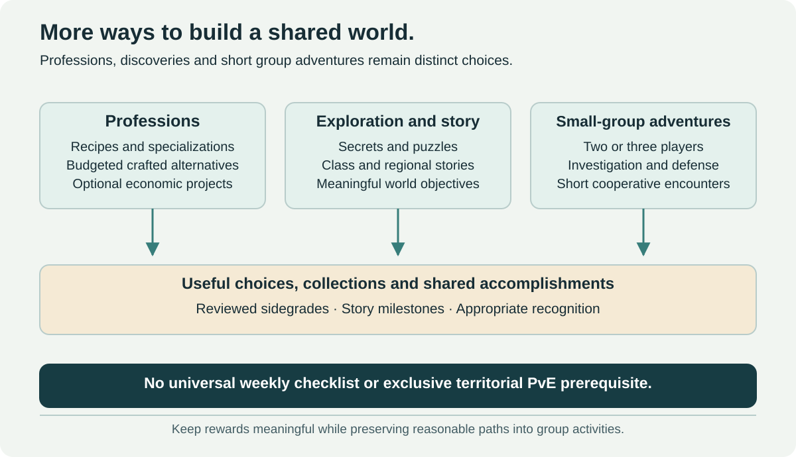

# Exploration and Small-Group Adventures

[← Main proposal](../../README.md) · [Open World](../03-world-and-professions.md) · [Explorer prestige](../08-prestige-ranks.md)

## Stories, discovery and class identity

Hidden locations, puzzles, reputations, class-specific quests and permanent story chains can expand the world without increasing the level cap. Their rewards should avoid becoming compulsory combat-stat unlocks before raiding.

Solo travel and discovery can lead into the world's social life. The main cooperative endgame remains important: investigation chains, dangerous locations and shared objectives should create opportunities to meet and rely on other players.

## Small-group adventures

Short two- or three-player scenarios can support investigations, village defense, exploration and smaller boss encounters. A 15–25-minute duration is a hypothesis to test, rather than a commitment for every adventure. Rewards emphasize stories, collections and accessible alternatives.

These adventures serve groups without a full dungeon party. They are distinct from five-player Heroics and 5–20-player procedural expeditions, with their own intended pacing and commitment.

## Explorer recognition

Award reviewed discovery and objective completions, not dialogue clicks, idle presence or repeatedly crossing a zone boundary. Continuing regional activity can use fresh assistance requests, authored investigations and meaningful projects.

[Explorer prestige](../08-prestige-ranks.md#explorer-discovery-and-meaningful-world-contribution) recognizes that history without granting statistics, economic throughput or raid entry privileges. Settlement defense and reconstruction also feed civic recognition under the event rules.

## Legacy integration

Official context describes an account-wide Legacy System. New milestones or collections could integrate with it, but this proposal does not assume its internal architecture or stack unbounded perks. Combat effects remain subject to the baseline and activity-normalization policies; see [factual boundaries](../references.md).
