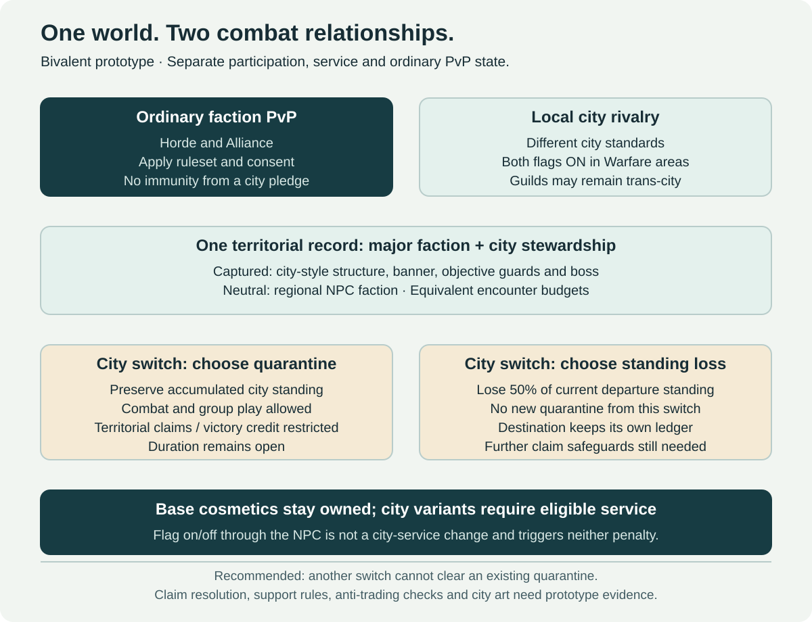

# Faction Warfare

[← Main proposal](../../README.md) · [PvP](pvp.md) · [Open-World PvP](open-world-pvp.md)

## Preferred prototype: ordinary factions with voluntary city rivalry

The recommended model is bivalent: ordinary Horde/Alliance combat remains the foundation, and an NPC-enabled city flag adds voluntary rivalry only inside Warfare areas. The system resolves each pair of characters; it does not globally switch modes when someone changes their flag. See the [full comparison and prototype](warfare-models.md).

Players pledge service to an eligible **city or community within their existing major faction**. A Horde character can choose an eligible Horde standard regardless of race, and an Alliance character can choose an eligible Alliance standard. Cross-faction enrollment is not part of this direction.

An NPC in the city manages enrollment and the active standard. Illustrative requested choices include Orgrimmar, Thunder Bluff, Undercity, Sen'jin Village and an eligible Skyborne community. The final sponsor registry, including Alliance choices, needs setting review; no unverified city name or complete roster is assumed.

City service changes whose banner a player advances in Warfare. It does not change their race, class or ordinary Horde/Alliance membership.

## Capture camps and small forts

The core activity is a group assault on a designated Warfare camp or small fort. Participants defeat its objective guards and boss, then the server resolves a valid capture. The bivalent proposal distinguishes major-faction ownership and city stewardship, rather than assigning two contradictory owners. This favors a compact regional encounter rather than requiring the report's entire province/supply infrastructure.

| Stage | Intended behavior | Open detail |
| --- | --- | --- |
| Enrollment | Select an eligible city through an NPC | Switching commitment and cooldown policy |
| Assault | Defeat the camp's designated guards and boss | Encounter tuning, population range and contested credit |
| Validation | Check the objective set, participation and eligible standard | Mixed-standard parties and simultaneous claims |
| Capture | Resolve the declared major-faction capture or city-stewardship change | Control duration, mixed participation, recurring windows and atomic claim rules |
| Recognition | Grant valid participants city-service reputation | Rates, diminishing returns and reward thresholds |

Only designated objective NPCs belong to this capture mechanism. Ordinary city guards, questgivers, vendors and essential travel services do not become destroyable capture targets. [NPC invasion recovery](../06-invasions-and-reconstruction.md) remains a separate system.

Guard and boss completion must be authoritative and tied to one capture occurrence. A final hit alone must not decide every participant's reward or allow a banner switch at the last second to steal the capture. The exact winning-claim policy remains to be specified.

## Ownership and visual transformation

After a validated conquest, the objective and its represented area display the controlling **major faction and city banner**. The camp, fort or tower changes its architectural/prop treatment to the city's style, and its designated guards and boss adopt that city's presentation. A neutral/uncontrolled objective instead uses the region's hostile NPC-faction structures and defenders.

This is one territorial record, not separate contradictory city and faction owners. Ordinary faction-only capture needs a defined sponsor/default treatment; the city claimant for mixed-standard groups remains open. Do not arbitrarily award the city through a last hit. No broader province/supply simulation is required.

City art is identity, not a stronger guard or boss tier. Keep reviewed encounter budgets consistent. Publish how role-equivalent NPC abilities remain readable across variants. Apply the ownership/banner/NPC transition at a safe, authoritative event boundary: no duplicated capture rewards or mid-fight reskin that resets an encounter. Test collision, navigation, spawn safety and return-to-neutral behavior.

## City-service reputation and rewards

Warfare uses its own city-service reputation and rank presentation, separate from ordinary reputation levels, PvP Honor, arena standing and Adventurer/Explorer participation. It records service to a selected standard rather than a universal skill rating.

| Reward | Intended expression | Boundary |
| --- | --- | --- |
| Standard or banner | A city-themed banner appearance, including an eligible off-hand treatment | Cosmetic presentation must not create additional weapon stats or misrepresent the active combat flag |
| Cloak | City insignia and visual identity | No stronger armor or hidden proc |
| Mount | A distinct themed mount or treatment for each eligible sponsor | No increased combat capability or exclusive travel advantage |
| Service recognition | City-themed titles or collection milestones | No raid buff, Rune statistical power or required PvE material |

The selected model keeps base objects permanently owned while city crests/variants require eligible current service. Changing service offers preserved standing plus territorial quarantine OR a 50% loss of the departed city's current Warfare standing without a new quarantine. Duration and further claim protections remain open. The [reward policy](warfare-rewards.md) separates ownership, live appearance, service change and flag toggling.

## Warfare flag and ordinary PvP are separate

The Warfare flag declares an active city standard and eligibility for that combat relationship. It is **not the same flag as ordinary PvP**. The city-enrollment and flag concepts apply across rulesets, while ordinary world-PvP rules remain a separate source of combat legality.

| Situation | Current interpretation |
| --- | --- |
| Two different city standards, both Warfare-flagged | Can be city rivals, including within the same major faction, only inside the Warfare area |
| Same active city standard | The Warfare channel does not make them enemies |
| A player lacks the Warfare flag | They do not become a Warfare target merely by choosing a city or approaching a camp |
| Ordinary opposing-faction PvP is already legal on the ruleset | A Warfare flag does not grant immunity or remove that ordinary combat relationship |
| A Normal-ruleset player has only a Warfare flag | Do not automatically treat them as universally ordinary-PvP-flagged; apply the explicit Warfare relation |
| A PvP-ruleset player is outside ordinary PvP protection | Opposing-faction combat remains possible under those rules, even when one participant has no Warfare pledge |

Ordinary faction hostility and voluntary city Warfare must be evaluated explicitly. No statement here promises that opting out of Warfare makes a character safe from ordinary combat on a PvP ruleset.

Same-major-faction rivalry is restricted to Warfare areas with both city flags active. One city-neutral ally is not a city target. Support/healing participation and the detailed capture state still require explicit rules; the [prototype](warfare-models.md#resolve-relations-per-pair) records the relationship matrix and edge cases.

## Changing standards and leaving combat

Only one city standard is active for a character at a time. The NPC manages city service and the separate on/off combat flag. Disabling combat participation is not changing city: the recommendation is no reputation loss merely for leaving the mode to play with friends or raid.

Changing the served city offers the two player-selected routes above. Neither changes character XP, level, Honor or guild membership. Base rewards stay owned; city treatments follow current service eligibility. Exact safe-state requirements remain open.

Flag removal, logout, city changes and crossing an area boundary must not provide an instant escape from an active fight or reset capture/reward eligibility. Timers, safe-state requirements and contest ownership need an explicit published policy.

## Population, cooperation and farming

Recognize valid tanking, healing, control and objective participation, rather than only damage or the final blow. Avoid making the most efficient strategy one character repeatedly clearing an undefended trivial target.

Recurring capture opportunities, participation-aware credit and reviewed reward rates should reduce monopolization and repeated capture trading. They do not alone solve population imbalance. Same-faction rivalries, if selected, also require rules for allied guilds trading objectives, alternate-character manipulation and access at low-population hours.

The pilot should use a small number of designated camps, known guard/boss sets and a limited city roster. Measure group formation, city choice, capture distribution, repeat-farming patterns, ordinary-PvP interference and recognition by role.

## Relationship to the earlier report

The province/supply/fortress proposal remains a separate expansion candidate. It is not a prerequisite for this capture design. The [report review](../proposals/incoming-reports-review.md) records selected directions and remaining decisions; [Warfare Models](warfare-models.md) explains the recommendation and its limits.
