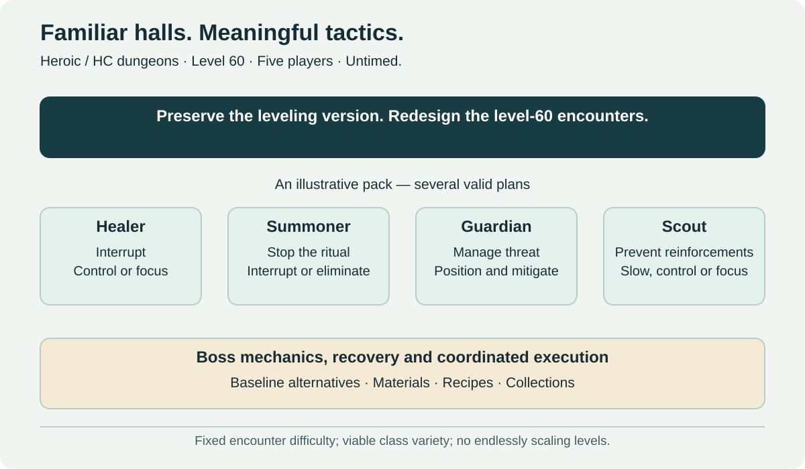

# Heroic Dungeons (HC)

[← Main proposal](../../README.md) · [Topic directory](../README.md)

Tactical, untimed five-player level-60 adventures. This page covers access, encounter design, composition, rewards and the Heroic pilot. For timed competition, see [Challenge Dungeons](challenge-dungeons.md).

## Heroic design goals

The long-term ambition is to revisit the existing leveling dungeon catalog at level 60 while preserving its leveling versions. A conversion needs actual encounter work: rescaling health and damage alone is insufficient.

Preserve recognizable routes, atmosphere and enemy groups. Add packs only where they improve pacing or decision-making. Rework trash abilities and add a small number of meaningful boss mechanics. Long, branching dungeons may need clearly defined wings rather than forcing every group into a marathon.

The intended tactical vocabulary includes crowd control, target priority, interrupt rotations, dispels, line of sight, threat management, defensive cooldowns and resource recovery. Telegraph dangerous actions through readable animations, audio and combat feedback.

### Example: a four-enemy pack

| Enemy | Threat | Possible answers |
| --- | --- | --- |
| Healer | Restores allies with an interruptible spell | Interrupt, control or focus damage |
| Pactbinder | Completes a ritual that adds reinforcements | Interrupt, displace where supported, or eliminate quickly |
| Guardian | Pressures the tank and punishes careless positioning | Mitigation, threat control and positioning |
| Scout | Escapes toward another group | Slow, root, stun or kill before escape |

One group might control the healer and interrupt the summoner. Another might burst the healer and restrain the scout. Tune for several viable compositions rather than requiring one specific class ability. Use diminishing returns and immunity rules consistently and explain them.

Not every pack should have four simultaneous priorities. Alternate demanding pulls with simpler encounters and provide reasonable recovery opportunities. Difficulty created by readable choices is more sustainable than constant attrition or surprise wipes.

## Heroic rewards and access

Questing, professions and other non-raid activities remain parallel routes to the permanent baseline. Heroics can be a convenient preparation path without becoming the only valid path or a requirement to collect every dungeon's set.

Equipment offers role-appropriate stat profiles and capped sidegrades. Recipes, materials, appearances and collections support repeated visits. A universally superior permanent trinket would undermine this model even if its item level matched other items.

Determine normal loot cadence separately from access to play. Controls on reward exploitation must not be disguised as Challenge Mode attempt limits. Avoid mandatory daily currency chains linking Heroics to Veteran progression.

## Pilot and open questions

Start with a few representative dungeons and test pacing, composition diversity, completion and abandonment. Preserve the leveling versions, use wings where long layouts need them, and expand only when redesigned encounters prove enjoyable and maintainable. Exact loot cadence and individual dungeon tuning remain open.
