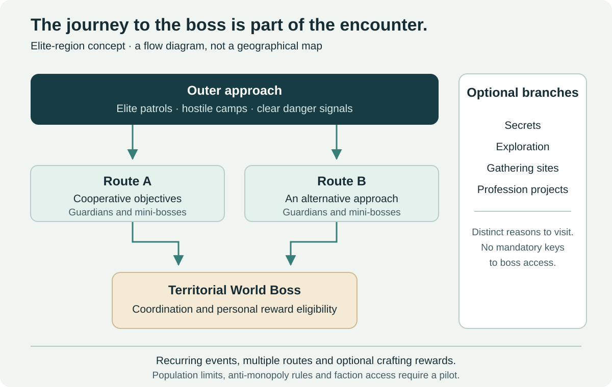

# World Bosses

[← Main proposal](../../README.md) · [Topic directory](../README.md)

Cooperative territorial bosses embedded in dangerous elite regions. This page explains the approach, access, contribution, anti-monopoly rules, artifacts and crafting boundaries.

## Elite regions as cooperative adventures

An elite region is a proposed level-60 area in which the approach to a territorial World Boss forms part of the encounter experience. It is an addition to the world, rather than a replacement for ordinary leveling zones.

| Region layer | Play experience | Design constraint |
| --- | --- | --- |
| Outer approach | Elite patrols, hostile camps and clear warnings | Players understand the danger before committing |
| Intermediate routes | Cooperative objectives, guardians and mini-bosses | Several viable approaches; no exclusive guild ownership |
| Central encounter | A territorial World Boss requiring coordinated mechanics | Numbers alone should not bypass all encounter requirements |
| Optional branches | Secrets, gathering sites, profession projects and exploration | Optional rewards do not become keys to the central route |

An event might open several paths after groups defeat guardians or complete simultaneous objectives. The boss encounter can require distributed tasks, protection of allies or environmental interactions so every participant is not simply attacking one target.

These are encounter patterns to test, not proof that open-world zerging can be solved. Health scaling by itself does not create coordination, and unrestricted player counts can exceed both encounter readability and server capacity.

## Access, monopolization and technical limits

Use recurring, visible activity windows and reasonable event durations rather than a single rare spawn owned by the first guild to camp it. Provide personal reward eligibility based on meaningful participation, including healing, mitigation, control and objective contribution.

Participation must be more than a last-second tag, but a damage-only threshold would unfairly exclude support roles. Evaluate contributions over the event and publish understandable eligibility rules. Handle reconnects and group reorganizations without allowing duplicate claims.

Multiple staging routes and repeated events may reduce choke-point control. If population distribution or event copies are needed, preserve party cohesion and prevent repeated reward collection by hopping between copies. Reward eligibility must follow the encounter identity and the player, rather than the current group leader.

Design around a tested participant envelope. If the population is too high, add more event opportunities or reduce the event's scope. Instancing could improve reliability but would change the social premise; that trade-off belongs in pilot evaluation.

On PvP rulesets, territorial conflict may be part of reaching the boss. That must still not turn a faction-dominated spawn into the only source of raid-critical equipment. Separate the cooperative event's reward contract from territorial PvP bonuses and test faction-access disparities.

## World Boss artifacts and crafting

Artifacts can support distinctive crafted sidegrades: an alternative proc, specialized defensive effect, visual treatment or utility option. Combat effects must consume an established item/effect budget, with explicit incompatibilities and content rules.

For example, a crafted modification could exchange a general offensive effect for an approved bonus against one enemy family. This is a hypothetical trade-off, not a tuned item. If it becomes decisively optimal for a raid, it needs adjustment or a comparable non-boss acquisition path.

| Reward | Suitable design | Failure to avoid |
| --- | --- | --- |
| Artifact material | Optional route to a budgeted sidegrade, also attainable through a reasonable PvE alternative | World Boss ownership determines raid access |
| Recipe | Distinctive appearance or equivalent functional option | An exclusive recipe grants unmatched permanent damage |
| Modification | Replaces another effect in the same budget family | Extra sockets or effects stack outside all existing caps |
| Cosmetic | Prestige, visual identity and long-term collection | Cosmetic ownership secretly enables combat benefits |

An alternative path must be reasonable in time, cost and availability. Merely placing an expensive equivalent on an auction house does not establish accessibility. Record acquisition time and compare real player behavior.
