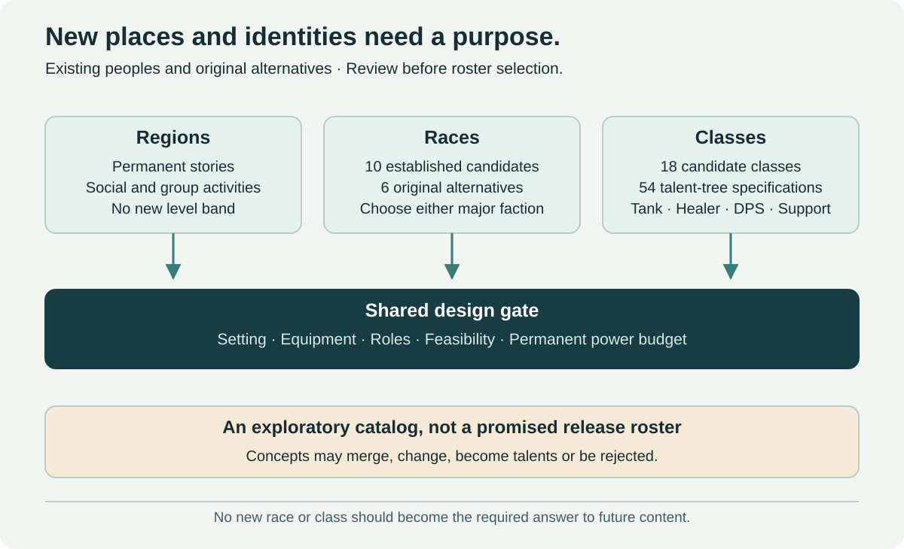

# Classes

[← Main proposal](../../README.md) · [Races](races.md) · [Roles and specializations](class-roles-and-specializations.md) · [Implementation standard](implementation-standard.md) · [Mechanic coverage](mechanic-coverage.md)

The catalog contains **eighteen candidate classes and three talent trees per class**, for **54 tree specifications**. Every family has an individual dossier. The table is a navigation and comparison tool; the full role, resource, state, baseline-action, talent-anchor and acceptance specifications live in those pages.

## How to read the class proposals

Tank, healer, DPS and pure support are distinct group responsibilities. Melee/ranged and physical/magical describe delivery. Bruiser is deferred. Both 1 tank + 1 healer + 3 DPS and 1 tank + 1 healer + 2 DPS + 1 support must remain viable in ordinary five-player content.

English archetype names identify the proposals. The three-tree structure is selected; most individual kits remain proposed designs. Summoner's three identities and the Artificer tank's core constraints have been selected by the author. The catalog is a candidate pool, not an eighteen-class release commitment.

These are Vanilla-style talent trees: hybrid allocation must be evaluated at the approved level-60 point budget. Listing three trees does not prove their full kits are mutually exclusive. The [implementation standard](implementation-standard.md) defines evidence levels and the required talent-allocation handoff.

## Class and role matrix

| Class dossier | Tree 1 | Tree 2 | Tree 3 | Equipment starting point |
| --- | --- | --- | --- | --- |
| [Bard](classes/bard.md) | [Conductor](classes/bard.md#conductor) — Pure support | [Cantor](classes/bard.md#cantor) — Healer | [Deep Cantor](classes/bard.md#deep-cantor) — Ranged magical DPS | Light armor; instrument focus with a reviewed weapon loadout. |
| [Alchemist](classes/alchemist.md) | [Bombardier](classes/alchemist.md#bombardier) — Ranged DPS | [Combat Medic](classes/alchemist.md#combat-medic) — Healer | [Mutagenist](classes/alchemist.md#mutagenist) — Melee DPS | Light/medium armor under review; reusable class apparatus and ordinary class weapons. |
| [Summoner](classes/summoner.md) | [Swarmcaller](classes/summoner.md#swarmcaller--selected-insect-branch) — Ranged DPS | [Soulbinder](classes/summoner.md#soulbinder--selected-souls-and-wisps-branch) — Ranged DPS | [Sporekeeper](classes/summoner.md#sporekeeper--selected-support-tree) — Pure support | Light armor; staff or caster focus. |
| [Inquisitor](classes/inquisitor.md) | [Judgment](classes/inquisitor.md#judgment) — Melee DPS | [Interrogator](classes/inquisitor.md#interrogator) — Pure support | [Absolver](classes/inquisitor.md#absolver) — Healer | Medium/heavy armor candidates; weapon and judgment focus, with branch-specific restrictions to evaluate. |
| [Oracle](classes/oracle.md) | [Seer](classes/oracle.md#seer) — Healer | [Omen](classes/oracle.md#omen) — Pure support | [Doomweaver](classes/oracle.md#doomweaver) — Ranged magical DPS | Light armor; staff or caster focus. |
| [Witch](classes/witch.md) | [Hexkeeper](classes/witch.md#hexkeeper) — Ranged magical DPS | [Familiar](classes/witch.md#familiar) — Ranged magical DPS | [Coven](classes/witch.md#coven) — Pure support | Light armor; focus and one familiar with an explicitly reviewed pet interaction policy. |
| [Investigator](classes/investigator.md) | [Field Agent](classes/investigator.md#field-agent) — Melee DPS | [Analyst](classes/investigator.md#analyst) — Pure support | [Saboteur](classes/investigator.md#saboteur) — Ranged DPS | Light/medium armor; field weapons and reusable class tools, with delivery fixed per tree. |
| [Spellblade](classes/spellblade.md) | [Channeler](classes/spellblade.md#channeler) — Melee magical/weapon DPS | [Spellguard](classes/spellblade.md#spellguard) — Tank | [Oath Duelist](classes/spellblade.md#oath-duelist) — Melee DPS with finite interventions | Medium/heavy armor to evaluate; blade and focus, with shield access for the tank tree under review. |
| [Gunslinger](classes/gunslinger.md) | [Sharpshooter](classes/gunslinger.md#sharpshooter) — Ranged physical DPS | [Trickshot](classes/gunslinger.md#trickshot) — Ranged physical DPS | [Gunmarshal](classes/gunslinger.md#gunmarshal) — Pure support | Light/medium armor; firearm subtype and dual-pistol asset/itemization support require an explicit decision. |
| [Cavalier](classes/cavalier.md) | [Outrider](classes/cavalier.md#outrider) — Melee DPS | [Mounted Guardian](classes/cavalier.md#mounted-guardian) — Tank | [Beast Rider](classes/cavalier.md#beast-rider) — Melee DPS | Medium/heavy armor; reviewed mounted/foot weapons and one companion with a defined recovery policy. |
| [Necromancer](classes/necromancer.md) | [Legion](classes/necromancer.md#legion) — Ranged magical DPS | [Decay](classes/necromancer.md#decay) — Ranged magical DPS | [Boneweaver](classes/necromancer.md#boneweaver) — Pure support | Light armor; staff/focus and bounded formation controls. |
| [Artificer](classes/artificer.md) | [Puppet Warden](classes/artificer.md#puppet-warden) — Tank | [Artillery](classes/artificer.md#artillery) — Ranged DPS | [Field Engineer](classes/artificer.md#field-engineer) — Pure support | Medium armor candidate; tool/weapon and command focus. |
| [Warden](classes/warden.md) | [Moon Predator](classes/warden.md#moon-predator) — Melee DPS | [Sentinel](classes/warden.md#sentinel) — Tank | [Duelist](classes/warden.md#duelist) — Melee DPS | Medium/heavy armor candidates; weapon/shield access evaluated by tree. |
| [Dark Ranger](classes/dark-ranger.md) | [Shade Archer](classes/dark-ranger.md#shade-archer) — Ranged DPS | [Spectral Marks](classes/dark-ranger.md#spectral-marks) — Ranged magical DPS | [Banshee Caller](classes/dark-ranger.md#banshee-caller) — Pure support | Medium armor candidate; bow or another explicitly reviewed ranged weapon. |
| [Runemaster](classes/runemaster.md) | [Runeblade](classes/runemaster.md#runeblade) — Melee magical/weapon DPS | [Rune Scholar](classes/runemaster.md#rune-scholar) — Ranged magical DPS | [Rime Scholar](classes/runemaster.md#rime-scholar) — Ranged magical DPS with control | Branch-reviewed armor; an inscribed weapon or caster focus. Rune Scholar/Rime Scholar begin from a caster profile. |
| [Beastmaster](classes/beastmaster.md) | [Packleader](classes/beastmaster.md#packleader) — Melee DPS | [Wildbond](classes/beastmaster.md#wildbond) — Ranged DPS | [Trailwarden](classes/beastmaster.md#trailwarden) — Pure support | Medium armor; branch-specific ranged/melee weapons and a bounded persistent pack. |
| [Hemomancer](classes/hemomancer.md) | [Bloodweaver](classes/hemomancer.md#bloodweaver) — Ranged magical DPS | [Nightform](classes/hemomancer.md#nightform) — Melee magical/weapon DPS | [Lifewarden](classes/hemomancer.md#lifewarden) — Healer | Light armor; caster focus and branch-reviewed close-range weapons for Nightform. |
| [Martial Adept](classes/martial-adept.md) | [Guarded Staff](classes/martial-adept.md#guarded-staff) — Tank | [Open Hand](classes/martial-adept.md#open-hand) — Melee DPS | [Waykeeper](classes/martial-adept.md#waykeeper) — Pure support | Light/medium armor; staff or reviewed hand weapons, with animation coverage for all candidate races. |

## Archetype and mechanic origins

Bard, Alchemist, Summoner, Inquisitor, Oracle, Witch, Investigator, Spellblade, Gunslinger, Cavalier and the martial archetype develop the supplied tabletop-style briefs through original MMO loops. The other families develop the additional fantasy/Warcraft-oriented briefs. These pages do not import another game's stat blocks or claim that a renamed existing kit is automatically distinct.

## Where the thirteen mechanical studies belong

The latest attachment repeats the first nine studies; four additional studies were supplied earlier. Each now has a primary dossier/tree, an explicit preserved decision and a recorded adaptation. See the [complete coverage audit](mechanic-coverage.md) for the source-to-proposal mapping and remaining work.

| Study | Primary implementation home | Treatment |
| --- | --- | --- |
| Two forms and combo spending | [Warden / Moon Predator](classes/warden.md#moon-predator) | Automatic internal combat cycle selected; world day/night dependency removed |
| Accumulate and command small beings | [Summoner](classes/summoner.md) | Insect, soul and colony trees; music/rats pairing retired; beings have no HP |
| Companion empowers the next action | [Spellblade / Spellguard](classes/spellblade.md#spellguard) | One primed eligible action, consumed exactly once |
| Apply and consume a cold state | [Runemaster / Rime Scholar](classes/runemaster.md#rime-scholar) | Damage state separate from control immunity; no full DoT plus free burst |
| Enchanted weapon and rare interventions | [Spellblade / Oath Duelist](classes/spellblade.md#oath-duelist) | Finite encounter allowance; no wealth creation or unlimited resurrection |
| Mobile versus anchored remote casting | [Bard / Deep Cantor](classes/bard.md#deep-cantor) | Vulnerable owner, bounded focus and explicit movement/channel cancellation |
| Deploy, repair and reposition automata | [Artificer / Puppet Warden](classes/artificer.md#puppet-warden) | Stationary dummies, separate HP, owner-only repair; extra temporary autonomous puppet |
| Defensive versus risky offensive posture | [Martial Adept / Open Hand](classes/martial-adept.md#open-hand) | Resource/posture decision; double/double source values not adopted as tuning |
| Blood resource and transformation | [Hemomancer / Nightform](classes/hemomancer.md#nightform) | Bounded health substitution/upkeep; no infinite drain or unrestricted flight |
| Parries and partnered follow-ups | [Warden / Duelist](classes/warden.md#duelist) | Independent viability; teammate timing optional and no duplicated payload |
| Ammunition and precision release | [Gunslinger / Sharpshooter](classes/gunslinger.md#sharpshooter) | Latency-tolerant timing and explicit reload cancellation |
| School selection and enhanced spell | [Runemaster / Rune Scholar](classes/runemaster.md#rune-scholar) | One class-sigil enhancement; separate from permanent Rune statistics |
| Mounted/foot companion and damage transfer | [Cavalier / Beast Rider](classes/cavalier.md#beast-rider) | Capped debt, indoor fallback and no free reset by mounting |

## Shared balance and development gates

Every class dossier defines its three trees; most require author review of the proposed kit choices before implementation validation. Establish one complete representative loop first, then compare the other trees and hybrid allocations. Shared themes are allowed; identical decisions with different colors are insufficient.

Permanent equipment, fixed Rune development, scoped raid effects, the one-slot repertoire, owned entities and support effects belong in one effective-power review. A class or racial package cannot become a mandatory party member or an exception to normalization. See [roles](class-roles-and-specializations.md) and the [implementation evidence gate](implementation-standard.md#evaluation-package).

Document resource pace, state recovery, input load, owner vulnerability, role contribution, animation/equipment coverage, performance and counterplay. A professional handoff identifies what is specified and what needs evidence; it does not claim engine or production readiness from prose alone.
