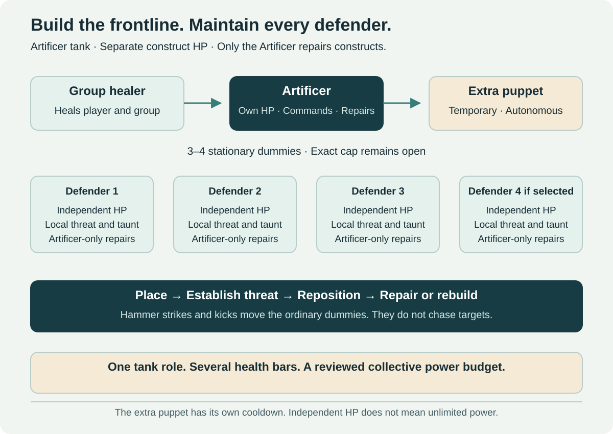

# Artificer — Three Talent Trees

[← Class catalog](../classes.md) · [Roles and specializations](../class-roles-and-specializations.md) · [Summoner](summoner.md)

**Tree structure:** Puppet Warden (tank), Artillery (ranged DPS) and Field Engineer (pure support). The tank's core constraints are author-selected; the two additional kits below are proposed implementation specifications. Apply the [Vanilla-style talent and evidence contract](../implementation-standard.md) before claiming complete tree or hybrid balance.

## Identity and role

**Puppet Warden primary role: tank.** It builds training-dummy-like defenders, positions them with forceful hammer strikes or kicks, repairs them and directs their threat. The player wins through preparation, facing, resource decisions and recovery. The ordinary constructs are **stationary**, not pets that chase targets automatically.

The detailed defender contract below concerns the tank tree; Artillery and Field Engineer use the same ownership, placement and repair foundation with different output responsibilities. Repair does not make any tree the group's healer. Devices cannot add full independent tank and damage budgets to a player already performing those roles at full strength.

**Selected fantasy:** three or four ordinary dummies as the target envelope, plus a powerful **temporary extra autonomous puppet** unlocked through a late talent. Dummies have **separate health and only the Artificer repairs them**. Exact cap, health, mitigation and costs remain prototype decisions. The extra puppet is not silently made a replacement for an ordinary dummy.

## A representative pull

1. Place defenders at the intended frontline and select which enemies each will engage.
2. Use a hammer strike to push one dummy into position. Its final location and interaction radius are previewed.
3. Activate a threat pulse or taunt to establish control. The player monitors proximity, facing and enemies outside the arrangement.
4. Spend the construction resource on a repair, shield function, reposition or rebuild. The same reserve cannot pay for all of them freely.
5. Reposition when enemies or a boss move. The stationary defenders do not follow automatically.
6. Use the autonomous-puppet cooldown for a dangerous wave or a movement window, then resume ordinary defense when it ends.

This is a tank loop with several placements, not a real-time strategy game requiring independent action bars for four characters. A single command palette, group recall and clear numbered anchors should be tested before adding advanced orders.

## Resources and deployed objects

| State | Proposed purpose | Boundary |
| --- | --- | --- |
| Construction reserve | Pays for placement, repairs and selected commands | Generated by the kit; no engineering consumable required per pull |
| Dummy health / integrity | Independent health for each ordinary construct | No damage transfer to a shared pool; only Artificer repairs restore it |
| Owner health and defense | The Artificer's own survival; ordinary healing targets the player | Separate from device health; the player remains exposed to mechanics |
| Threat assignment | Tracks enemies engaged by each owned defender | One player role and coherent encounter credit, not extra raid members |
| Autonomous puppet state | Tracks the extra unit's duration, power and recovery | Separate cooldown budget; no permanent extra tank through refresh tricks |

Dummies use the owner's approved equipment/profile rather than an independent gear ladder. Their appearance can reflect talent-selected functions, but they do not need a second set of raid items or profession-crafted upgrades to remain viable.

## Stationary dummies, proximity and threat

Ordinary dummies interact with nearby valid enemies. They can attack, generate threat and **taunt tauntable NPCs**. They do not run after a target outside their operating area. The player must move a dummy or take another action to maintain coverage.

Multiple dummies may hold different enemies: that is part of the positional tank fantasy. Sharing one character's budget prevents that from becoming several full-strength tanks. Threat follows an explicit ownership rule so moving, recalling or destroying a dummy does not randomly wipe threat or switch a boss onto the healer.

**Recommended prototype:** retain an owner-level threat contribution and a clearly selected defender anchor for each enemy. Valid commands change the anchor without resetting the earned contribution. Taunts use a shared category/cooldown policy across the player's dummies; three devices do not provide three unrelated unlimited taunt rotations. Exact threat-transfer behavior needs an engine prototype.

Taunt immunity and encounter-specific targeting remain effective. A dummy cannot provoke a player into losing control of their character. In PvP, the tank uses interception, placement and pressure rather than NPC threat rules.

## Hammer and kick positioning

**Selected movement fantasy:** the Artificer hits or kicks a construct forward relative to the player's position and the command direction. The interaction should feel physical and readable.

**Recommended input:** choose a dummy, show a short directional landing preview, then commit a displacement along navigable ground. A contextual command can select the nearby dummy in the current facing; an explicit target command provides reliable access in crowded scenes. These are alternative input tests, not a demand for pixel-perfect contact.

The landing must reject walls, cliffs, invalid terrain and unintended vertical shortcuts. A failed command reports why it failed and should not consume the full resource without moving anything. Define a safe maximum displacement and stop behavior; neither is numerically fixed yet.

Moving a dummy must not drag a boss through geometry, teleport an enemy or silently reset its attack timer. Enemies respond through normal movement/targeting. Repositioning a defender is different from forcibly moving its enemy. Pathing and encounter evade behavior need explicit tests.

## Talent-dependent functions

| Function | Tank decision | Necessary trade-off |
| --- | --- | --- |
| Physical shield | Face a defender toward a physical threat | Bounded coverage; not permanent immunity from all directions |
| Magical ward | Prepare for a spell or magic-heavy wave | Shares the mitigation budget; does not grant universal spell immunity |
| Sword arm | Maintain nearby threat with short-range attacks | Damage remains tank output, not an added DPS character |
| Spear arm | Reach a controlled local area or hold a narrow approach | Explicit range/facing; no extra player melee reach |
| Ranged module | Establish attention on a distant valid target | Lower local defense or another cost; no unlimited remote tanking |
| Repair specialization | Improve recovery or resource efficiency | Competes with offensive/mitigation talents rather than adding everything |

Talent selection can change a dummy's visible equipment and function. It should not require several separate loot sets or make one shield type mandatory to enter every new raid. Number, stacking and combinations of modules remain open.

## Defense and healer interaction

**Selected model: independent construct health.** Damage to one dummy reduces that dummy's health, not the owner's health or the other dummies. Only the Artificer's repair abilities restore construct health. The healer and other players cannot directly heal the dummies, apply healing-over-time to them or restore them incidentally through group/AoE healing. Use clear target feedback rather than consuming a heal on an invalid target.

The Artificer has a separate ordinary health bar and can be healed normally. The healer handles the player and the rest of the group; the Artificer manages construct repair. The player's tools restore **real device HP**, not just an abstract shared defense reserve. This dossier applies the same repair ownership to the temporary autonomous puppet for a consistent construct rule.

This deliberately differs from a conventional tank receiving most repairs from a healer. Independent health is **not independent full player power**: total construct durability, mitigation uptime, repair throughput, damage, taunts and command load must be tested together. A shared design budget does not mean shared HP. No validated formula or health total is selected.

Repairs spend a limited class resource and take an actionable window. Repairing one defender competes with moving another, attacking and preparing mitigation. Passive regeneration alone must not maintain every construct indefinitely. The kit needs a response to simultaneous damage without requiring impossible inputs or granting a permanent free group tank wall.

The healer must still matter in the intended group through player damage, group mechanics and the Artificer's exposure. Do not add arbitrary unavoidable owner damage solely to force healing; test real encounter responsibilities and resource pressure. External prevention/buffs need a published eligibility/stacking rule, since an absorb is not the same operation as a heal. They cannot quietly bypass the construct-only repair policy.

The player remains vulnerable and must handle encounter mechanics. Devices do not remove the owner from debuff, movement or player-targeted checks. Encounter rules distinguish attacks aimed at a defender from effects aimed at a player. An area attack may legitimately damage both independently; apply each valid hit once to its own health bar. There is no automatic redirection into the owner's health and no blanket construct AoE immunity.

Defender geometry does not automatically create a physical line-of-sight wall. **Recommended protection prototype:** an explicit interception or guarded-zone effect, with visible coverage and a capped result. True moving collision cover is separate technical research; no promise is made that NPC obstacles already supply it.

## Active abilities to prototype

Names describe original working actions; no numbers below are finalized.

| Action | Function | Decision and failure case |
| --- | --- | --- |
| Assemble Defender | Place a stationary dummy at a valid point | Reserve a slot and resource; cannot place inside walls or on forbidden ledges |
| Driving Blow | Strike/kick a selected dummy into a previewed position | Reposition versus repair; invalid terrain gives clear feedback |
| Challenge Pulse | Generate threat and request a taunt where permitted | Shares taunt rules across owned devices |
| Field Repair | Restore HP to the selected owned construct | Only Artificer repairs work; resource, positioning and pressure constrain the window |
| Guard Pattern | Activate the selected shield or interception function | Facing and coverage matter; physical/magical configurations have costs |
| Salvage and Rebuild | Recover a destroyed device into a usable defender | Construction cost/time prevents cycling destruction for free full health |
| Emergency Bracing | Give the owner a short recovery response when the formation fails | Finite fallback, not permanent full tanking without devices |
| Harvest Puppet | Summon the extra autonomous capstone unit | Powerful temporary window with its own cooldown and explicit end behavior |

## Autonomous capstone puppet

**Selected:** an extra, temporary, powerful construct with a cooldown. Its visual reference is an agricultural/scarecrow-like machine with tool arms, not another stationary training dummy. It moves autonomously, engages enemies, can taunt and has its own abilities. Exact appearance and final name remain open.

**Recommended command set:** follow, guard a point, attack the designated target and recall. Autonomous movement obeys the player's permissions and a combat leash; it cannot wander into an unpulled pack. It must remain usable in moving fights without becoming an invulnerable remote player.

Give the summon a separately specified power allowance funded by the capstone/cooldown design. Its presence can exceed ordinary steady-state defense for a limited window, as a reviewed tank cooldown. It does not gain an uncapped independent stat package. Its damage, taunt behavior, mitigation, duration and cooldown all belong in the balance comparison.

On expiry or destruction, announce the transition, stop new autonomous taunts and transfer controlled enemies according to the threat rule. Do not despawn the tank anchor without a recovery window. Recalling, zoning or reconnecting cannot reset the cooldown or duplicate the puppet. Whether destruction has an extra penalty is open.

## Failure recovery, PvP and group access

A disabled dummy reduces coverage and demands a repair/rebuild decision. A fully broken formation needs a bounded fallback long enough to respond, not indefinite invulnerability. Dismissal must not clear hostile attention, remove a dangerous debuff for free or recover a full reserve instantly.

In PvP, opponents can pressure the exposed Artificer, deny a repair position and move outside defender coverage. Device targetability, destructibility, control immunity and AoE treatment need a dedicated policy; do not inherit the Summoner swarm's non-selectable/no-HP rule. Dummies cannot grief allies by blocking narrow doors or permanently breaking line of sight.

In a five-player dungeon the specialization occupies **one tank slot**. Other players should not need to operate its devices. Healing, tank participation and objective credit are attributed to the owner once, under the same policies as other classes.

## Prototype acceptance scenes

| Scene | What must be demonstrated |
| --- | --- |
| Four-enemy pull | Establish separate attention, move one dummy, repair another and keep readable control |
| Moving boss | Maintain threat/defense without automatic ordinary-dummy pursuit or impossible command load |
| Magic-heavy boss | A valid ward choice without immunity or a mandatory external counter-class |
| Broken frontline | Recover from a destroyed dummy without a full free reset or an unavoidable healer death |
| Extra puppet expires | Predictable threat transition; ordinary kit resumes safely within its intended budget |
| Small interior and stairs | Valid placement, no geometry bypass, useful camera and commands |
| Owner plus device hit | Independent valid damage to each affected health bar, no duplicate reports and clear mechanic responsibility |
| Normal/Veteran/Challenge | Summons inherit the approved profile; no contextual power leak or extra reward shares |
| PvP pressure | Counterplay through positioning and owner pressure, with device interaction defined |

Measure command frequency, setup time, threat losses, healer targeting burden, damage spikes, recovery options and effective power against existing tank baselines. A promising fantasy is not a claim that its engine behavior or numbers are already validated.

## Talent-tree specifications

### Puppet Warden

**Primary role:** tank. **Status:** core identity selected; exact talent allocation and tuning open.

Its baseline kit, independent construct HP, owner-only repairs, hammer movement, local threat and extra temporary autonomous capstone are specified above. The first implementation slice is Assemble Defender, Driving Blow, Challenge Pulse and Field Repair against one moving threat, followed by a multi-enemy pull.

**Talent anchors:** early placement/repair efficiency versus resource retention; middle physical shield, magical ward or offensive threat-module choices with opportunity costs; deep Harvest Puppet capstone adding the selected temporary autonomous unit and its own cooldown/power allowance. A repair talent improves device recovery, not ordinary group healing.

### Artillery

**Primary role:** ranged DPS. **Status:** proposed tree specification.

**Loop:** deploy a small stationary firing arrangement, generate construction reserve through ranged/tool actions, manage limited Heat and choose a controlled overdrive before repair/reposition. Devices remain independently healthy and only the Artificer repairs them. This tree does not receive full tank durability and boss-taunt capability on top of full ranged damage.

| Baseline action | State change | Guard and trade-off |
| --- | --- | --- |
| Assemble Firing Module | Commit an ordinary device slot and reserve to a stationary ranged module | Shared family deployment cap; no extra full turret set alongside tank/support devices |
| Calibrated Volley | Spend reserve/Heat allowance for a legal focused firing sequence | Owner range, target permission, line of sight and one total output budget |
| Vent and Reposition | End overdrive, recover Heat under the rule and move/repair a module | Costs firing time/resource; no full health or cooldown reset |

**Talent anchors:** early reserve generation versus Heat tolerance; middle focused volley versus bounded area delivery; capstone a finite overdrive sequence with a visible end and recovery, not the tank tree's full autonomous defender kit added for free.

The test scene moves the target out of the firing arrangement, interrupts a repair and compares output before/after a full reposition. Stationary-device friction must be meaningful without making ordinary movement mechanics disable the class.

### Field Engineer

**Primary role:** pure support. **Status:** proposed tree specification.

**Loop:** build a small relay arrangement, accumulate preparation through active tool/support actions and spend it on finite protection, disruption or regrouping utility. Device placement and repair remain decisions, while direct damage, healing and main-tank attention are deliberately low.

| Baseline action | State change | Guard and trade-off |
| --- | --- | --- |
| Deploy Relay | Reserve a shared device slot and prepare a local support anchor | Independent HP and owner-only repairs; no invulnerable wall or extra full tank |
| Interception Pattern | Spend preparation on finite guarded-zone prevention | Visible coverage, shared prevention allowance and ordinary encounter responsibilities |
| Counterpulse | Commit a relay to reviewed local disruption or countermeasure delivery | Normal immunity/diminishing returns; no complete dispel catalog in one build |

**Talent anchors:** early repair/reposition efficiency versus retained preparation; middle protective coverage versus control emphasis; capstone a short coordinated relay release consuming preparation with a shared support allowance.

Test a control-immune boss, a moving encounter and a destroyed relay. The support must have useful protection/countermeasure decisions while both accepted five-player compositions remain viable. Its relays cannot generate main-tank threat merely to justify their visible bodies.

## Shared deployment and mixed-tree allocation

Ordinary devices from all three trees share the family deployment cap and construction resource. A mixed build cannot gain three independent deployment rosters, three repair budgets or every full output role. The extra autonomous tank capstone remains additional and temporary as selected; its deep-tree access, cooldown and power must be evaluated in the actual talent allocation.

Before full implementation, specify node ranks, prerequisites, unlock depths, resource/Heat values, target caps, placement range, repair throughput, external-prevention eligibility and the encounter threat-transition rules. Validate representative hybrid builds under the approved level-60 point budget rather than imposing an unannounced modern specialization lock.
