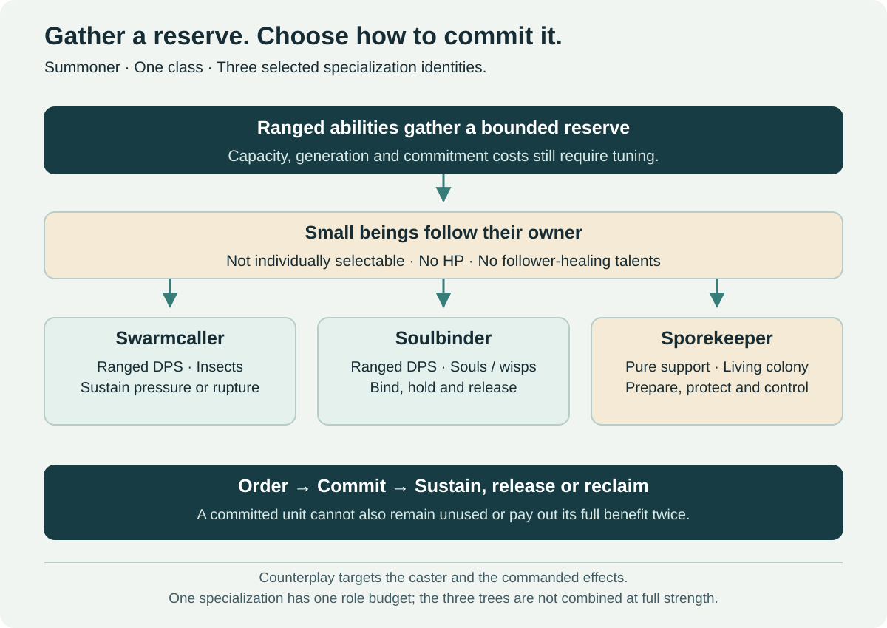

# Summoner — Swarms and Spirits

[← Class catalog](../classes.md) · [Roles and specializations](../class-roles-and-specializations.md) · [Artificer](artificer.md)

**Implementation contract:** three Vanilla-style talent trees with one family resource/commitment budget. The [implementation standard](../implementation-standard.md) defines the point-grid, hybrid-allocation and evidence work still required.

## Shared class identity

A ranged caster accumulates small accompanying beings through abilities and sends them at a designated target through explicit orders. They follow the player between orders. The character continues using ranged actions while managing the reserve, committed beings and recovery.

**Selected branches:** **Swarmcaller** controls insects; **Soulbinder** controls small souls or wisps; **Sporekeeper** commands a pure-support living colony. These are three specializations of one class, not three additional classes. Identities and roles are selected; ability sketches and numbers remain prototypes.

The earlier Bard/Piper direction is retired from this concept. Music and rats are not the new class identity. The shared design is accumulation, controlled deployment and consumption; the three selected trees need different play decisions, not merely different particle colors.

## Role and equipment

Swarmcaller and Soulbinder are **ranged DPS** with bounded utility/control. Sporekeeper occupies a **pure support** role, with low direct damage and no full healer or tank responsibility. Its prototype must demonstrate the [two viable five-player compositions](../class-roles-and-specializations.md#five-player-compositions).

Prototype light armor and a staff or one-handed caster focus. Those are working equipment choices, not a new required profession or an independent pet gearing system. The caster's approved profile funds the entire kit, including its small beings.

## Reserve, orders and a representative fight

| State | Meaning | Constraint |
| --- | --- | --- |
| Gathered reserve | Beings currently available around the player | Fixed reviewed cap; no endless pre-pull accumulation |
| Committed group | A portion sent toward an ordered target or effect | The same unit cannot be reserved and attacking simultaneously |
| Released payload | A consumed detonation, transfer or support effect | Removes the relevant commitment; no duplicate damage/utility claim |
| Recovery | Units returning or regenerated through valid actions | Cannot reset all costs on target swapping or reconnecting |

**Fight example:** use ranged abilities to gather a small reserve, order part of it onto the priority enemy, keep casting while those beings attack, then choose between sustained pressure and a consumption ability. Preserve some reserve for the next threat or commit it all for the current phase. Recall or retarget when the encounter changes.

The original twenty-unit suggestion is only a reference for visual scale, not selected tuning. A first prototype should test a modest cap and a few order groups. More visible beings need not mean twenty independent pathfinding agents or twenty action bars.

## Targetability and counterplay

**Selected:** the accompanying beings are **not individually selectable and have no HP**. They cannot be killed through direct attacks or hidden AoE health calculations. This is a resource-and-visual system, not a collection of ordinary vulnerable combat pets.

Consequently, **HP, armor, avoidance and healing talents for these beings are removed**. Talents can affect generation, reserve size, commitment duration, command behavior or payload within a shared budget. They cannot improve a health statistic that does not exist.

Opponents interact with the caster and the commanded effects: pressure the owner, interrupt gathering/casting where allowed, control movement, use line of sight, move out of a telegraphed area, and apply the appropriate dispel or control rule. The class must not combine unattackable beings with unavoidable ranged output and a protected owner.

**Recommended prototype:** new offensive orders require the caster's valid target, range and line of sight. Short visible travel communicates commitment. Disabling the caster prevents new orders; already-applied DoTs follow their explicit duration/dispel policy, while queued or traveling attacks need a defined cancellation rule. Non-selectability is not permission to attack through walls.

## Swarmcaller — selected insect branch

**Primary role: ranged DPS.** The caster gathers insects through ranged actions, assigns a portion to harry a target, and chooses between sustained attacks, infestation damage over time and a telegraphed burst that consumes part of the swarm.

**Distinct decision:** maintain several affordable infestations or concentrate and consume on a priority target. Damage over time should matter long enough to create a real opportunity cost. A detonation cannot award the full remaining DoT and a free equal burst without paying for both.

| Working action | Purpose | Decision |
| --- | --- | --- |
| Gathering Bolt | Ranged attack that generates a bounded reserve | Build while contributing; no need to find ambient insects |
| Harrier Order | Send a portion to make repeated basic attacks on the selected target | Commit sustained pressure or preserve reserve |
| Infestation | Convert a portion into a finite damaging-over-time effect | Spread selectively; no uncapped targets or permanent uptime for free |
| Swarm Rupture | Consume committed/reserved units for a readable area burst | Trade future pressure for the immediate window |
| Recall | Recover eligible unconsumed units under the return rule | Preserve resources without duplicating a payload |
| Scatter Screen | Short, bounded disruption or self-protection | Competes with offensive spending and cannot become untargetable kiting |

Candidate talents adjust generation during active play, capacity, the split between basic attacks and infestation, recall efficiency and single-target versus area commitment. They are alternatives, not a single tree that grants maximum generation, maximum reserve and maximum burst together.

## Soulbinder — selected souls and wisps branch

**Primary role: ranged DPS.** Small wisps/souls gather around the caster. They are not physical corpses and do not require another player or a harmless NPC to die. The branch should remain functional on a boss with no adds.

**Distinct decision:** form a limited binding on a priority target, hold the commitment through an exposed cast window, then release or reclaim it. Compared with Swarmcaller spreading pressure, Soulbinder emphasizes focus, commitment timing and a planned release. It cannot reuse every infestation mechanic with a spectral skin and still claim a separate specialization.

| Working action | Purpose | Decision |
| --- | --- | --- |
| Echo Bolt | Ranged action that gathers an echo under valid combat rules | Build through play rather than corpse farming |
| Bind Echoes | Commit wisps to a visible target link | Hold pressure versus save the reserve |
| Resonant Pulse | Trigger a bounded action through active links | Choose timing without infinite multi-target replication |
| Soul Release | Consume a commitment for a delayed, signaled strike | Risk a cast/position window for planned output |
| Recollect | Reclaim eligible unconsumed echoes | Recover flexibility at a cost; no full refund after damage is already dealt |
| Quiet Passage | Limited movement or control utility | No phasing through encounter geometry or invulnerable remote damage |

Whether the spirits are literal departed souls, magical echoes or minor independent entities is a **setting decision still open**. The name does not justify compulsory necromancy, an undead race lock, stealing player souls or preventing resurrection.

## Sporekeeper — selected support tree

**Primary role: pure support**, controlling small animated spores or fungal motes that follow the player and germinate into short-lived ordered effects. The author selected this third tree after reviewing the alternative. It gives the class a third recognizable kind of small being and a different group responsibility; its proposed actions still require kit design and testing.

**Distinct decision:** keep a mobile reserve for an emergency or commit part of the colony to a prepared location. Once committed, those units cannot also supply another protection/control effect. The player predicts the next group movement rather than merely spreading a third color of DoT.

| Working action | Utility proposal | Boundary |
| --- | --- | --- |
| Cultivate | Gather the colony through active ranged/support actions | Must work during boss-only phases without trivial repeat loops |
| Rooting Spores | Prepare a small slow/root area on valid targets | Respect immunities and diminishing returns; no boss stun exception |
| Shelter Bloom | Release a finite preventive group guard | Bounded protection, not full direct healing or permanent immunity |
| Clearing Spores | Prepare a specific reviewed countermeasure | Must have ordinary-class/encounter alternatives; not every dispel at once |
| Guiding Colony | Give a brief, limited repositioning opportunity | No wall bypass or indefinite movement advantage |
| Reclaim Growth | Recover eligible unspent colony effects | No refund after an effect's full benefit was delivered |

The major overlap risk is nature/control fantasy already represented elsewhere. Its justification is **mobile reserve versus committed prepared utility**, with original visuals and clear controls. The selected three-tree structure requires a genuinely distinct support decision loop; weak differentiation is a redesign task, not evidence that the kit is already complete.

## Talent structure and output budget

| Tree | Early talent choice | Middle talent choice | Capstone direction |
| --- | --- | --- | --- |
| Swarmcaller | Generation pace versus reserve capacity | Sustained infestation versus a planned rupture | A finite committed swarm release with remaining-payload accounting |
| Soulbinder | Echo retention versus faster active generation | Longer binding commitment versus earlier release | A finite coordinated release that consumes bindings exactly once |
| Sporekeeper | Active cultivation versus retained preparation | Narrow protection versus local control coverage | A finite colony response that spends prepared utility without full healer output |

These are allocation anchors, not a finished point grid. Specify node ranks, depth and prerequisites at the approved level-60 budget. Hybrid builds share the same reserve and commitment ledger; different visual themes cannot produce three separate full caps or simultaneous full damage and support kits.

Use three kinds of choice: generation/recovery, commitment/payload, and utility/defense. Capacity talents should trade against generation or output; a larger visual maximum cannot automatically grant proportionally more free damage. No exact cap or coefficients are selected.

Compute a shared total contribution across caster attacks, basic companion attacks, DoTs, bursts and utility. White/basic attacks are part of that budget, not a free pet layer on top. Swarmcaller and Soulbinder do not retain the support tree's full protection kit. Sporekeeper sacrifices offensive output for its selected pure-support responsibility.

For a consumption ability, count what has already been delivered and what remains committed. Consuming a DoT-linked group cancels or converts its remaining future payload under the published rule. A unit cannot deal a full attack, detonate and return as an unused reserve charge from the same order.

## Orders, recovery and target changes

**Recommended rules to test:** reserve units follow the owner; explicit orders choose the target; no uncontrolled pulls or autonomous target selection outside an ordered engagement. Use a few visible groups and simple commands rather than one keybind per small being.

On target death, eligible unspent commitment can return after a brief recovery rather than disappearing or refunding the entire fight's spent payload. Range or line-of-sight loss pauses/cancels pending orders according to a visible rule; it cannot teleport new attacks through geometry. Target switching preserves costs and remaining duration.

On owner death, despawn active reserve/command visuals and terminate new orders. A reconnect restores authoritative state and cooldowns without duplicating units. Existing applied effects follow the same persistence rule as comparable class effects. Encounter resets restore a published starting state; idle waiting must not be the best opening rotation.

The class generates its own resource, so a dungeon needs no ambient critters and the player need not consume another player's pets, cosmetic companions, quest creatures or world wildlife. Capturing real environmental animals is not selected for this version.

## Technical presentation and readability

Separate the gameplay reserve and ordered effects from decorative followers. A small number of server-owned order groups can drive several visual beings; the exact implementation is research, not a claim about the existing engine. Visual culling must not change combat results.

Show gathered reserve, committed groups, selected target and impending release clearly. Give opponents a readable major attack signal without covering a raid in twenty nameplates per caster. Summons do not create collision walls or independent objective bodies merely because they are visible.

Apply approved equipment, finite Rune, repertoire and normalization rules once through the owner. No copied attack should multiply a proc, a participation claim or a scoped raid effect once per decorative insect. Entity counts cannot bypass the power envelope.

## Prototype acceptance scenes

| Scene | Required result |
| --- | --- |
| Boss without adds | Both DPS branches generate resources and make meaningful decisions |
| Priority target changes | Recover/retarget clearly without free full refunds or long unusable downtime |
| DoT followed by burst | Correct remaining-payload accounting; no duplicated benefit |
| Owner controlled in PvP | New orders respect control/range/line-of-sight rules; counterplay remains meaningful |
| Heavy AoE over followers | No HP or hidden deaths, as selected; major attack effects remain dodgeable where specified |
| Several Summoners in a raid | Readable encounter signals, bounded visual cost and no proc multiplication |
| Long travel then first pull | Functional opening reserve without a mandatory pre-pull wait |
| Support composition | Sporekeeper can help complete the same five-player encounters without becoming mandatory |

Measure reserve pacing, active inputs, target-change friction, direct-versus-companion output, PvP response windows and visual density. A shared accumulation mechanic alone does not prove that three branches are fun or balanced.
