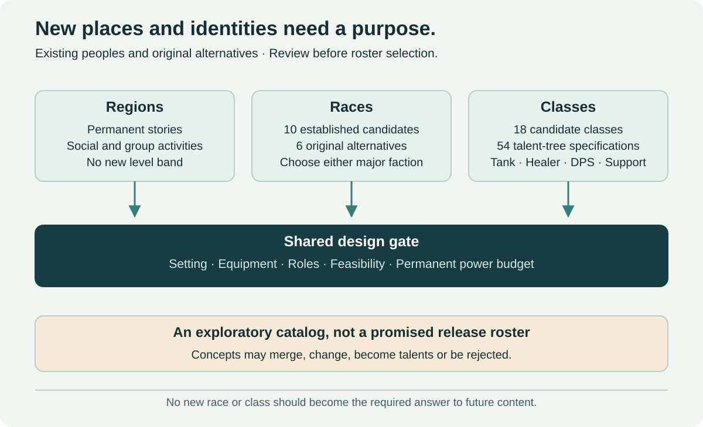

# Races

[← Main proposal](../../README.md) · [Classes](classes.md) · [Identity review questions](class-roles-and-specializations.md#questions-for-the-next-design-review)

Start with **ten peoples already represented in Vanilla, The Burning Crusade or Wrath of the Lich King**. Their existing NPC appearance is the visual reference, rather than an invented replacement name. Six original concepts remain below as secondary alternatives. None is an announced playable addition.

## Selection policy and historical scope

A candidate must add a recognizable silhouette, culture and social identity. Different skin colors or minor variants of an existing playable people are insufficient for this shortlist. This is a preference for this project, not an assessment of other players' tastes.

The reference window is the **original versions of Vanilla, TBC and Wrath**. It does not require importing an expansion's campaign, level cap or later model redesign. TBC/Wrath candidates need an explicit arrival story in a level-60 world; reference-era eligibility does not establish that their assets are available in the current Forever client.

**Classic Worgen are an explicit exception to the preference for never-playable peoples.** The subject is the older Silverpine/Arugal-associated appearance, not the later Cataclysm playable model or its starting campaign. Arugal is the associated mage, not the name of a separate race.

The references below establish historical appearances. Equipment solutions, fitting workload, faction stories and prototype priorities are **our design analysis**. No client files or rigs have been inspected; none of these candidates is verified as fully compatible with player armor.

## Ten established candidates at a glance

The work bands compare expected complexity, not measured time or production estimates. Even a biped may need new UV layouts, attachments and animations. Every candidate requires equipment testing.

| Candidate | Historical visual reference | Distinct identity | Expected fitting work | Recommendation |
| --- | --- | --- | --- | --- |
| [Ethereals](races/ethereals.md) — Eterei | TBC; Consortium and Mana-Tombs | Wrapped energy body | Substantial: opacity, body layers, anchors and robes | High creative priority; first equipment proof |
| [Ogres](races/ogres.md) | Vanilla; Stonemaul and other clans | Large, heavy-built humanoid | Substantial: scale, belly, shoulders and helmets | Strong candidate; begin with one head |
| [Naga](races/naga.md) | Vanilla coasts and Blackfathom Deeps | Serpentine body | Exceptional: tail, leg/foot presentation, mounts and arms | Desirable research candidate; separate feasibility track |
| [Classic Worgen](races/classic-worgen.md) | Vanilla Silverpine and Shadowfang Keep | Older feral werewolf silhouette | Substantial: muzzle, posture, claws and animations | Prototype the requested appearance explicitly |
| [Quilboar / Razormane](races/quilboar.md) | Vanilla Durotar and the Barrens | Bristles, tusks and thornland culture | Substantial: mane, muzzle, torso and back items | Strong candidate with narrative review |
| [Kobolds](races/kobolds.md) — Coboldi | Vanilla Elwynn mines | Small underground people | Substantial: stature, posture, muzzle and headgear | Candidate if armor remains readable at scale |
| [Gnolls](races/gnolls.md) | Vanilla; Riverpaw and other packs | Hyena-like frontier silhouette | Substantial: muzzle, mane, posture and grips | Strong first-wave candidate |
| [Furbolgs](races/furbolgs.md) | Vanilla forests and Timbermaw | Broad bear-like body | Substantial: fur, paws, robes and shoulders | Good cultural candidate; prove armor coverage early |
| [Arakkoa](races/arakkoa.md) | TBC; original hunched, flightless appearance | Avian silhouette and ritual identity | Very substantial: beak, talons, feathers and cloak | Distinctive research candidate; no flight assumption |
| [Tuskarr](races/tuskarr.md) | Wrath; Kalu'ak settlements | Walrus-like coastal community | Substantial: tusks, broad torso, neck and feet | Strong Wrath-era alternative; arrival story needed |

This is a comparison, not a commitment to ship ten races. Test **Ethereal, Ogre and Gnoll equipment mockups** first: the first tests a requested unusual body, the others test broad and bestial bipeds. This recommendation is a feasibility sample, not a selected release order. Keep Naga locomotion and armor research separate rather than treating it as a cheap follow-up.

## Candidate dossiers

Each established candidate has a dedicated implementation-evaluation page. The short anchors below remain available for existing links.

### 1. Ethereals

[Open the Ethereals dossier](races/ethereals.md) — Wrapped-energy body with recognizable armor, not a permanent bandage outfit.

### 2. Ogres

[Open the Ogres dossier](races/ogres.md) — A broad single-headed body whose size survives the playable-scale review.

### 3. Naga

[Open the Naga dossier](races/naga.md) — A serpentine playable body with genuine tail locomotion and visible lower-body item adaptation.

### 4. Classic Worgen

[Open the Classic Worgen dossier](races/classic-worgen.md) — The older Silverpine/Arugal-associated werewolf appearance, with a player-capable rig preserving its mood.

### 5. Quilboar and the Razormane

[Open the Quilboar / Razormane dossier](races/quilboar.md) — Bristles, tusks and a coherent thornland culture; Razormane remains a tribal reference.

### 6. Kobolds

[Open the Kobolds dossier](races/kobolds.md) — A genuinely small mine-dwelling silhouette with readable earned items and full player actions.

### 7. Gnolls

[Open the Gnolls dossier](races/gnolls.md) — The early hyena-like frontier profile with individual agency and recognizable equipment.

### 8. Furbolgs

[Open the Furbolgs dossier](races/furbolgs.md) — A broad forest people with substantial culture and a workable full-armor presentation.

### 9. Arakkoa

[Open the Arakkoa dossier](races/arakkoa.md) — The original hunched, flightless TBC appearance rather than a later winged model.

### 10. Tuskarr

[Open the Tuskarr dossier](races/tuskarr.md) — The older walrus-like coastal body and a communal seafaring identity.

## Equipment contract for every candidate

**Selected:** players see their earned equipment through recognizable anatomy-specific adaptations. Naga leg/foot armor can become tail treatments; beaks, tusks, claws and energetic bodies need their own fitting rules. Preserve the item's identity, statistics and slots. Exact mappings still require prototypes; invisible equipment is not the default solution.

| Layer | Required behavior | Evidence before approval |
| --- | --- | --- |
| Item ownership and power | Same slots, eligibility, enchants and budget; no anatomy bonus slots | Equip/unequip and set-effect checks across eligible classes |
| Visible armor | Recognizable head, shoulders, chest/robe, wrists, hands, waist, legs, feet and back where those slots normally have a visible presentation | Cloth/leather/mail/plate samples and an explicit exception list |
| Normally invisible slots | Rings, neck and trinkets use the ordinary item system | UI and power parity; no invented visual requirement for every trinket |
| Weapons | Correct grips, sheathing, ranged use and shield poses | One/two-handed, class-legal dual-wield, ranged and caster samples |
| Anatomy adaptations | Preserve item identity; show unresolved cases | Tail, claw, tusk, feather and Ethereal-layering mockups |
| Character creation | Intentional customization and body/presentation choices | Armor tests for every supported body option |
| Player actions | Combat, casting, movement, death, recovery, emotes, sitting and interaction | Animation coverage in a working prototype |
| World interaction | Doors, stairs, lifts, transports, mounts, camera and combat positioning | Small interiors, crowded combat and traversal scene |

Use a test wardrobe: close/open helmets, large shoulders, chest-and-leg armor, long robe, cape, gloves, boots, shield, staff, two-handed and ranged weapons. Repeat for relevant armor types and body presentations. Any hidden or adapted item needs an explicit decision; do not advertise complete compatibility from a dressed NPC screenshot.

No automatic flight, extra weapon attacks, phasing or encounter immunity comes from a model. Racial abilities use the same permanent budget and competitive policies as the existing roster.

## Six original alternatives

These are **secondary invented concepts**, not disguised names for the established peoples above. If a concept merely approximates an Ogre, Naga or Ethereal, develop the established candidate instead. Retain an original only if culture and mechanics earn a separate identity.

| Original concept | Independent opportunity | Decision needed |
| --- | --- | --- |
| Gravemarch | Broad-built stone-country clans | Does it add enough beyond other broad bodies? |
| Brineveil | A separate serpentine coastal society | Merge or archive if it duplicates Naga |
| Stonewake | Mountain people shaped by regional mythology | Distinguish from scaled-up humanoids and solve playable size |
| Thornmaw | A distinct bestial frontier culture | Merge or archive if it merely substitutes for Gnolls |
| Briarhide | Thornland communities with their own traditions | Distinguish from the existing Quilboar direction |
| Veilbound | Shrouded magical people with a separate origin | Merge or archive if it merely substitutes for Ethereals |

## Neutral origins and faction choice

**Selected for every new playable people:** start in a race-appropriate introductory experience, then choose **Alliance or Horde**. Friends should not have to abandon their preferred new race to join the same faction. Neutral origin does not mean the character remains mechanically neutral after that choice.

Use a specific community or delegation with reasons to negotiate with both sides. Existing NPC tribes can remain hostile, friendly or independent. An individual player's choice does not rewrite the allegiance of the whole species or automatically resolve old conflicts.

The introduction must explain communication, travel to the chosen faction, trainers, baseline services and how joining affects local relationships. Completing that introduction cannot require a prestige rank or old raid. Whether faction choice can later be changed is a separate policy, not selected here.

Race appearance alone will no longer identify major-faction membership. Nameplates, targeting, guards, party rules and PvP indicators must communicate it reliably. Warfare city selection then follows the character's **chosen major faction**, not ancestry; this does not grant access to opposing-faction city standards.

## Decisions still open

Arrival stories, final shortlist, race/class combinations, precise armor mappings, customization and later faction-change rules remain open. Neutral introduction followed by either-faction choice, and recognizable anatomy-specific armor adaptation, are selected boundaries. No new race is assigned exclusively to one faction in this catalog.

No race requires prestige rank, prior raid completion or territorial victory to become an ordinary player option. A future unlock policy must preserve reasonable leveling entry and keep existing races complete choices.
