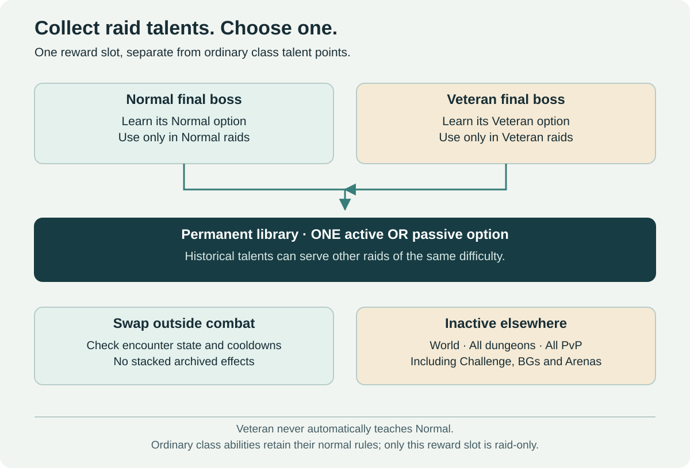

# Adventurer Abilities

[← Raids](../01-progression-and-raids.md) · [Runes](runes.md) · [Raid entry preset](raid-entry-preset.md)

## Selected direction

Completing a raid's final boss teaches its reviewed class/build-compatible **raid talent**. The character keeps the unlock and can select **one active ability or passive option** in the Adventurer Repertoire. This is a separate raid-choice slot, not extra points in the ordinary 51-point class talent allocation.

**These unlocked options work only inside matching-difficulty raids.** Base class spells and ordinary talent-tree abilities retain their normal use; this restriction concerns the additional final-boss reward slot.

## Working acquisition model

| Source / destination | Normal raid | Veteran raid | World / dungeons / PvP |
| --- | --- | --- | --- |
| Normal final-boss option | Active if selected and eligible | Inactive | Inactive |
| Veteran final-boss option | Inactive | Active if selected and eligible | Inactive |

Each difficulty teaches only its own option. Veteran does not automatically grant Normal. The proposed acquisition is an eligible final-boss completion without a competitive loot roll for the ability; participation and late-join criteria still need specification.

The difficulty boundary is different from the source-update scope of contextual equipment. Learned options can provide choices in other raids of the **same difficulty**, rather than expire when the source update ends. Their interaction budget must remain reviewed across that catalog.

## The revised access promise

The [entry preset](raid-entry-preset.md) provides the lasting starting equipment budget for each new raid season. A prepared character does not gear sequentially through previous raid tiers. A desired older talent can still motivate a visit to its original raid; the initial library need not already contain every optimized choice.

The author accepts that a learned raid option can make encounters easier through utility, strategy and more choices. That does not justify an accumulating permanent damage statistic, a simply stronger copy of every earlier option or one exclusive historical ability as the only solution to a new encounter.

## One equipped option

Resolve one eligible raid entry, active or passive. A growing collection does not add simultaneous slots. Review damage, healing, protection, control, mobility, resources and mechanic interactions together. A new utility option can improve a strategy without increasing the permanent entry preset.

## Switching outside combat

Select/change the raid slot only outside combat under encounter-state restrictions. Dropping personal combat during a live boss is insufficient. The recommended prototype remains a short free preparation action; exact input, time and locations are open.

Cooldowns, persistent auras, summons and delayed effects survive or terminate under an explicit policy. Swapping does not reset cooldowns or let several discarded entries contribute simultaneously. Leaving a raid or changing difficulty deactivates incompatible effects and prevents carried snapshots from bypassing scope.

## World, dungeons and competition

The raid talent is inactive in open world, Heroic dungeons, procedural dungeons, Challenge Modes, ordinary PvP, battlegrounds and Arenas. Ownership does not override those boundaries. Challenge/Arena equipment, ordinary talents and class/racial rules still need their own competitive profiles, but these raid rewards are excluded rather than enabled through an unreviewed exception.

## Sustaining old raids

Keep sources and eligible rewards available. Support understandable group formation, role-aware completion credit and recognizable prestige. Monitor dominant options, acquisition pressure and the diversity of selections across raids. One slot and a raid boundary do not prove all choices equally valuable.

## Acceptance cases

1. A Normal final-boss clear grants only its own Normal option; Veteran grants only its Veteran option.
2. A Normal option cannot activate in Veteran, or vice versa.
3. A selected raid option is inactive immediately outside the permitted raid context.
4. Base class abilities still work normally outside raids.
5. A swap during an active encounter is rejected even if the owner temporarily leaves personal combat.
6. Swapping, zoning, summons and persistent effects cannot stack archived options or reset cooldowns.

The previous globally usable repertoire direction is superseded. Rune milestones and raid talents are a completion/unlock journey, not a new Mastery-XP/stat system or another prestige ladder.
