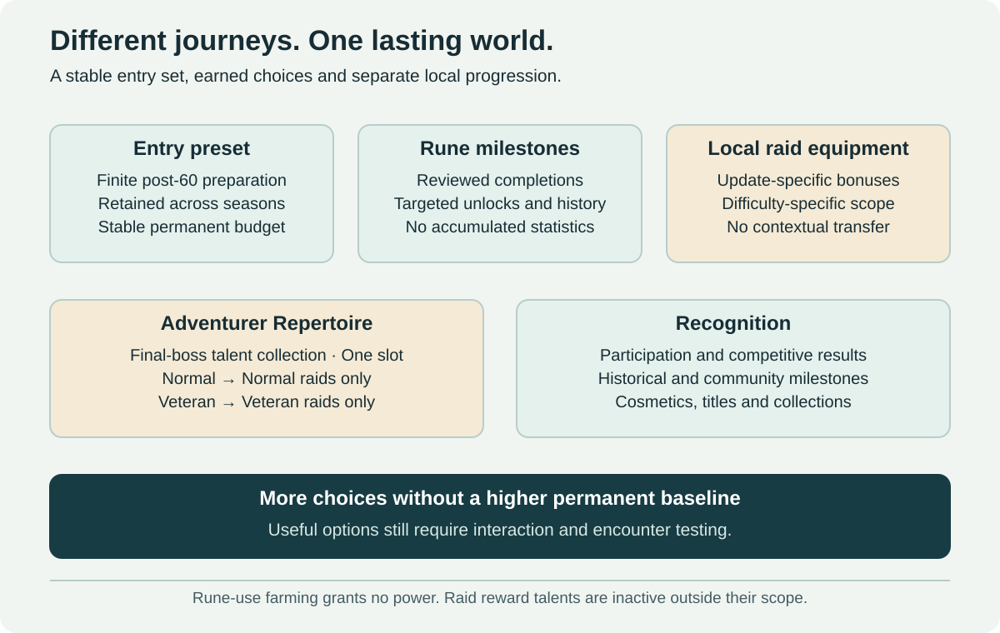

# Equipment and Progression

[← Main proposal](../../README.md) · [Raids](../01-progression-and-raids.md) · [Rewards](../11-rewards-and-acquisition.md)

## Complementary progression channels

| Layer | What develops | Boundary |
| --- | --- | --- |
| Permanent preparation | An accessible finite transition after 60 to the raid-entry preset | The same default permanent budget starts every raid season |
| Contextual raid equipment | Reviewed bounded effects in the approved update/difficulty | No transfer to a future update, another difficulty or external activity |
| Runes | Completion history, targeted unlocks and cosmetic milestones | No stat allowance, usage-based power, seasonal increment or new rank |
| Adventurer Repertoire | Permanently owned final-boss raid talents | One slot; Normal only in Normal raids, Veteran only in Veteran raids |
| Collections and recognition | Earned accomplishments, records, appearances and community contributions | No daily power checklist, yield advantage or hidden stat reward |

## Starting and returning

At level 60 the player can undertake the [raid-entry preset route](raid-entry-preset.md). Once earned, its stable role-appropriate budget is the default for each new raid season. A returning character does not obtain a stronger entry set because more updates have passed. Exact route, time and physical-set/entitlement representation remain open.

An older raid may still teach a desirable choice. That does not require a sequential equipment climb. [Raid talents](adventurer-abilities.md) may make a raid easier or broaden strategy, but are inactive outside matching-difficulty raids. [Runes](runes.md) record completion-based progress rather than fractionally increasing abilities through repeated casts.

## Effective power and local progression

The permanent contract prohibits cumulative statistical advantages from progression. Contextual equipment remains an explicitly bounded local system; it must not be advertised as proof of identical effective power in every encounter. Equipment effects, utility, pets, enchants, consumables and interactions all need review.

The entry preset is not automatically a Challenge or Arena normalization template. Those modes use their declared profiles; raid-unlocked talents are excluded from dungeons and all PvP. See the [technical framework](../04-technical-framework.md).
