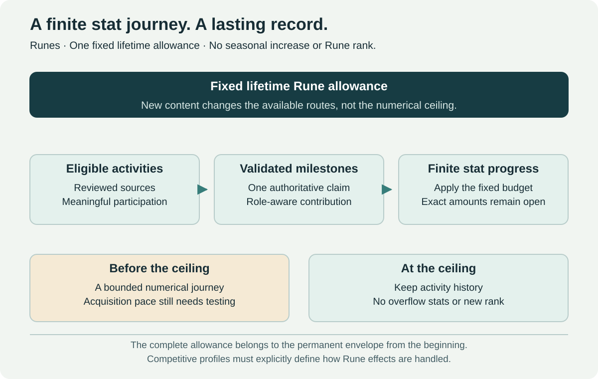

# Runes

[← Equipment and Progression](equipment-and-progression.md) · [Raid talents](adventurer-abilities.md) · [Raid entry preset](raid-entry-preset.md)

## Selected direction

**Permanent progression expands choices; it does not accumulate combat statistics.** Runes record meaningful completion milestones and targeted unlocks. The proposal to gain 0.01% per ability through increasing usage requirements, up to 1%, is **not adopted**, including inside raids.

A finite cap or raid-only counting would still reward repetitive casts, prolonged boss phases and trash farming. There is no Rune power per cast, fractional-stat allowance, seasonal increment or requirement to practice an ability a certain number of times before progression.

## Milestones and targeted rewards

Use reviewed boss completions, authored objectives and achievements with clear participation criteria. A milestone may record history, grant a cosmetic or teach a class/build-compatible raid option. The [Adventurer Repertoire](adventurer-abilities.md) manages learned raid options and its one selected slot. Runes do not add a second equipped combat slot or duplicate talent tree.

| Element | Selected behavior |
| --- | --- |
| Character level | Remains 60 |
| Numerical Rune reward | None; no accumulated damage, healing, primary/secondary stats or yield |
| Objective | A reviewed completion or explicit authored milestone, not a cast counter |
| Learned raid option | Permanent ownership; activation follows raid/difficulty rules |
| Cosmetic/history | Records the accomplishment and its source |
| Existing recognition | Adventurer, Explorer, Honor, Gladiator and Challenger keep separate purposes |
| New Rune rank/currency | Not introduced |

The final boss of a raid is the selected source for that difficulty's reviewed raid option. Other Rune objectives must state their reward explicitly; they do not silently award additional combat abilities for every activity. No promise of two new abilities for every tree in every update is made.

## Eligibility and anti-farming

Credit real group contribution, including healing, tanking, control and assigned objectives. Store one authoritative occurrence and one eligible-character claim. Retries and reconnects return the same entitlement, not repeated unlocks.

No extra progress is granted for stalling an encounter, unnecessary healing, low-risk trash resets or casting on harmless targets. Completion credit does not depend on the final blow. Exact minimum participation and late-join rules need the reward specification.

## Power and competitive boundaries

Rune records grant no numeric advantage in the world, dungeons or PvP. Learned raid options are inactive outside raids, including Heroics, procedural expeditions, Challenges, battlegrounds and Arenas. Normal options work only in Normal raids; Veteran options work only in Veteran raids.

More available raid choices can make a raid easier through utility and better decisions. That accepted benefit still requires interaction testing: one slot does not prove equal value. An unconditional permanent statistical upgrade is not justified by calling it a Rune.

## Interface and evaluation

Show completed objective, source raid/difficulty, reward, eligibility and the reason a learned effect is inactive. There is no hidden fractional percentage or progress bar implying that repeated casts improve an ability.

Measure objective clarity, role eligibility, old-raid group formation, reward satisfaction, dominant choices and perceived preparation obligations. The earlier finite-stat Rune model is superseded; historical change entries and dated reviews remain historical records.
